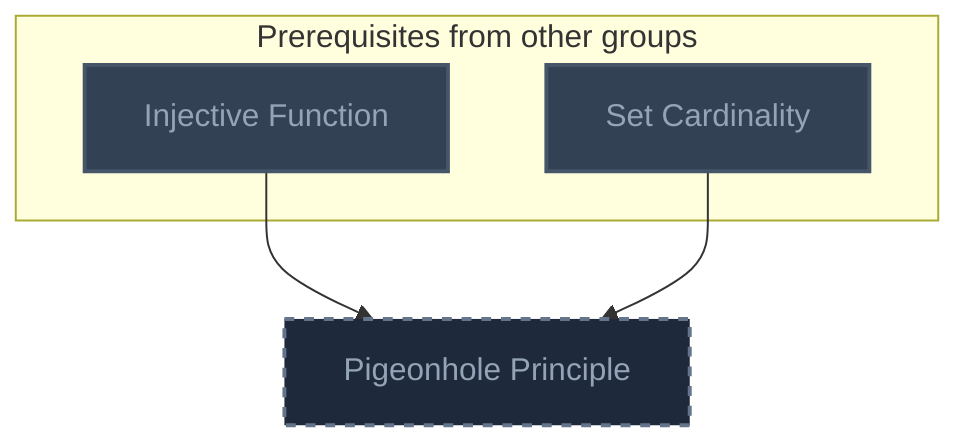
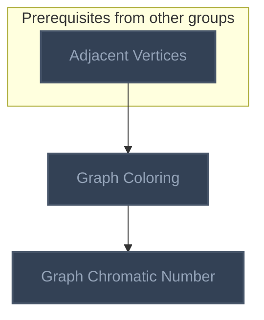
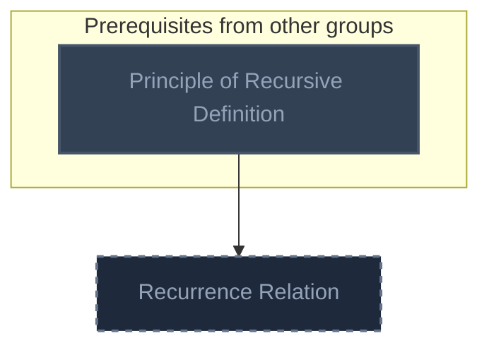
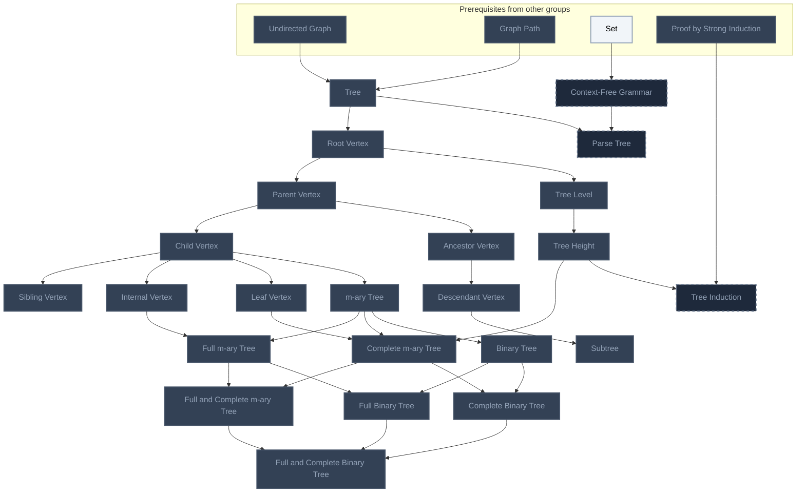
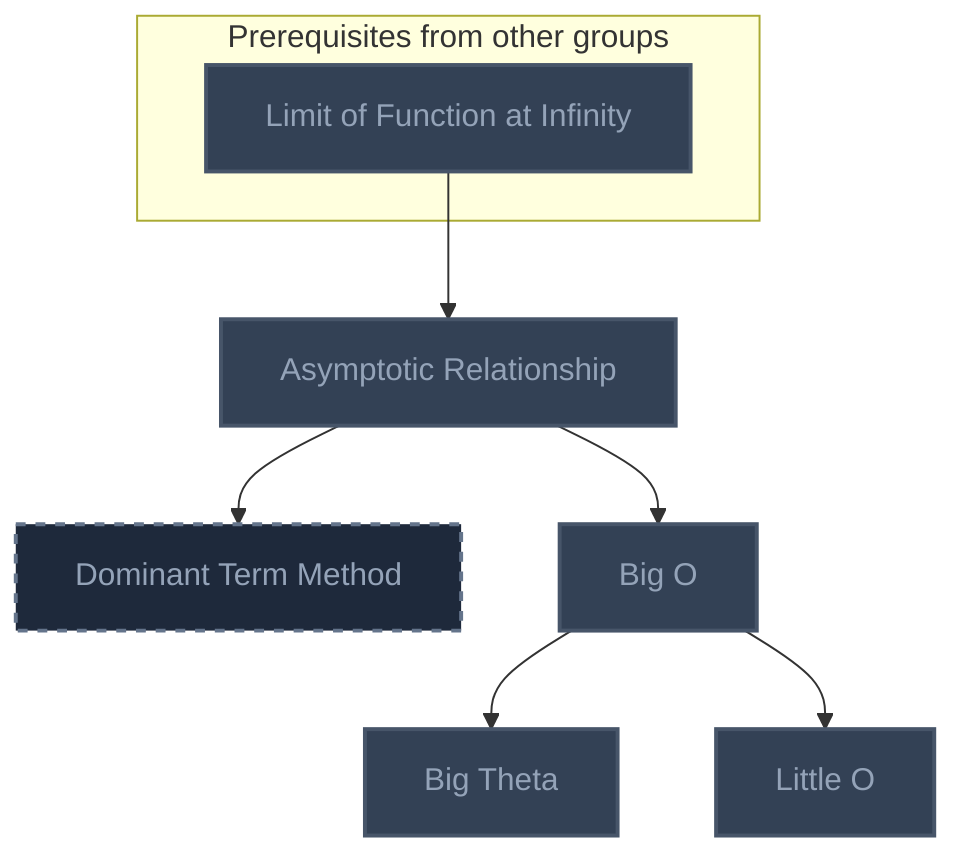
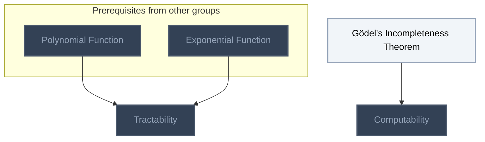
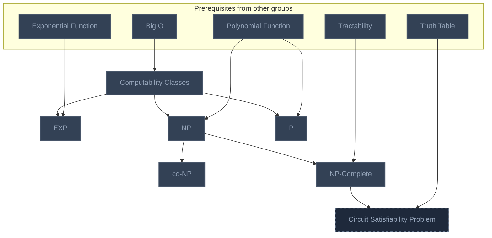
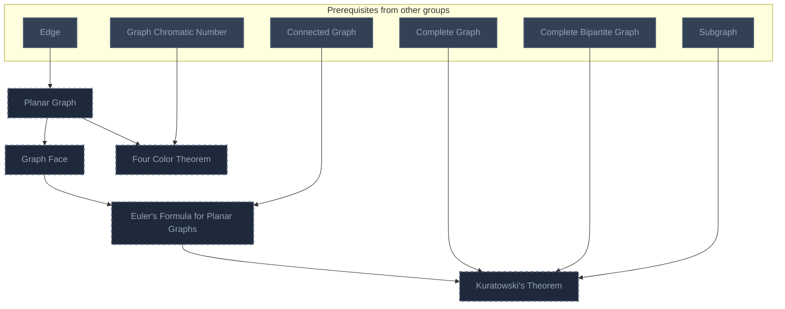
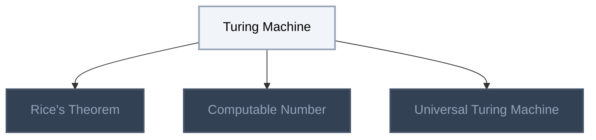

<!-- BEGIN STATS (generated by Scripts/skill_trees.py; do not edit) -->
**Mastered:** 0 / 87 · **Depth:** 0% · **Discovered:** 75 · **Planned:** 12 · **Locked:** 73 · **Rusty:** 0

**Levels:** L0 75 · L1 0 · L2 0 · L3 0 · L4 0 · L5 0

**Next up:** [[Gödel's Incompleteness Theorem]], [[Turing Machine]]

Legend: dashed grey = planned (no note yet) · dark grey = locked · white L0 Discovered · green L1 Recall · blue L2 Apply · purple L3 Prove (Mastered) · orange L4 Wield · gold L5 Command · brown dashed border = rusty
<!-- END STATS -->

## Fleck Ch. 8: Functions and One-to-One
**Mastered:** 0 / 1 · **Discovered:** 0 / 1



## Fleck Ch. 9: Graphs
**Mastered:** 0 / 36 · **Discovered:** 36 / 36

```mermaid
flowchart TD
    classDef planned fill:#1E293B,stroke:#64748B,stroke-width:2px,stroke-dasharray:5 5,color:#94A3B8;
    classDef locked fill:#334155,stroke:#475569,stroke-width:2px,color:#94A3B8;
    classDef L0 fill:#F1F5F9,stroke:#94A3B8,stroke-width:2px,color:#000000;
    classDef L1 fill:#22C55E,stroke:#15803D,stroke-width:2px,color:#000000;
    classDef L2 fill:#3B82F6,stroke:#1D4ED8,stroke-width:3px,color:#FFFFFF;
    classDef L3 fill:#A855F7,stroke:#6B21A8,stroke-width:3px,color:#FFFFFF,font-weight:bold;
    classDef L4 fill:#F97316,stroke:#C2410C,stroke-width:4px,color:#000000,font-weight:bold;
    classDef L5 fill:#FFD700,stroke:#FF8C00,stroke-width:5px,color:#000000,font-weight:bold;
    classDef rusty stroke:#8B4513,stroke-width:4px,stroke-dasharray:3 3;
    subgraph sg_prereqs["Prerequisites from other groups"]
        n_set["Set"]
        n_bijective_function["Bijective Function"]
        n_subset["Subset"]
        n_sequence["Sequence"]
        n_even_number["Even Number"]
        n_diagonal_matrix["Diagonal Matrix"]
        n_adjacency_matrix["Adjacency Matrix"]
    end
    n_graph["Graph"]
    n_vertex["Vertex"]
    n_edge["Edge"]
    n_adjacent_vertices["Adjacent Vertices"]
    n_directed_graph["Directed Graph"]
    n_undirected_graph["Undirected Graph"]
    n_simple_graph["Simple Graph"]
    n_degree_of_vertex["Degree of Vertex"]
    n_handshaking_theorem["Handshaking Theorem"]
    n_complete_graph["Complete Graph"]
    n_cycle_graph["Cycle Graph"]
    n_wheel_graph["Wheel Graph"]
    n_graph_isomorphism["Graph Isomorphism"]
    n_subgraph["Subgraph"]
    n_graph_walk["Graph Walk"]
    n_closed_graph_walk["Closed Graph Walk"]
    n_open_graph_walk["Open Graph Walk"]
    n_graph_path["Graph Path"]
    n_graph_cycle["Graph Cycle"]
    n_acyclic_graph["Acyclic Graph"]
    n_connected_graph["Connected Graph"]
    n_graph_euler_circuit["Graph Euler Circuit"]
    n_graph_connected_components["Graph Connected Components"]
    n_cut_edge["Cut Edge"]
    n_graph_distance["Graph Distance"]
    n_graph_diameter["Graph Diameter"]
    n_graph_euler_circuit_existence_theorem["Graph Euler Circuit Existence Theorem"]
    n_bipartite_graph["Bipartite Graph"]
    n_complete_bipartite_graph["Complete Bipartite Graph"]
    n_multigraph["Multigraph"]
    n_line_graph["Line Graph"]
    n_degree_matrix["Degree Matrix"]
    n_graph_laplacian_matrix["Graph Laplacian Matrix"]
    n_hierarchical_graph["Hierarchical Graph"]
    n_geometric_graph["Geometric Graph"]
    n_graph_partitioning["Graph Partitioning"]
    n_set --> n_graph
    n_graph --> n_vertex
    n_vertex --> n_edge
    n_edge --> n_adjacent_vertices
    n_edge --> n_directed_graph
    n_edge --> n_undirected_graph
    n_undirected_graph --> n_simple_graph
    n_edge --> n_degree_of_vertex
    n_degree_of_vertex --> n_handshaking_theorem
    n_simple_graph --> n_complete_graph
    n_adjacent_vertices --> n_complete_graph
    n_simple_graph --> n_cycle_graph
    n_cycle_graph --> n_wheel_graph
    n_adjacent_vertices --> n_graph_isomorphism
    n_bijective_function --> n_graph_isomorphism
    n_edge --> n_subgraph
    n_subset --> n_subgraph
    n_edge --> n_graph_walk
    n_sequence --> n_graph_walk
    n_graph_walk --> n_closed_graph_walk
    n_closed_graph_walk --> n_open_graph_walk
    n_graph_walk --> n_graph_path
    n_closed_graph_walk --> n_graph_cycle
    n_graph_cycle --> n_acyclic_graph
    n_graph_walk --> n_connected_graph
    n_closed_graph_walk --> n_graph_euler_circuit
    n_connected_graph --> n_graph_connected_components
    n_subgraph --> n_graph_connected_components
    n_graph_connected_components --> n_cut_edge
    n_graph_path --> n_graph_distance
    n_graph_distance --> n_graph_diameter
    n_graph_euler_circuit --> n_graph_euler_circuit_existence_theorem
    n_connected_graph --> n_graph_euler_circuit_existence_theorem
    n_degree_of_vertex --> n_graph_euler_circuit_existence_theorem
    n_even_number --> n_graph_euler_circuit_existence_theorem
    n_edge --> n_bipartite_graph
    n_bipartite_graph --> n_complete_bipartite_graph
    n_graph --> n_multigraph
    n_graph --> n_line_graph
    n_diagonal_matrix --> n_degree_matrix
    n_degree_of_vertex --> n_degree_matrix
    n_adjacency_matrix --> n_graph_laplacian_matrix
    n_degree_matrix --> n_graph_laplacian_matrix
    n_graph --> n_hierarchical_graph
    n_graph --> n_geometric_graph
    n_subgraph --> n_graph_partitioning
    class n_bijective_function,n_subset,n_sequence,n_even_number,n_diagonal_matrix,n_adjacency_matrix,n_graph,n_vertex,n_edge,n_adjacent_vertices,n_directed_graph,n_undirected_graph,n_simple_graph,n_degree_of_vertex,n_handshaking_theorem,n_complete_graph,n_cycle_graph,n_wheel_graph,n_graph_isomorphism,n_subgraph,n_graph_walk,n_closed_graph_walk,n_open_graph_walk,n_graph_path,n_graph_cycle,n_acyclic_graph,n_connected_graph,n_graph_euler_circuit,n_graph_connected_components,n_cut_edge,n_graph_distance,n_graph_diameter,n_graph_euler_circuit_existence_theorem,n_bipartite_graph,n_complete_bipartite_graph,n_multigraph,n_line_graph,n_degree_matrix,n_graph_laplacian_matrix,n_hierarchical_graph,n_geometric_graph,n_graph_partitioning locked;
    class n_set L0;
    class n_set,n_bijective_function,n_subset,n_sequence,n_even_number,n_diagonal_matrix,n_adjacency_matrix,n_graph,n_vertex,n_edge,n_adjacent_vertices,n_directed_graph,n_undirected_graph,n_simple_graph,n_degree_of_vertex,n_handshaking_theorem,n_complete_graph,n_cycle_graph,n_wheel_graph,n_graph_isomorphism,n_subgraph,n_graph_walk,n_closed_graph_walk,n_open_graph_walk,n_graph_path,n_graph_cycle,n_acyclic_graph,n_connected_graph,n_graph_euler_circuit,n_graph_connected_components,n_cut_edge,n_graph_distance,n_graph_diameter,n_graph_euler_circuit_existence_theorem,n_bipartite_graph,n_complete_bipartite_graph,n_multigraph,n_line_graph,n_degree_matrix,n_graph_laplacian_matrix,n_hierarchical_graph,n_geometric_graph,n_graph_partitioning internal-link;
```



## Fleck Ch. 10: Two-Way Bounding
**Mastered:** 0 / 2 · **Discovered:** 2 / 2



## Fleck Ch. 12: Recursive Definition
**Mastered:** 0 / 1 · **Discovered:** 0 / 1



## Fleck Ch. 13: Trees
**Mastered:** 0 / 23 · **Discovered:** 20 / 23



## Fleck Ch. 14: Big-O
**Mastered:** 0 / 5 · **Discovered:** 4 / 5



## Computability and Tractability (Russell & Norvig Ch. 1)
**Mastered:** 0 / 3 · **Discovered:** 3 / 3



## Fleck Ch. 16: NP
**Mastered:** 0 / 7 · **Discovered:** 6 / 7



## Fleck Ch. 21: Planar Graphs
**Mastered:** 0 / 5 · **Discovered:** 0 / 5



## Computability
**Mastered:** 0 / 4 · **Discovered:** 4 / 4



# Source
Graph structure: the single source for the diagrams above, edited by `/note` and `Scripts/skill_trees.py` (`add`, `edge`, `rename`). Everything above this heading is regenerated by `render`.

```skilltree
    %% PREREQUISITES
    n_injective_function["Injective Function"]
    n_set_cardinality["Set Cardinality"]
    n_set["Set"]
    n_bijective_function["Bijective Function"]
    n_subset["Subset"]
    n_sequence["Sequence"]
    n_even_number["Even Number"]
    n_principle_of_recursive_definition["Principle of Recursive Definition"]
    n_proof_by_strong_induction["Proof by Strong Induction"]
    n_limit_of_function_at_infinity["Limit of Function at Infinity"]
    n_polynomial_function["Polynomial Function"]
    n_exponential_function["Exponential Function"]
    n_truth_table["Truth Table"]
    n_diagonal_matrix["Diagonal Matrix"]
    n_adjacency_matrix["Adjacency Matrix"]
    %% NODES
    %% == Fleck Ch. 8: Functions and One-to-One ==
    n_pigeonhole_principle["Pigeonhole Principle"]
    %% == Fleck Ch. 9: Graphs ==
    n_graph["Graph"]
    n_vertex["Vertex"]
    n_edge["Edge"]
    n_adjacent_vertices["Adjacent Vertices"]
    n_directed_graph["Directed Graph"]
    n_undirected_graph["Undirected Graph"]
    n_simple_graph["Simple Graph"]
    n_degree_of_vertex["Degree of Vertex"]
    n_handshaking_theorem["Handshaking Theorem"]
    n_complete_graph["Complete Graph"]
    n_cycle_graph["Cycle Graph"]
    n_wheel_graph["Wheel Graph"]
    n_graph_isomorphism["Graph Isomorphism"]
    n_subgraph["Subgraph"]
    n_graph_walk["Graph Walk"]
    n_closed_graph_walk["Closed Graph Walk"]
    n_open_graph_walk["Open Graph Walk"]
    n_graph_path["Graph Path"]
    n_graph_cycle["Graph Cycle"]
    n_acyclic_graph["Acyclic Graph"]
    n_connected_graph["Connected Graph"]
    n_graph_euler_circuit["Graph Euler Circuit"]
    n_graph_connected_components["Graph Connected Components"]
    n_cut_edge["Cut Edge"]
    n_graph_distance["Graph Distance"]
    n_graph_diameter["Graph Diameter"]
    n_graph_euler_circuit_existence_theorem["Graph Euler Circuit Existence Theorem"]
    n_bipartite_graph["Bipartite Graph"]
    n_complete_bipartite_graph["Complete Bipartite Graph"]
    n_multigraph["Multigraph"]
    n_line_graph["Line Graph"]
    n_degree_matrix["Degree Matrix"]
    n_graph_laplacian_matrix["Graph Laplacian Matrix"]
    n_hierarchical_graph["Hierarchical Graph"]
    n_geometric_graph["Geometric Graph"]
    n_graph_partitioning["Graph Partitioning"]
    %% == Fleck Ch. 10: Two-Way Bounding ==
    n_graph_coloring["Graph Coloring"]
    n_graph_chromatic_number["Graph Chromatic Number"]
    %% == Fleck Ch. 12: Recursive Definition ==
    n_recurrence_relation["Recurrence Relation"]
    %% == Fleck Ch. 13: Trees ==
    n_tree["Tree"]
    n_root_vertex["Root Vertex"]
    n_parent_vertex["Parent Vertex"]
    n_child_vertex["Child Vertex"]
    n_sibling_vertex["Sibling Vertex"]
    n_ancestor_vertex["Ancestor Vertex"]
    n_descendant_vertex["Descendant Vertex"]
    n_internal_vertex["Internal Vertex"]
    n_leaf_vertex["Leaf Vertex"]
    n_tree_level["Tree Level"]
    n_tree_height["Tree Height"]
    n_subtree["Subtree"]
    n_m_ary_tree["m-ary Tree"]
    n_full_m_ary_tree["Full m-ary Tree"]
    n_complete_m_ary_tree["Complete m-ary Tree"]
    n_full_and_complete_m_ary_tree["Full and Complete m-ary Tree"]
    n_binary_tree["Binary Tree"]
    n_full_binary_tree["Full Binary Tree"]
    n_complete_binary_tree["Complete Binary Tree"]
    n_full_and_complete_binary_tree["Full and Complete Binary Tree"]
    n_context_free_grammar["Context-Free Grammar"]
    n_parse_tree["Parse Tree"]
    n_tree_induction["Tree Induction"]
    %% == Open Data Structures (Morin) ==
    %% == Fleck Ch. 14: Big-O ==
    n_asymptotic_relationship["Asymptotic Relationship"]
    n_dominant_term_method["Dominant Term Method"]
    n_big_o["Big O"]
    n_big_theta["Big Theta"]
    n_little_o["Little O"]
    %% == Computability and Tractability (Russell & Norvig Ch. 1) ==
    n_g_del_s_incompleteness_theorem["Gödel's Incompleteness Theorem"]
    n_computability["Computability"]
    n_tractability["Tractability"]
    %% == Fleck Ch. 16: NP ==
    n_computability_classes["Computability Classes"]
    n_exp["EXP"]
    n_np["NP"]
    n_co_np["co-NP"]
    n_p["P"]
    n_np_complete["NP-Complete"]
    n_circuit_satisfiability_problem["Circuit Satisfiability Problem"]
    %% == Fleck Ch. 21: Planar Graphs ==
    n_planar_graph["Planar Graph"]
    n_graph_face["Graph Face"]
    n_euler_s_formula_for_planar_graphs["Euler's Formula for Planar Graphs"]
    n_kuratowski_s_theorem["Kuratowski's Theorem"]
    n_four_color_theorem["Four Color Theorem"]
    %% == Computability ==
    n_turing_machine["Turing Machine"]
    n_computable_number["Computable Number"]
    n_universal_turing_machine["Universal Turing Machine"]
    n_rice_s_theorem["Rice's Theorem"]
    %% EDGES
    n_injective_function --> n_pigeonhole_principle
    n_set_cardinality --> n_pigeonhole_principle
    n_set --> n_graph
    n_graph --> n_vertex
    n_vertex --> n_edge
    n_edge --> n_adjacent_vertices
    n_edge --> n_directed_graph
    n_edge --> n_undirected_graph
    n_undirected_graph --> n_simple_graph
    n_edge --> n_degree_of_vertex
    n_degree_of_vertex --> n_handshaking_theorem
    n_simple_graph --> n_complete_graph
    n_adjacent_vertices --> n_complete_graph
    n_simple_graph --> n_cycle_graph
    n_cycle_graph --> n_wheel_graph
    n_adjacent_vertices --> n_graph_isomorphism
    n_bijective_function --> n_graph_isomorphism
    n_edge --> n_subgraph
    n_subset --> n_subgraph
    n_edge --> n_graph_walk
    n_sequence --> n_graph_walk
    n_graph_walk --> n_closed_graph_walk
    n_closed_graph_walk --> n_open_graph_walk
    n_graph_walk --> n_graph_path
    n_closed_graph_walk --> n_graph_cycle
    n_graph_cycle --> n_acyclic_graph
    n_graph_walk --> n_connected_graph
    n_closed_graph_walk --> n_graph_euler_circuit
    n_connected_graph --> n_graph_connected_components
    n_subgraph --> n_graph_connected_components
    n_graph_connected_components --> n_cut_edge
    n_graph_path --> n_graph_distance
    n_graph_distance --> n_graph_diameter
    n_graph_euler_circuit --> n_graph_euler_circuit_existence_theorem
    n_connected_graph --> n_graph_euler_circuit_existence_theorem
    n_degree_of_vertex --> n_graph_euler_circuit_existence_theorem
    n_even_number --> n_graph_euler_circuit_existence_theorem
    n_edge --> n_bipartite_graph
    n_bipartite_graph --> n_complete_bipartite_graph
    n_adjacent_vertices --> n_graph_coloring
    n_graph_coloring --> n_graph_chromatic_number
    n_principle_of_recursive_definition --> n_recurrence_relation
    n_undirected_graph --> n_tree
    n_graph_path --> n_tree
    n_tree --> n_root_vertex
    n_root_vertex --> n_parent_vertex
    n_parent_vertex --> n_child_vertex
    n_child_vertex --> n_sibling_vertex
    n_parent_vertex --> n_ancestor_vertex
    n_ancestor_vertex --> n_descendant_vertex
    n_child_vertex --> n_internal_vertex
    n_child_vertex --> n_leaf_vertex
    n_root_vertex --> n_tree_level
    n_tree_level --> n_tree_height
    n_descendant_vertex --> n_subtree
    n_child_vertex --> n_m_ary_tree
    n_m_ary_tree --> n_full_m_ary_tree
    n_internal_vertex --> n_full_m_ary_tree
    n_m_ary_tree --> n_complete_m_ary_tree
    n_leaf_vertex --> n_complete_m_ary_tree
    n_tree_height --> n_complete_m_ary_tree
    n_full_m_ary_tree --> n_full_and_complete_m_ary_tree
    n_complete_m_ary_tree --> n_full_and_complete_m_ary_tree
    n_m_ary_tree --> n_binary_tree
    n_binary_tree --> n_full_binary_tree
    n_full_m_ary_tree --> n_full_binary_tree
    n_binary_tree --> n_complete_binary_tree
    n_complete_m_ary_tree --> n_complete_binary_tree
    n_full_binary_tree --> n_full_and_complete_binary_tree
    n_complete_binary_tree --> n_full_and_complete_binary_tree
    n_full_and_complete_m_ary_tree --> n_full_and_complete_binary_tree
    n_set --> n_context_free_grammar
    n_context_free_grammar --> n_parse_tree
    n_tree --> n_parse_tree
    n_tree_height --> n_tree_induction
    n_proof_by_strong_induction --> n_tree_induction
    n_limit_of_function_at_infinity --> n_asymptotic_relationship
    n_asymptotic_relationship --> n_dominant_term_method
    n_asymptotic_relationship --> n_big_o
    n_big_o --> n_big_theta
    n_g_del_s_incompleteness_theorem --> n_computability
    n_polynomial_function --> n_tractability
    n_exponential_function --> n_tractability
    n_big_o --> n_computability_classes
    n_computability_classes --> n_exp
    n_exponential_function --> n_exp
    n_computability_classes --> n_np
    n_polynomial_function --> n_np
    n_np --> n_co_np
    n_computability_classes --> n_p
    n_polynomial_function --> n_p
    n_np --> n_np_complete
    n_tractability --> n_np_complete
    n_np_complete --> n_circuit_satisfiability_problem
    n_truth_table --> n_circuit_satisfiability_problem
    n_edge --> n_planar_graph
    n_planar_graph --> n_graph_face
    n_graph_face --> n_euler_s_formula_for_planar_graphs
    n_connected_graph --> n_euler_s_formula_for_planar_graphs
    n_euler_s_formula_for_planar_graphs --> n_kuratowski_s_theorem
    n_complete_graph --> n_kuratowski_s_theorem
    n_complete_bipartite_graph --> n_kuratowski_s_theorem
    n_subgraph --> n_kuratowski_s_theorem
    n_planar_graph --> n_four_color_theorem
    n_graph_chromatic_number --> n_four_color_theorem
    n_big_o --> n_little_o
    n_turing_machine --> n_rice_s_theorem
    n_turing_machine --> n_computable_number
    n_turing_machine --> n_universal_turing_machine
    n_graph --> n_multigraph
    n_graph --> n_line_graph
    n_diagonal_matrix --> n_degree_matrix
    n_degree_of_vertex --> n_degree_matrix
    n_adjacency_matrix --> n_graph_laplacian_matrix
    n_degree_matrix --> n_graph_laplacian_matrix
    n_graph --> n_hierarchical_graph
    n_graph --> n_geometric_graph
    n_subgraph --> n_graph_partitioning
```
