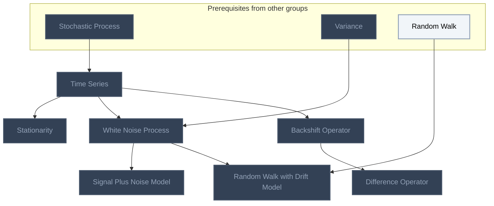

<!-- BEGIN STATS (generated by Scripts/skill_trees.py; do not edit) -->
**Mastered:** 0 / 30 · **Depth:** 0% · **Discovered:** 30 · **Planned:** 0 · **Locked:** 30 · **Rusty:** 0

| | L0 Discovered | L1 Recall | L2 Apply | L3 Prove ★ | L4 Wield | L5 Command |
|---|---:|---:|---:|---:|---:|---:|
| **At this level** | 30 | 0 | 0 | 0 | 0 | 0 |
| **Reached (this level or higher)** | 30 | 0 | 0 | 0 | 0 | 0 |

**Next up:** —

Legend: dashed grey = planned (no note yet) · dark grey = locked · white L0 Discovered · green L1 Recall · blue L2 Apply · purple L3 Prove (Mastered) · orange L4 Wield · gold L5 Command · brown dashed border = rusty
<!-- END STATS -->

## Time Series Basics
**Reached:** L1 0 · L2 0 · L3 0 · L4 0 · L5 0 (of 7 nodes)



## Dependence and Stationarity
**Reached:** L1 0 · L2 0 · L3 0 · L4 0 · L5 0 (of 12 nodes)

```mermaid
flowchart TD
    classDef planned fill:#1E293B,stroke:#64748B,stroke-width:2px,stroke-dasharray:5 5,color:#94A3B8;
    classDef locked fill:#334155,stroke:#475569,stroke-width:2px,color:#94A3B8;
    classDef L0 fill:#F1F5F9,stroke:#94A3B8,stroke-width:2px,color:#000000;
    classDef L1 fill:#22C55E,stroke:#15803D,stroke-width:2px,color:#000000;
    classDef L2 fill:#3B82F6,stroke:#1D4ED8,stroke-width:3px,color:#FFFFFF;
    classDef L3 fill:#A855F7,stroke:#6B21A8,stroke-width:3px,color:#FFFFFF,font-weight:bold;
    classDef L4 fill:#F97316,stroke:#C2410C,stroke-width:4px,color:#000000,font-weight:bold;
    classDef L5 fill:#FFD700,stroke:#FF8C00,stroke-width:5px,color:#000000,font-weight:bold;
    classDef rusty stroke:#8B4513,stroke-width:4px,stroke-dasharray:3 3;
    subgraph sg_prereqs["Prerequisites from other groups"]
        n_covariance["Covariance"]
        n_time_series["Time Series"]
        n_variance["Variance"]
        n_stationarity["Stationarity"]
        n_correlation["Correlation"]
        n_regression["Regression"]
        n_stochastic_process["Stochastic Process"]
    end
    n_auto_covariance["Auto Covariance"]
    n_stationary_stochastic_process["Stationary Stochastic Process"]
    n_auto_covariance_basic_properties["Auto Covariance Basic Properties"]
    n_auto_correlation["Auto Correlation"]
    n_auto_correlation_basic_properties["Auto Correlation Basic Properties"]
    n_partial_auto_correlation["Partial Auto Correlation"]
    n_trend_stationary_stochastic_process["Trend Stationary Stochastic Process"]
    n_cross_covariance["Cross Covariance"]
    n_cross_correlation["Cross Correlation"]
    n_joint_stationary_stochastic_process["Joint Stationary Stochastic Process"]
    n_cross_covariance_basic_properties["Cross Covariance Basic Properties"]
    n_cross_correlation_basic_properties["Cross Correlation Basic Properties"]
    n_covariance --> n_auto_covariance
    n_time_series --> n_auto_covariance
    n_variance --> n_stationary_stochastic_process
    n_stationarity --> n_stationary_stochastic_process
    n_auto_covariance --> n_stationary_stochastic_process
    n_stationary_stochastic_process --> n_auto_covariance_basic_properties
    n_correlation --> n_auto_correlation
    n_auto_covariance --> n_auto_correlation
    n_stationary_stochastic_process --> n_auto_correlation_basic_properties
    n_auto_correlation --> n_auto_correlation_basic_properties
    n_regression --> n_partial_auto_correlation
    n_stationary_stochastic_process --> n_partial_auto_correlation
    n_auto_correlation --> n_partial_auto_correlation
    n_stationary_stochastic_process --> n_trend_stationary_stochastic_process
    n_covariance --> n_cross_covariance
    n_time_series --> n_cross_covariance
    n_correlation --> n_cross_correlation
    n_cross_covariance --> n_cross_correlation
    n_stationary_stochastic_process --> n_joint_stationary_stochastic_process
    n_cross_covariance --> n_joint_stationary_stochastic_process
    n_joint_stationary_stochastic_process --> n_cross_covariance_basic_properties
    n_cross_correlation --> n_cross_correlation_basic_properties
    n_joint_stationary_stochastic_process --> n_cross_correlation_basic_properties
    n_stochastic_process --> n_stationary_stochastic_process
    n_stochastic_process --> n_auto_covariance
    n_stochastic_process --> n_cross_covariance
    class n_covariance,n_time_series,n_variance,n_stationarity,n_correlation,n_regression,n_stochastic_process,n_auto_covariance,n_stationary_stochastic_process,n_auto_covariance_basic_properties,n_auto_correlation,n_auto_correlation_basic_properties,n_partial_auto_correlation,n_trend_stationary_stochastic_process,n_cross_covariance,n_cross_correlation,n_joint_stationary_stochastic_process,n_cross_covariance_basic_properties,n_cross_correlation_basic_properties locked;
    class n_covariance,n_time_series,n_variance,n_stationarity,n_correlation,n_regression,n_stochastic_process,n_auto_covariance,n_stationary_stochastic_process,n_auto_covariance_basic_properties,n_auto_correlation,n_auto_correlation_basic_properties,n_partial_auto_correlation,n_trend_stationary_stochastic_process,n_cross_covariance,n_cross_correlation,n_joint_stationary_stochastic_process,n_cross_covariance_basic_properties,n_cross_correlation_basic_properties internal-link;
```



## Linear Time Series Models (AR, MA, ARMA, ARIMA)
**Reached:** L1 0 · L2 0 · L3 0 · L4 0 · L5 0 (of 11 nodes)

```mermaid
flowchart TD
    classDef planned fill:#1E293B,stroke:#64748B,stroke-width:2px,stroke-dasharray:5 5,color:#94A3B8;
    classDef locked fill:#334155,stroke:#475569,stroke-width:2px,color:#94A3B8;
    classDef L0 fill:#F1F5F9,stroke:#94A3B8,stroke-width:2px,color:#000000;
    classDef L1 fill:#22C55E,stroke:#15803D,stroke-width:2px,color:#000000;
    classDef L2 fill:#3B82F6,stroke:#1D4ED8,stroke-width:3px,color:#FFFFFF;
    classDef L3 fill:#A855F7,stroke:#6B21A8,stroke-width:3px,color:#FFFFFF,font-weight:bold;
    classDef L4 fill:#F97316,stroke:#C2410C,stroke-width:4px,color:#000000,font-weight:bold;
    classDef L5 fill:#FFD700,stroke:#FF8C00,stroke-width:5px,color:#000000,font-weight:bold;
    classDef rusty stroke:#8B4513,stroke-width:4px,stroke-dasharray:3 3;
    subgraph sg_prereqs["Prerequisites from other groups"]
        n_white_noise_process["White Noise Process"]
        n_stationary_stochastic_process["Stationary Stochastic Process"]
        n_backshift_operator["Backshift Operator"]
        n_linear_combination["Linear Combination"]
        n_absolute_value_of_complex_number["Absolute Value of Complex Number"]
        n_polynomial["Polynomial"]
        n_difference_operator["Difference Operator"]
    end
    n_moving_average_process["Moving Average Process"]
    n_moving_average_operator["Moving Average Operator"]
    n_autoregressive_process["Autoregressive Process"]
    n_autoregressive_operator["Autoregressive Operator"]
    n_wold_decomposition["Wold Decomposition"]
    n_causal_autoregressive_process["Causal Autoregressive Process"]
    n_causal_representation_operator["Causal Representation Operator"]
    n_invertible_moving_average_process["Invertible Moving Average Process"]
    n_invertible_representation_operator["Invertible Representation Operator"]
    n_autoregressive_moving_average_process["Autoregressive Moving Average Process"]
    n_autoregressive_integrated_moving_average_process["Autoregressive Integrated Moving Average Process"]
    n_white_noise_process --> n_moving_average_process
    n_stationary_stochastic_process --> n_moving_average_process
    n_backshift_operator --> n_moving_average_operator
    n_moving_average_process --> n_moving_average_operator
    n_white_noise_process --> n_autoregressive_process
    n_stationary_stochastic_process --> n_autoregressive_process
    n_backshift_operator --> n_autoregressive_operator
    n_autoregressive_process --> n_autoregressive_operator
    n_linear_combination --> n_wold_decomposition
    n_moving_average_process --> n_wold_decomposition
    n_absolute_value_of_complex_number --> n_causal_autoregressive_process
    n_polynomial --> n_causal_autoregressive_process
    n_autoregressive_operator --> n_causal_autoregressive_process
    n_wold_decomposition --> n_causal_autoregressive_process
    n_causal_autoregressive_process --> n_causal_representation_operator
    n_absolute_value_of_complex_number --> n_invertible_moving_average_process
    n_polynomial --> n_invertible_moving_average_process
    n_moving_average_operator --> n_invertible_moving_average_process
    n_autoregressive_process --> n_invertible_moving_average_process
    n_invertible_moving_average_process --> n_invertible_representation_operator
    n_causal_autoregressive_process --> n_autoregressive_moving_average_process
    n_invertible_moving_average_process --> n_autoregressive_moving_average_process
    n_difference_operator --> n_autoregressive_integrated_moving_average_process
    n_autoregressive_moving_average_process --> n_autoregressive_integrated_moving_average_process
    class n_white_noise_process,n_stationary_stochastic_process,n_backshift_operator,n_linear_combination,n_absolute_value_of_complex_number,n_difference_operator,n_moving_average_process,n_moving_average_operator,n_autoregressive_process,n_autoregressive_operator,n_wold_decomposition,n_causal_autoregressive_process,n_causal_representation_operator,n_invertible_moving_average_process,n_invertible_representation_operator,n_autoregressive_moving_average_process,n_autoregressive_integrated_moving_average_process locked;
    class n_polynomial L2;
    class n_white_noise_process,n_stationary_stochastic_process,n_backshift_operator,n_linear_combination,n_absolute_value_of_complex_number,n_polynomial,n_difference_operator,n_moving_average_process,n_moving_average_operator,n_autoregressive_process,n_autoregressive_operator,n_wold_decomposition,n_causal_autoregressive_process,n_causal_representation_operator,n_invertible_moving_average_process,n_invertible_representation_operator,n_autoregressive_moving_average_process,n_autoregressive_integrated_moving_average_process internal-link;
```



# Source
Graph structure: the single source for the diagrams above, edited by `/note` and `Scripts/skill_trees.py` (`add`, `edge`, `rename`). Everything above this heading is regenerated by `render`.

```skilltree
    %% PREREQUISITES
    n_absolute_value_of_complex_number["Absolute Value of Complex Number"]
    n_regression["Regression"]
    n_random_walk["Random Walk"]
    n_linear_combination["Linear Combination"]
    n_correlation["Correlation"]
    n_covariance["Covariance"]
    n_variance["Variance"]
    n_polynomial["Polynomial"]
    n_stochastic_process["Stochastic Process"]
    %% NODES
    %% == Time Series Basics ==
    n_time_series["Time Series"]
    n_stationarity["Stationarity"]
    n_white_noise_process["White Noise Process"]
    n_signal_plus_noise_model["Signal Plus Noise Model"]
    n_random_walk_with_drift_model["Random Walk with Drift Model"]
    n_backshift_operator["Backshift Operator"]
    n_difference_operator["Difference Operator"]
    %% == Dependence and Stationarity ==
    n_auto_covariance["Auto Covariance"]
    n_stationary_stochastic_process["Stationary Stochastic Process"]
    n_auto_covariance_basic_properties["Auto Covariance Basic Properties"]
    n_auto_correlation["Auto Correlation"]
    n_auto_correlation_basic_properties["Auto Correlation Basic Properties"]
    n_partial_auto_correlation["Partial Auto Correlation"]
    n_trend_stationary_stochastic_process["Trend Stationary Stochastic Process"]
    n_cross_covariance["Cross Covariance"]
    n_cross_correlation["Cross Correlation"]
    n_joint_stationary_stochastic_process["Joint Stationary Stochastic Process"]
    n_cross_covariance_basic_properties["Cross Covariance Basic Properties"]
    n_cross_correlation_basic_properties["Cross Correlation Basic Properties"]
    %% == Linear Time Series Models (AR, MA, ARMA, ARIMA) ==
    n_moving_average_process["Moving Average Process"]
    n_moving_average_operator["Moving Average Operator"]
    n_autoregressive_process["Autoregressive Process"]
    n_autoregressive_operator["Autoregressive Operator"]
    n_wold_decomposition["Wold Decomposition"]
    n_causal_autoregressive_process["Causal Autoregressive Process"]
    n_causal_representation_operator["Causal Representation Operator"]
    n_invertible_moving_average_process["Invertible Moving Average Process"]
    n_invertible_representation_operator["Invertible Representation Operator"]
    n_autoregressive_moving_average_process["Autoregressive Moving Average Process"]
    n_autoregressive_integrated_moving_average_process["Autoregressive Integrated Moving Average Process"]
    %% EDGES
    n_stochastic_process --> n_time_series
    n_time_series --> n_stationarity
    n_variance --> n_white_noise_process
    n_time_series --> n_white_noise_process
    n_white_noise_process --> n_signal_plus_noise_model
    n_random_walk --> n_random_walk_with_drift_model
    n_white_noise_process --> n_random_walk_with_drift_model
    n_time_series --> n_backshift_operator
    n_backshift_operator --> n_difference_operator
    n_covariance --> n_auto_covariance
    n_time_series --> n_auto_covariance
    n_variance --> n_stationary_stochastic_process
    n_stationarity --> n_stationary_stochastic_process
    n_auto_covariance --> n_stationary_stochastic_process
    n_stationary_stochastic_process --> n_auto_covariance_basic_properties
    n_correlation --> n_auto_correlation
    n_auto_covariance --> n_auto_correlation
    n_stationary_stochastic_process --> n_auto_correlation_basic_properties
    n_auto_correlation --> n_auto_correlation_basic_properties
    n_regression --> n_partial_auto_correlation
    n_stationary_stochastic_process --> n_partial_auto_correlation
    n_auto_correlation --> n_partial_auto_correlation
    n_stationary_stochastic_process --> n_trend_stationary_stochastic_process
    n_covariance --> n_cross_covariance
    n_time_series --> n_cross_covariance
    n_correlation --> n_cross_correlation
    n_cross_covariance --> n_cross_correlation
    n_stationary_stochastic_process --> n_joint_stationary_stochastic_process
    n_cross_covariance --> n_joint_stationary_stochastic_process
    n_joint_stationary_stochastic_process --> n_cross_covariance_basic_properties
    n_cross_correlation --> n_cross_correlation_basic_properties
    n_joint_stationary_stochastic_process --> n_cross_correlation_basic_properties
    n_white_noise_process --> n_moving_average_process
    n_stationary_stochastic_process --> n_moving_average_process
    n_backshift_operator --> n_moving_average_operator
    n_moving_average_process --> n_moving_average_operator
    n_white_noise_process --> n_autoregressive_process
    n_stationary_stochastic_process --> n_autoregressive_process
    n_backshift_operator --> n_autoregressive_operator
    n_autoregressive_process --> n_autoregressive_operator
    n_linear_combination --> n_wold_decomposition
    n_moving_average_process --> n_wold_decomposition
    n_absolute_value_of_complex_number --> n_causal_autoregressive_process
    n_polynomial --> n_causal_autoregressive_process
    n_autoregressive_operator --> n_causal_autoregressive_process
    n_wold_decomposition --> n_causal_autoregressive_process
    n_causal_autoregressive_process --> n_causal_representation_operator
    n_absolute_value_of_complex_number --> n_invertible_moving_average_process
    n_polynomial --> n_invertible_moving_average_process
    n_moving_average_operator --> n_invertible_moving_average_process
    n_autoregressive_process --> n_invertible_moving_average_process
    n_invertible_moving_average_process --> n_invertible_representation_operator
    n_causal_autoregressive_process --> n_autoregressive_moving_average_process
    n_invertible_moving_average_process --> n_autoregressive_moving_average_process
    n_difference_operator --> n_autoregressive_integrated_moving_average_process
    n_autoregressive_moving_average_process --> n_autoregressive_integrated_moving_average_process
    n_stochastic_process --> n_stationary_stochastic_process
    n_stochastic_process --> n_auto_covariance
    n_stochastic_process --> n_cross_covariance
```
