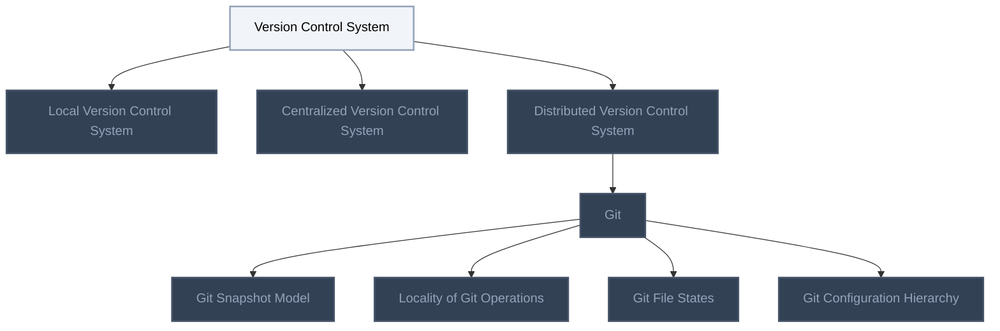
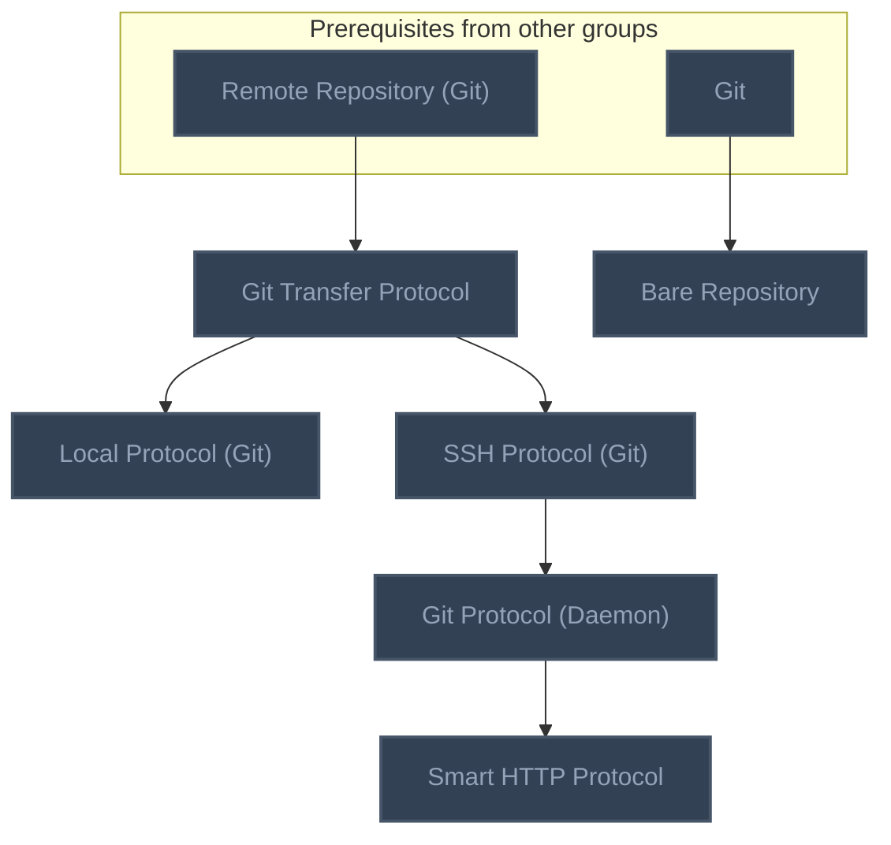
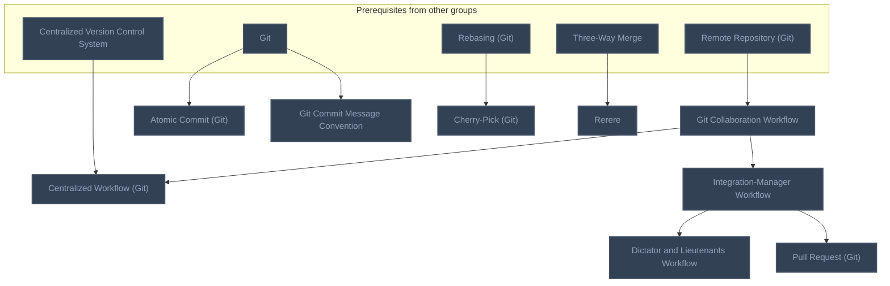
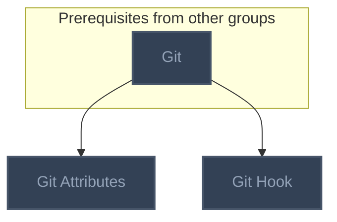
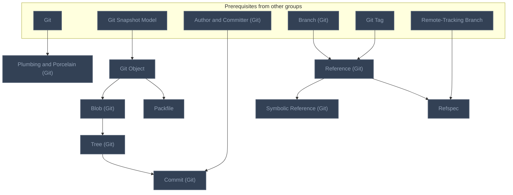
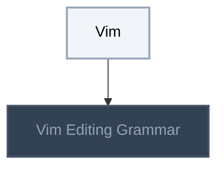
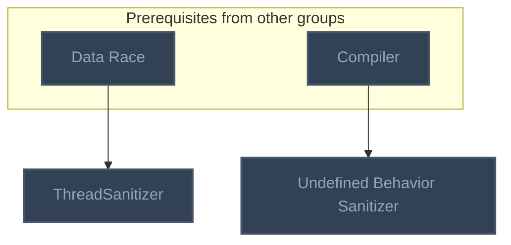

<!-- BEGIN STATS (generated by Scripts/skill_trees.py; do not edit) -->
**Mastered:** 0 / 73 · **Depth:** 0% · **Mastery Depth:** 0% · **Discovered:** 73 · **Planned:** 0 · **Locked:** 71 · **Rusty:** 0

| | L0 Discovered | L1 Recall | L2 Apply | L3 Prove ★ | L4 Wield | L5 Command |
|---|---:|---:|---:|---:|---:|---:|
| **At this level** | 73 | 0 | 0 | 0 | 0 | 0 |
| **Reached (this level or higher)** | 73 | 0 | 0 | 0 | 0 | 0 |

**Next up:** [[Version Control System]], [[Vim]]

Legend: dashed grey = planned (no note yet) · dark grey = locked · white L0 Discovered · green L1 Recall · blue L2 Apply · purple L3 Prove (Mastered) · orange L4 Wield · gold L5 Command · brown dashed border = rusty
<!-- END STATS -->

## Pro Git Ch. 1: Getting Started
**Reached:** L1 0 · L2 0 · L3 0 · L4 0 · L5 0 (of 9 nodes)



## Pro Git Ch. 2: Git Basics
**Reached:** L1 0 · L2 0 · L3 0 · L4 0 · L5 0 (of 8 nodes)

```mermaid
flowchart TD
    classDef planned fill:#1E293B,stroke:#64748B,stroke-width:2px,stroke-dasharray:5 5,color:#94A3B8;
    classDef locked fill:#334155,stroke:#475569,stroke-width:2px,color:#94A3B8;
    classDef L0 fill:#F1F5F9,stroke:#94A3B8,stroke-width:2px,color:#000000;
    classDef L1 fill:#22C55E,stroke:#15803D,stroke-width:2px,color:#000000;
    classDef L2 fill:#3B82F6,stroke:#1D4ED8,stroke-width:3px,color:#FFFFFF;
    classDef L3 fill:#A855F7,stroke:#6B21A8,stroke-width:3px,color:#FFFFFF,font-weight:bold;
    classDef L4 fill:#F97316,stroke:#C2410C,stroke-width:4px,color:#000000,font-weight:bold;
    classDef L5 fill:#FFD700,stroke:#FF8C00,stroke-width:5px,color:#000000,font-weight:bold;
    classDef rusty stroke:#8B4513,stroke-width:4px,stroke-dasharray:3 3;
    subgraph sg_prereqs["Prerequisites from other groups"]
        n_git_file_states["Git File States"]
        n_git_snapshot_model["Git Snapshot Model"]
        n_git["Git"]
    end
    n_gitignore["Gitignore"]
    n_git_rename_detection["Git Rename Detection"]
    n_author_and_committer_git["Author and Committer (Git)"]
    n_amending_a_commit["Amending a Commit"]
    n_remote_repository_git["Remote Repository (Git)"]
    n_git_tag["Git Tag"]
    n_annotated_tag["Annotated Tag"]
    n_lightweight_tag["Lightweight Tag"]
    n_git_file_states --> n_gitignore
    n_git_snapshot_model --> n_git_rename_detection
    n_git --> n_author_and_committer_git
    n_git --> n_amending_a_commit
    n_git --> n_remote_repository_git
    n_git --> n_git_tag
    n_git_tag --> n_annotated_tag
    n_git_tag --> n_lightweight_tag
    class n_git_file_states,n_git_snapshot_model,n_git,n_gitignore,n_git_rename_detection,n_author_and_committer_git,n_amending_a_commit,n_remote_repository_git,n_git_tag,n_annotated_tag,n_lightweight_tag locked;
    class n_git_file_states,n_git_snapshot_model,n_git,n_gitignore,n_git_rename_detection,n_author_and_committer_git,n_amending_a_commit,n_remote_repository_git,n_git_tag,n_annotated_tag,n_lightweight_tag internal-link;
```



## Pro Git Ch. 3: Git Branching
**Reached:** L1 0 · L2 0 · L3 0 · L4 0 · L5 0 (of 14 nodes)

```mermaid
flowchart TD
    classDef planned fill:#1E293B,stroke:#64748B,stroke-width:2px,stroke-dasharray:5 5,color:#94A3B8;
    classDef locked fill:#334155,stroke:#475569,stroke-width:2px,color:#94A3B8;
    classDef L0 fill:#F1F5F9,stroke:#94A3B8,stroke-width:2px,color:#000000;
    classDef L1 fill:#22C55E,stroke:#15803D,stroke-width:2px,color:#000000;
    classDef L2 fill:#3B82F6,stroke:#1D4ED8,stroke-width:3px,color:#FFFFFF;
    classDef L3 fill:#A855F7,stroke:#6B21A8,stroke-width:3px,color:#FFFFFF,font-weight:bold;
    classDef L4 fill:#F97316,stroke:#C2410C,stroke-width:4px,color:#000000,font-weight:bold;
    classDef L5 fill:#FFD700,stroke:#FF8C00,stroke-width:5px,color:#000000,font-weight:bold;
    classDef rusty stroke:#8B4513,stroke-width:4px,stroke-dasharray:3 3;
    subgraph sg_prereqs["Prerequisites from other groups"]
        n_git["Git"]
        n_remote_repository_git["Remote Repository (Git)"]
    end
    n_branch_git["Branch (Git)"]
    n_head_git["HEAD (Git)"]
    n_detached_head["Detached HEAD"]
    n_switching_branches_git["Switching Branches (Git)"]
    n_fast_forward_merge["Fast-Forward Merge"]
    n_three_way_merge["Three-Way Merge"]
    n_merge_commit["Merge Commit"]
    n_long_running_branch["Long-Running Branch"]
    n_topic_branch["Topic Branch"]
    n_remote_tracking_branch["Remote-Tracking Branch"]
    n_tracking_branch_git["Tracking Branch (Git)"]
    n_rebasing_git["Rebasing (Git)"]
    n_golden_rule_of_rebasing["Golden Rule of Rebasing"]
    n_patch_id_git["Patch-ID (Git)"]
    n_git --> n_branch_git
    n_branch_git --> n_head_git
    n_head_git --> n_detached_head
    n_head_git --> n_switching_branches_git
    n_branch_git --> n_fast_forward_merge
    n_branch_git --> n_three_way_merge
    n_three_way_merge --> n_merge_commit
    n_branch_git --> n_long_running_branch
    n_branch_git --> n_topic_branch
    n_remote_repository_git --> n_remote_tracking_branch
    n_branch_git --> n_remote_tracking_branch
    n_remote_tracking_branch --> n_tracking_branch_git
    n_branch_git --> n_rebasing_git
    n_rebasing_git --> n_golden_rule_of_rebasing
    n_remote_repository_git --> n_golden_rule_of_rebasing
    n_git --> n_patch_id_git
    class n_git,n_remote_repository_git,n_branch_git,n_head_git,n_detached_head,n_switching_branches_git,n_fast_forward_merge,n_three_way_merge,n_merge_commit,n_long_running_branch,n_topic_branch,n_remote_tracking_branch,n_tracking_branch_git,n_rebasing_git,n_golden_rule_of_rebasing,n_patch_id_git locked;
    class n_git,n_remote_repository_git,n_branch_git,n_head_git,n_detached_head,n_switching_branches_git,n_fast_forward_merge,n_three_way_merge,n_merge_commit,n_long_running_branch,n_topic_branch,n_remote_tracking_branch,n_tracking_branch_git,n_rebasing_git,n_golden_rule_of_rebasing,n_patch_id_git internal-link;
```



## Pro Git Ch. 4: Git on the Server
**Reached:** L1 0 · L2 0 · L3 0 · L4 0 · L5 0 (of 6 nodes)



## Pro Git Ch. 5-6: Distributed Git and GitHub
**Reached:** L1 0 · L2 0 · L3 0 · L4 0 · L5 0 (of 9 nodes)



## Pro Git Ch. 7: Git Tools
**Reached:** L1 0 · L2 0 · L3 0 · L4 0 · L5 0 (of 12 nodes)

```mermaid
flowchart TD
    classDef planned fill:#1E293B,stroke:#64748B,stroke-width:2px,stroke-dasharray:5 5,color:#94A3B8;
    classDef locked fill:#334155,stroke:#475569,stroke-width:2px,color:#94A3B8;
    classDef L0 fill:#F1F5F9,stroke:#94A3B8,stroke-width:2px,color:#000000;
    classDef L1 fill:#22C55E,stroke:#15803D,stroke-width:2px,color:#000000;
    classDef L2 fill:#3B82F6,stroke:#1D4ED8,stroke-width:3px,color:#FFFFFF;
    classDef L3 fill:#A855F7,stroke:#6B21A8,stroke-width:3px,color:#FFFFFF,font-weight:bold;
    classDef L4 fill:#F97316,stroke:#C2410C,stroke-width:4px,color:#000000,font-weight:bold;
    classDef L5 fill:#FFD700,stroke:#FF8C00,stroke-width:5px,color:#000000,font-weight:bold;
    classDef rusty stroke:#8B4513,stroke-width:4px,stroke-dasharray:3 3;
    subgraph sg_prereqs["Prerequisites from other groups"]
        n_git_object["Git Object"]
        n_head_git["HEAD (Git)"]
        n_git_file_states["Git File States"]
        n_git_tag["Git Tag"]
        n_rebasing_git["Rebasing (Git)"]
        n_git["Git"]
    end
    n_sha_1_hash_collision_git["SHA-1 Hash Collision (Git)"]
    n_reflog["Reflog"]
    n_git_stash["Git Stash"]
    n_gpg_signing_git["GPG Signing (Git)"]
    n_interactive_rebase_git["Interactive Rebase (Git)"]
    n_reset_git["Reset (Git)"]
    n_revert_git["Revert (Git)"]
    n_file_annotation_git["File Annotation (Git)"]
    n_bisect_git["Bisect (Git)"]
    n_submodule_git["Submodule (Git)"]
    n_git_bundle["Git Bundle"]
    n_git_replace["Git Replace"]
    n_git_object --> n_sha_1_hash_collision_git
    n_head_git --> n_reflog
    n_git_file_states --> n_git_stash
    n_git_tag --> n_gpg_signing_git
    n_rebasing_git --> n_interactive_rebase_git
    n_head_git --> n_reset_git
    n_git_file_states --> n_reset_git
    n_git --> n_revert_git
    n_git --> n_file_annotation_git
    n_git --> n_bisect_git
    n_git --> n_submodule_git
    n_git --> n_git_bundle
    n_git --> n_git_replace
    class n_git_object,n_head_git,n_git_file_states,n_git_tag,n_rebasing_git,n_git,n_sha_1_hash_collision_git,n_reflog,n_git_stash,n_gpg_signing_git,n_interactive_rebase_git,n_reset_git,n_revert_git,n_file_annotation_git,n_bisect_git,n_submodule_git,n_git_bundle,n_git_replace locked;
    class n_git_object,n_head_git,n_git_file_states,n_git_tag,n_rebasing_git,n_git,n_sha_1_hash_collision_git,n_reflog,n_git_stash,n_gpg_signing_git,n_interactive_rebase_git,n_reset_git,n_revert_git,n_file_annotation_git,n_bisect_git,n_submodule_git,n_git_bundle,n_git_replace internal-link;
```



## Pro Git Ch. 8: Customizing Git
**Reached:** L1 0 · L2 0 · L3 0 · L4 0 · L5 0 (of 2 nodes)



## Pro Git Ch. 10: Git Internals
**Reached:** L1 0 · L2 0 · L3 0 · L4 0 · L5 0 (of 9 nodes)



## Vim
**Reached:** L1 0 · L2 0 · L3 0 · L4 0 · L5 0 (of 2 nodes)



## Sanitizers
**Reached:** L1 0 · L2 0 · L3 0 · L4 0 · L5 0 (of 2 nodes)



# Source
Graph structure: the single source for the diagrams above, edited by `/note` and `Scripts/skill_trees.py` (`add`, `edge`, `rename`). Everything above this heading is regenerated by `render`.

```skilltree
    %% PREREQUISITES
    n_data_race["Data Race"]
    n_compiler["Compiler"]
    %% NODES
    %% == Pro Git Ch. 1: Getting Started ==
    n_version_control_system["Version Control System"]
    n_local_version_control_system["Local Version Control System"]
    n_centralized_version_control_system["Centralized Version Control System"]
    n_distributed_version_control_system["Distributed Version Control System"]
    n_git["Git"]
    n_git_snapshot_model["Git Snapshot Model"]
    n_locality_of_git_operations["Locality of Git Operations"]
    n_git_file_states["Git File States"]
    n_git_configuration_hierarchy["Git Configuration Hierarchy"]
    %% == Pro Git Ch. 2: Git Basics ==
    n_gitignore["Gitignore"]
    n_git_rename_detection["Git Rename Detection"]
    n_author_and_committer_git["Author and Committer (Git)"]
    n_amending_a_commit["Amending a Commit"]
    n_remote_repository_git["Remote Repository (Git)"]
    n_git_tag["Git Tag"]
    n_annotated_tag["Annotated Tag"]
    n_lightweight_tag["Lightweight Tag"]
    %% == Pro Git Ch. 3: Git Branching ==
    n_branch_git["Branch (Git)"]
    n_head_git["HEAD (Git)"]
    n_detached_head["Detached HEAD"]
    n_switching_branches_git["Switching Branches (Git)"]
    n_fast_forward_merge["Fast-Forward Merge"]
    n_three_way_merge["Three-Way Merge"]
    n_merge_commit["Merge Commit"]
    n_long_running_branch["Long-Running Branch"]
    n_topic_branch["Topic Branch"]
    n_remote_tracking_branch["Remote-Tracking Branch"]
    n_tracking_branch_git["Tracking Branch (Git)"]
    n_rebasing_git["Rebasing (Git)"]
    n_golden_rule_of_rebasing["Golden Rule of Rebasing"]
    n_patch_id_git["Patch-ID (Git)"]
    %% == Pro Git Ch. 4: Git on the Server ==
    n_git_transfer_protocol["Git Transfer Protocol"]
    n_local_protocol_git["Local Protocol (Git)"]
    n_bare_repository["Bare Repository"]
    n_ssh_protocol_git["SSH Protocol (Git)"]
    n_git_protocol_daemon["Git Protocol (Daemon)"]
    n_smart_http_protocol["Smart HTTP Protocol"]
    %% == Pro Git Ch. 5-6: Distributed Git and GitHub ==
    n_git_collaboration_workflow["Git Collaboration Workflow"]
    n_centralized_workflow_git["Centralized Workflow (Git)"]
    n_integration_manager_workflow["Integration-Manager Workflow"]
    n_dictator_and_lieutenants_workflow["Dictator and Lieutenants Workflow"]
    n_atomic_commit_git["Atomic Commit (Git)"]
    n_git_commit_message_convention["Git Commit Message Convention"]
    n_pull_request_git["Pull Request (Git)"]
    n_cherry_pick_git["Cherry-Pick (Git)"]
    n_rerere["Rerere"]
    %% == Pro Git Ch. 7: Git Tools ==
    n_sha_1_hash_collision_git["SHA-1 Hash Collision (Git)"]
    n_reflog["Reflog"]
    n_git_stash["Git Stash"]
    n_gpg_signing_git["GPG Signing (Git)"]
    n_interactive_rebase_git["Interactive Rebase (Git)"]
    n_reset_git["Reset (Git)"]
    n_revert_git["Revert (Git)"]
    n_file_annotation_git["File Annotation (Git)"]
    n_bisect_git["Bisect (Git)"]
    n_submodule_git["Submodule (Git)"]
    n_git_bundle["Git Bundle"]
    n_git_replace["Git Replace"]
    %% == Pro Git Ch. 8: Customizing Git ==
    n_git_attributes["Git Attributes"]
    n_git_hook["Git Hook"]
    %% == Pro Git Ch. 10: Git Internals ==
    n_plumbing_and_porcelain_git["Plumbing and Porcelain (Git)"]
    n_git_object["Git Object"]
    n_blob_git["Blob (Git)"]
    n_tree_git["Tree (Git)"]
    n_commit_git["Commit (Git)"]
    n_reference_git["Reference (Git)"]
    n_symbolic_reference_git["Symbolic Reference (Git)"]
    n_refspec["Refspec"]
    n_packfile["Packfile"]
    %% == Vim ==
    n_vim["Vim"]
    n_vim_editing_grammar["Vim Editing Grammar"]
    %% == Sanitizers ==
    n_threadsanitizer["ThreadSanitizer"]
    n_undefined_behavior_sanitizer["Undefined Behavior Sanitizer"]
    %% EDGES
    n_version_control_system --> n_local_version_control_system
    n_version_control_system --> n_centralized_version_control_system
    n_version_control_system --> n_distributed_version_control_system
    n_distributed_version_control_system --> n_git
    n_git --> n_git_snapshot_model
    n_git --> n_locality_of_git_operations
    n_git --> n_git_file_states
    n_git --> n_git_configuration_hierarchy
    n_git_file_states --> n_gitignore
    n_git_snapshot_model --> n_git_rename_detection
    n_git --> n_author_and_committer_git
    n_git --> n_amending_a_commit
    n_git --> n_remote_repository_git
    n_git --> n_git_tag
    n_git_tag --> n_annotated_tag
    n_git_tag --> n_lightweight_tag
    n_git --> n_branch_git
    n_branch_git --> n_head_git
    n_head_git --> n_detached_head
    n_head_git --> n_switching_branches_git
    n_branch_git --> n_fast_forward_merge
    n_branch_git --> n_three_way_merge
    n_three_way_merge --> n_merge_commit
    n_branch_git --> n_long_running_branch
    n_branch_git --> n_topic_branch
    n_remote_repository_git --> n_remote_tracking_branch
    n_branch_git --> n_remote_tracking_branch
    n_remote_tracking_branch --> n_tracking_branch_git
    n_branch_git --> n_rebasing_git
    n_rebasing_git --> n_golden_rule_of_rebasing
    n_remote_repository_git --> n_golden_rule_of_rebasing
    n_git --> n_patch_id_git
    n_remote_repository_git --> n_git_transfer_protocol
    n_git_transfer_protocol --> n_local_protocol_git
    n_git --> n_bare_repository
    n_git_transfer_protocol --> n_ssh_protocol_git
    n_ssh_protocol_git --> n_git_protocol_daemon
    n_git_protocol_daemon --> n_smart_http_protocol
    n_remote_repository_git --> n_git_collaboration_workflow
    n_git_collaboration_workflow --> n_centralized_workflow_git
    n_centralized_version_control_system --> n_centralized_workflow_git
    n_git_collaboration_workflow --> n_integration_manager_workflow
    n_integration_manager_workflow --> n_dictator_and_lieutenants_workflow
    n_git --> n_atomic_commit_git
    n_git --> n_git_commit_message_convention
    n_integration_manager_workflow --> n_pull_request_git
    n_rebasing_git --> n_cherry_pick_git
    n_three_way_merge --> n_rerere
    n_git --> n_plumbing_and_porcelain_git
    n_git_snapshot_model --> n_git_object
    n_git_object --> n_blob_git
    n_blob_git --> n_tree_git
    n_tree_git --> n_commit_git
    n_author_and_committer_git --> n_commit_git
    n_branch_git --> n_reference_git
    n_git_tag --> n_reference_git
    n_reference_git --> n_symbolic_reference_git
    n_reference_git --> n_refspec
    n_remote_tracking_branch --> n_refspec
    n_git_object --> n_packfile
    n_git_object --> n_sha_1_hash_collision_git
    n_head_git --> n_reflog
    n_git_file_states --> n_git_stash
    n_git_tag --> n_gpg_signing_git
    n_rebasing_git --> n_interactive_rebase_git
    n_head_git --> n_reset_git
    n_git_file_states --> n_reset_git
    n_git --> n_revert_git
    n_git --> n_file_annotation_git
    n_git --> n_bisect_git
    n_git --> n_submodule_git
    n_git --> n_git_bundle
    n_git --> n_git_replace
    n_git --> n_git_attributes
    n_git --> n_git_hook
    n_data_race --> n_threadsanitizer
    n_compiler --> n_undefined_behavior_sanitizer
    n_vim --> n_vim_editing_grammar
```
