<!-- BEGIN STATS (generated by Scripts/skill_trees.py; do not edit) -->
**Mastered:** 0 / 131 · **Depth:** 0% · **Discovered:** 8 · **Planned:** 123 · **Locked:** 5 · **Rusty:** 0

| | L0 Discovered | L1 Recall | L2 Apply | L3 Prove ★ | L4 Wield | L5 Command |
|---|---:|---:|---:|---:|---:|---:|
| **At this level** | 8 | 0 | 0 | 0 | 0 | 0 |
| **Reached (this level or higher)** | 8 | 0 | 0 | 0 | 0 | 0 |

**Next up:** [[Restriction of Function]], [[Inductive Set]], [[Relation Maximal Element]]

Legend: dashed grey = planned (no note yet) · dark grey = locked · white L0 Discovered · green L1 Recall · blue L2 Apply · purple L3 Prove (Mastered) · orange L4 Wield · gold L5 Command · brown dashed border = rusty
<!-- END STATS -->

## Munkres §2: Functions
**Reached:** L1 0 · L2 0 · L3 0 · L4 0 · L5 0 (of 1 nodes)

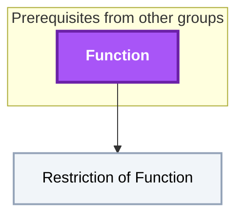

## Munkres §3: Relations
**Reached:** L1 0 · L2 0 · L3 0 · L4 0 · L5 0 (of 2 nodes)

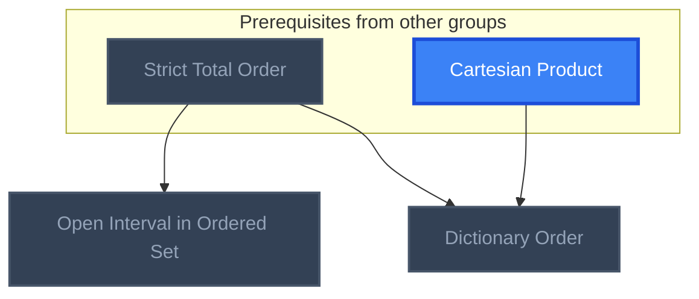

## Munkres §4: The Integers and the Real Numbers
**Reached:** L1 0 · L2 0 · L3 0 · L4 0 · L5 0 (of 2 nodes)

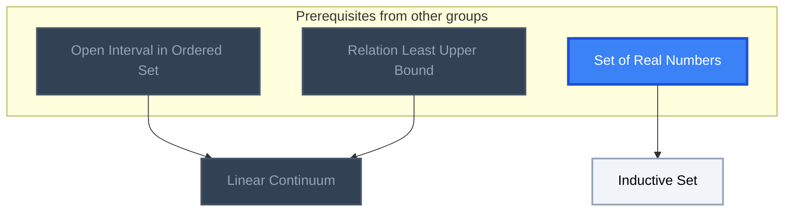

## Munkres §5: Cartesian Products
**Reached:** L1 0 · L2 0 · L3 0 · L4 0 · L5 0 (of 1 nodes)

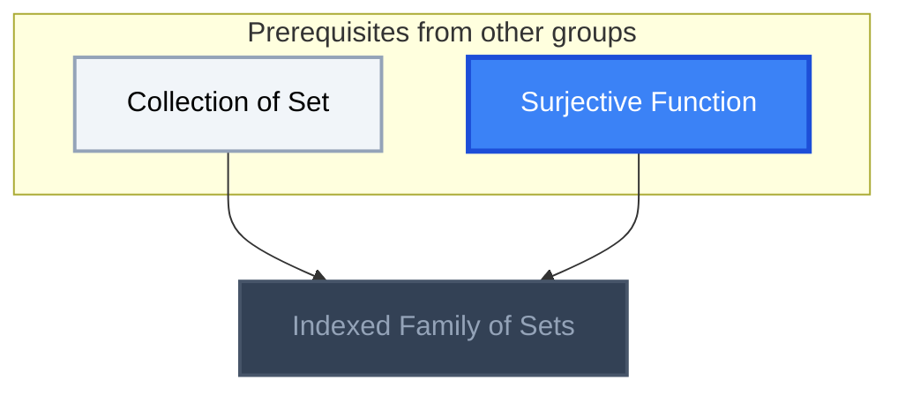

## Munkres §8: The Principle of Recursive Definition
**Reached:** L1 0 · L2 0 · L3 0 · L4 0 · L5 0 (of 1 nodes)

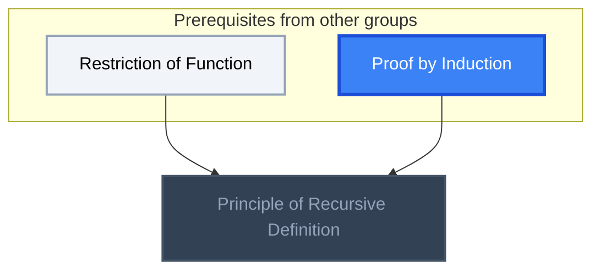

## Munkres §11: The Maximum Principle
**Reached:** L1 0 · L2 0 · L3 0 · L4 0 · L5 0 (of 1 nodes)

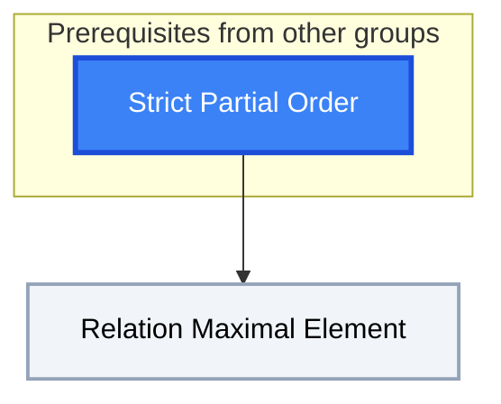

## Munkres §12: Topological Spaces
**Reached:** L1 0 · L2 0 · L3 0 · L4 0 · L5 0 (of 2 nodes, 2 planned)

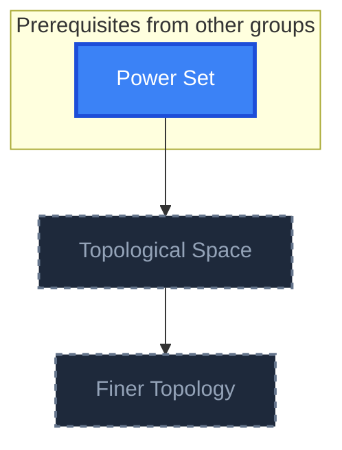

## Munkres §13: Basis for a Topology
**Reached:** L1 0 · L2 0 · L3 0 · L4 0 · L5 0 (of 2 nodes, 2 planned)

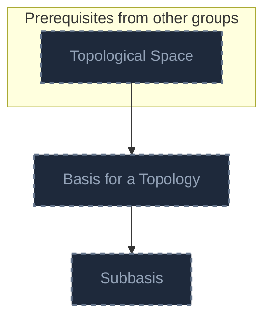

## Munkres §14: The Order Topology
**Reached:** L1 0 · L2 0 · L3 0 · L4 0 · L5 0 (of 1 nodes, 1 planned)

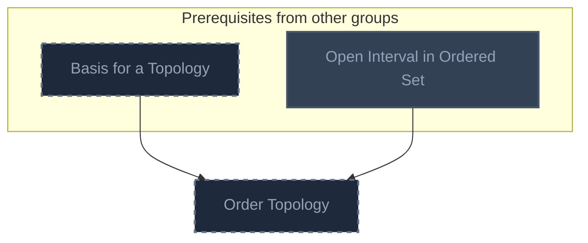

## Munkres §15: The Product Topology on X x Y
**Reached:** L1 0 · L2 0 · L3 0 · L4 0 · L5 0 (of 1 nodes, 1 planned)

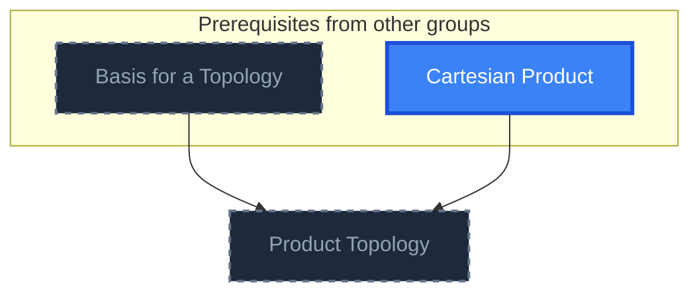

## Munkres §16: The Subspace Topology
**Reached:** L1 0 · L2 0 · L3 0 · L4 0 · L5 0 (of 1 nodes, 1 planned)

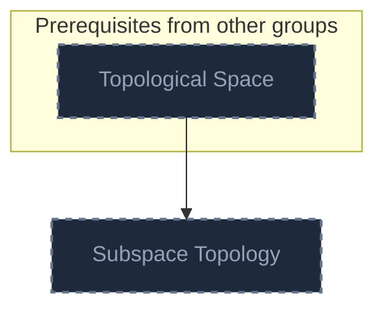

## Munkres §17: Closed Sets and Limit Points
**Reached:** L1 0 · L2 0 · L3 0 · L4 0 · L5 0 (of 2 nodes, 2 planned)

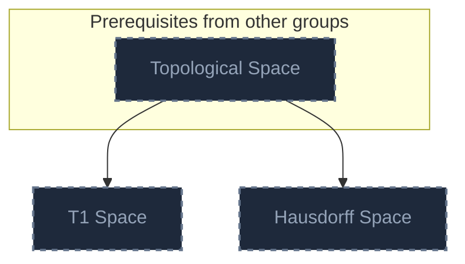

## Munkres §18: Continuous Functions
**Reached:** L1 0 · L2 0 · L3 0 · L4 0 · L5 0 (of 4 nodes, 4 planned)

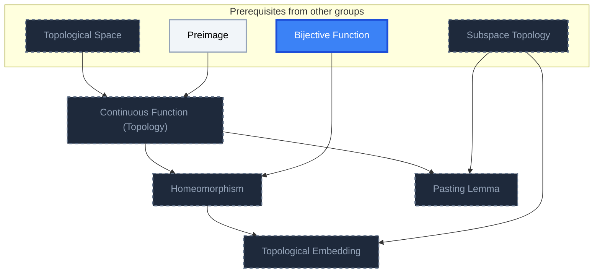

## Munkres §19: The Product Topology
**Reached:** L1 0 · L2 0 · L3 0 · L4 0 · L5 0 (of 2 nodes, 2 planned)

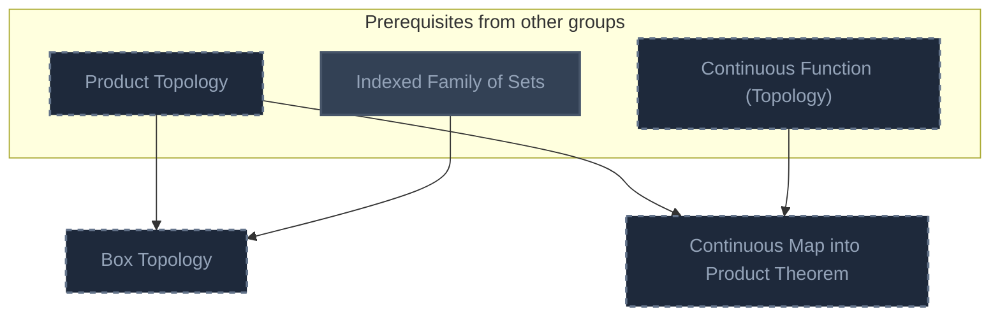

## Munkres §20: The Metric Topology
**Reached:** L1 0 · L2 0 · L3 0 · L4 0 · L5 0 (of 3 nodes, 3 planned)

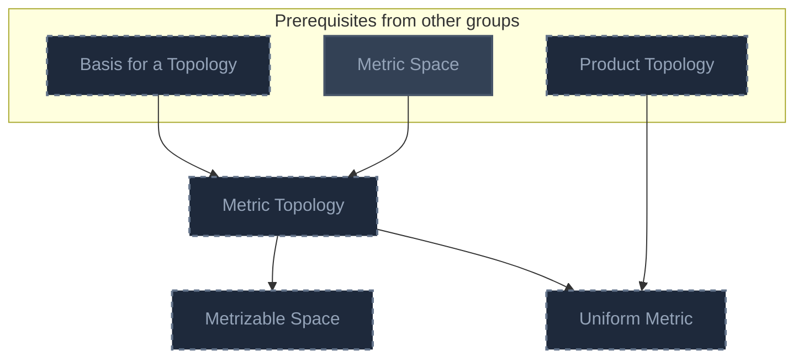

## Munkres §21: The Metric Topology (continued)
**Reached:** L1 0 · L2 0 · L3 0 · L4 0 · L5 0 (of 1 nodes, 1 planned)

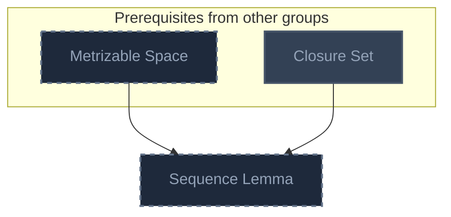

## Munkres §22: The Quotient Topology
**Reached:** L1 0 · L2 0 · L3 0 · L4 0 · L5 0 (of 3 nodes, 3 planned)

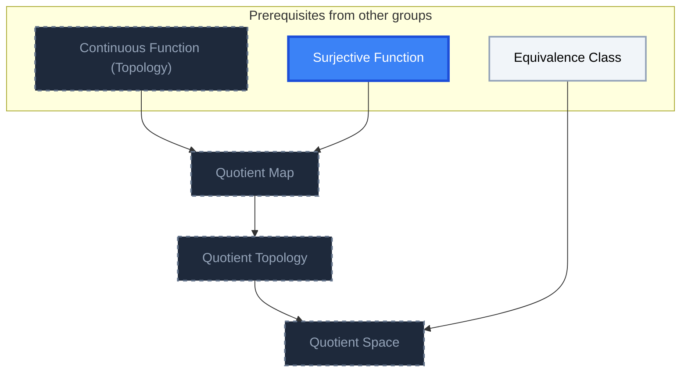

## Munkres §23: Connected Spaces
**Reached:** L1 0 · L2 0 · L3 0 · L4 0 · L5 0 (of 2 nodes, 2 planned)

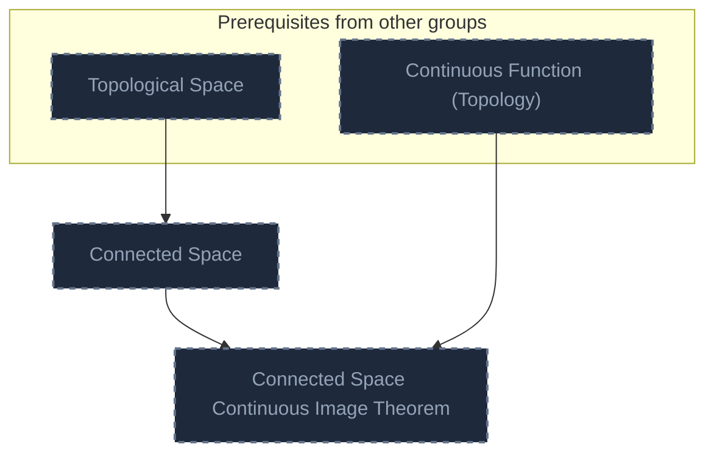

## Munkres §24: Connected Subspaces of the Real Line
**Reached:** L1 0 · L2 0 · L3 0 · L4 0 · L5 0 (of 3 nodes, 3 planned)

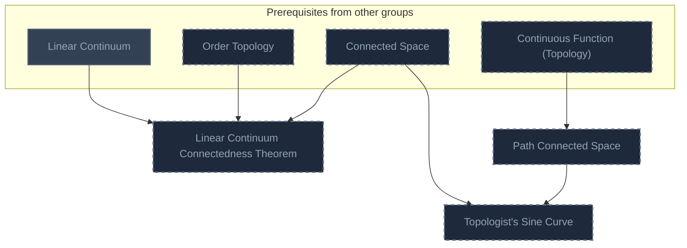

## Munkres §25: Components and Local Connectedness
**Reached:** L1 0 · L2 0 · L3 0 · L4 0 · L5 0 (of 3 nodes, 3 planned)

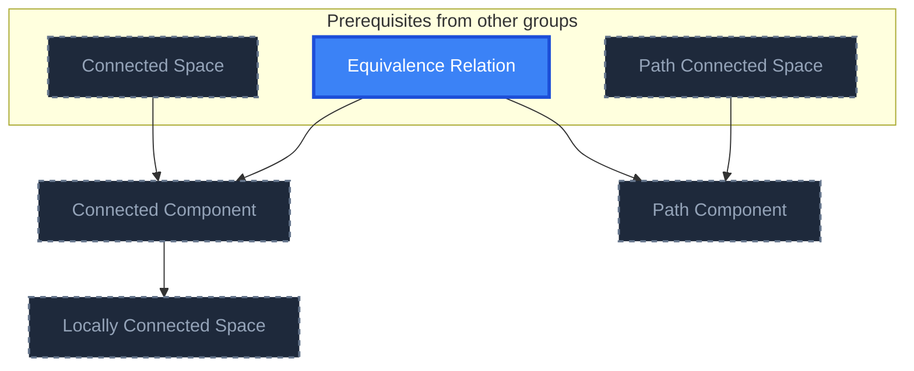

## Munkres §26: Compact Spaces
**Reached:** L1 0 · L2 0 · L3 0 · L4 0 · L5 0 (of 3 nodes, 3 planned)

```mermaid
flowchart TD
    classDef planned fill:#1E293B,stroke:#64748B,stroke-width:2px,stroke-dasharray:5 5,color:#94A3B8;
    classDef locked fill:#334155,stroke:#475569,stroke-width:2px,color:#94A3B8;
    classDef L0 fill:#F1F5F9,stroke:#94A3B8,stroke-width:2px,color:#000000;
    classDef L1 fill:#22C55E,stroke:#15803D,stroke-width:2px,color:#000000;
    classDef L2 fill:#3B82F6,stroke:#1D4ED8,stroke-width:3px,color:#FFFFFF;
    classDef L3 fill:#A855F7,stroke:#6B21A8,stroke-width:3px,color:#FFFFFF,font-weight:bold;
    classDef L4 fill:#F97316,stroke:#C2410C,stroke-width:4px,color:#000000,font-weight:bold;
    classDef L5 fill:#FFD700,stroke:#FF8C00,stroke-width:5px,color:#000000,font-weight:bold;
    classDef rusty stroke:#8B4513,stroke-width:4px,stroke-dasharray:3 3;
    subgraph sg_prereqs["Prerequisites from other groups"]
        n_compact_set["Compact Set"]
        n_product_topology["Product Topology"]
        n_hausdorff_space["Hausdorff Space"]
        n_subspace_topology["Subspace Topology"]
        n_homeomorphism["Homeomorphism"]
    end
    n_tube_lemma["Tube Lemma"]
    n_compact_subspace_of_hausdorff_space_theorem["Compact Subspace of Hausdorff Space Theorem"]
    n_compact_to_hausdorff_homeomorphism_theorem["Compact-to-Hausdorff Homeomorphism Theorem"]
    n_compact_set --> n_tube_lemma
    n_product_topology --> n_tube_lemma
    n_compact_set --> n_compact_subspace_of_hausdorff_space_theorem
    n_hausdorff_space --> n_compact_subspace_of_hausdorff_space_theorem
    n_subspace_topology --> n_compact_subspace_of_hausdorff_space_theorem
    n_compact_subspace_of_hausdorff_space_theorem --> n_compact_to_hausdorff_homeomorphism_theorem
    n_homeomorphism --> n_compact_to_hausdorff_homeomorphism_theorem
    class n_product_topology,n_hausdorff_space,n_subspace_topology,n_homeomorphism,n_tube_lemma,n_compact_subspace_of_hausdorff_space_theorem,n_compact_to_hausdorff_homeomorphism_theorem planned;
    class n_compact_set locked;
    class n_compact_set internal-link;
```

## Munkres §27: Compact Subspaces of the Real Line
**Reached:** L1 0 · L2 0 · L3 0 · L4 0 · L5 0 (of 1 nodes, 1 planned)

```mermaid
flowchart TD
    classDef planned fill:#1E293B,stroke:#64748B,stroke-width:2px,stroke-dasharray:5 5,color:#94A3B8;
    classDef locked fill:#334155,stroke:#475569,stroke-width:2px,color:#94A3B8;
    classDef L0 fill:#F1F5F9,stroke:#94A3B8,stroke-width:2px,color:#000000;
    classDef L1 fill:#22C55E,stroke:#15803D,stroke-width:2px,color:#000000;
    classDef L2 fill:#3B82F6,stroke:#1D4ED8,stroke-width:3px,color:#FFFFFF;
    classDef L3 fill:#A855F7,stroke:#6B21A8,stroke-width:3px,color:#FFFFFF,font-weight:bold;
    classDef L4 fill:#F97316,stroke:#C2410C,stroke-width:4px,color:#000000,font-weight:bold;
    classDef L5 fill:#FFD700,stroke:#FF8C00,stroke-width:5px,color:#000000,font-weight:bold;
    classDef rusty stroke:#8B4513,stroke-width:4px,stroke-dasharray:3 3;
    subgraph sg_prereqs["Prerequisites from other groups"]
        n_compact_metric_space["Compact Metric Space"]
        n_open_cover["Open Cover"]
    end
    n_lebesgue_number_lemma["Lebesgue Number Lemma"]
    n_compact_metric_space --> n_lebesgue_number_lemma
    n_open_cover --> n_lebesgue_number_lemma
    class n_lebesgue_number_lemma planned;
    class n_compact_metric_space,n_open_cover locked;
    class n_compact_metric_space,n_open_cover internal-link;
```

## Munkres §28: Limit Point Compactness
**Reached:** L1 0 · L2 0 · L3 0 · L4 0 · L5 0 (of 3 nodes, 3 planned)

```mermaid
flowchart TD
    classDef planned fill:#1E293B,stroke:#64748B,stroke-width:2px,stroke-dasharray:5 5,color:#94A3B8;
    classDef locked fill:#334155,stroke:#475569,stroke-width:2px,color:#94A3B8;
    classDef L0 fill:#F1F5F9,stroke:#94A3B8,stroke-width:2px,color:#000000;
    classDef L1 fill:#22C55E,stroke:#15803D,stroke-width:2px,color:#000000;
    classDef L2 fill:#3B82F6,stroke:#1D4ED8,stroke-width:3px,color:#FFFFFF;
    classDef L3 fill:#A855F7,stroke:#6B21A8,stroke-width:3px,color:#FFFFFF,font-weight:bold;
    classDef L4 fill:#F97316,stroke:#C2410C,stroke-width:4px,color:#000000,font-weight:bold;
    classDef L5 fill:#FFD700,stroke:#FF8C00,stroke-width:5px,color:#000000,font-weight:bold;
    classDef rusty stroke:#8B4513,stroke-width:4px,stroke-dasharray:3 3;
    subgraph sg_prereqs["Prerequisites from other groups"]
        n_compact_set["Compact Set"]
        n_limit_point["Limit Point"]
        n_sequence["Sequence"]
        n_metrizable_space["Metrizable Space"]
        n_lebesgue_number_lemma["Lebesgue Number Lemma"]
    end
    n_limit_point_compact_space["Limit Point Compact Space"]
    n_sequentially_compact_space["Sequentially Compact Space"]
    n_compactness_in_metrizable_spaces_theorem["Compactness in Metrizable Spaces Theorem"]
    n_compact_set --> n_limit_point_compact_space
    n_limit_point --> n_limit_point_compact_space
    n_compact_set --> n_sequentially_compact_space
    n_sequence --> n_sequentially_compact_space
    n_limit_point_compact_space --> n_compactness_in_metrizable_spaces_theorem
    n_sequentially_compact_space --> n_compactness_in_metrizable_spaces_theorem
    n_metrizable_space --> n_compactness_in_metrizable_spaces_theorem
    n_lebesgue_number_lemma --> n_compactness_in_metrizable_spaces_theorem
    class n_metrizable_space,n_lebesgue_number_lemma,n_limit_point_compact_space,n_sequentially_compact_space,n_compactness_in_metrizable_spaces_theorem planned;
    class n_compact_set,n_limit_point locked;
    class n_sequence L0;
    class n_compact_set,n_limit_point,n_sequence internal-link;
```

## Munkres §29: Local Compactness
**Reached:** L1 0 · L2 0 · L3 0 · L4 0 · L5 0 (of 2 nodes, 2 planned)

```mermaid
flowchart TD
    classDef planned fill:#1E293B,stroke:#64748B,stroke-width:2px,stroke-dasharray:5 5,color:#94A3B8;
    classDef locked fill:#334155,stroke:#475569,stroke-width:2px,color:#94A3B8;
    classDef L0 fill:#F1F5F9,stroke:#94A3B8,stroke-width:2px,color:#000000;
    classDef L1 fill:#22C55E,stroke:#15803D,stroke-width:2px,color:#000000;
    classDef L2 fill:#3B82F6,stroke:#1D4ED8,stroke-width:3px,color:#FFFFFF;
    classDef L3 fill:#A855F7,stroke:#6B21A8,stroke-width:3px,color:#FFFFFF,font-weight:bold;
    classDef L4 fill:#F97316,stroke:#C2410C,stroke-width:4px,color:#000000,font-weight:bold;
    classDef L5 fill:#FFD700,stroke:#FF8C00,stroke-width:5px,color:#000000,font-weight:bold;
    classDef rusty stroke:#8B4513,stroke-width:4px,stroke-dasharray:3 3;
    subgraph sg_prereqs["Prerequisites from other groups"]
        n_compact_set["Compact Set"]
        n_hausdorff_space["Hausdorff Space"]
    end
    n_locally_compact_space["Locally Compact Space"]
    n_one_point_compactification["One-Point Compactification"]
    n_compact_set --> n_locally_compact_space
    n_hausdorff_space --> n_locally_compact_space
    n_locally_compact_space --> n_one_point_compactification
    class n_hausdorff_space,n_locally_compact_space,n_one_point_compactification planned;
    class n_compact_set locked;
    class n_compact_set internal-link;
```

## Munkres §30: The Countability Axioms
**Reached:** L1 0 · L2 0 · L3 0 · L4 0 · L5 0 (of 3 nodes, 3 planned)

```mermaid
flowchart TD
    classDef planned fill:#1E293B,stroke:#64748B,stroke-width:2px,stroke-dasharray:5 5,color:#94A3B8;
    classDef locked fill:#334155,stroke:#475569,stroke-width:2px,color:#94A3B8;
    classDef L0 fill:#F1F5F9,stroke:#94A3B8,stroke-width:2px,color:#000000;
    classDef L1 fill:#22C55E,stroke:#15803D,stroke-width:2px,color:#000000;
    classDef L2 fill:#3B82F6,stroke:#1D4ED8,stroke-width:3px,color:#FFFFFF;
    classDef L3 fill:#A855F7,stroke:#6B21A8,stroke-width:3px,color:#FFFFFF,font-weight:bold;
    classDef L4 fill:#F97316,stroke:#C2410C,stroke-width:4px,color:#000000,font-weight:bold;
    classDef L5 fill:#FFD700,stroke:#FF8C00,stroke-width:5px,color:#000000,font-weight:bold;
    classDef rusty stroke:#8B4513,stroke-width:4px,stroke-dasharray:3 3;
    subgraph sg_prereqs["Prerequisites from other groups"]
        n_topological_space["Topological Space"]
        n_countable_set["Countable Set"]
        n_basis_for_a_topology["Basis for a Topology"]
        n_open_cover["Open Cover"]
    end
    n_first_countable_space["First-Countable Space"]
    n_second_countable_space["Second-Countable Space"]
    n_lindel_f_space["Lindelöf Space"]
    n_topological_space --> n_first_countable_space
    n_countable_set --> n_first_countable_space
    n_basis_for_a_topology --> n_second_countable_space
    n_countable_set --> n_second_countable_space
    n_open_cover --> n_lindel_f_space
    class n_topological_space,n_basis_for_a_topology,n_first_countable_space,n_second_countable_space,n_lindel_f_space planned;
    class n_open_cover locked;
    class n_countable_set L0;
    class n_countable_set,n_open_cover internal-link;
```

## Munkres §31: The Separation Axioms
**Reached:** L1 0 · L2 0 · L3 0 · L4 0 · L5 0 (of 1 nodes, 1 planned)

```mermaid
flowchart TD
    classDef planned fill:#1E293B,stroke:#64748B,stroke-width:2px,stroke-dasharray:5 5,color:#94A3B8;
    classDef locked fill:#334155,stroke:#475569,stroke-width:2px,color:#94A3B8;
    classDef L0 fill:#F1F5F9,stroke:#94A3B8,stroke-width:2px,color:#000000;
    classDef L1 fill:#22C55E,stroke:#15803D,stroke-width:2px,color:#000000;
    classDef L2 fill:#3B82F6,stroke:#1D4ED8,stroke-width:3px,color:#FFFFFF;
    classDef L3 fill:#A855F7,stroke:#6B21A8,stroke-width:3px,color:#FFFFFF,font-weight:bold;
    classDef L4 fill:#F97316,stroke:#C2410C,stroke-width:4px,color:#000000,font-weight:bold;
    classDef L5 fill:#FFD700,stroke:#FF8C00,stroke-width:5px,color:#000000,font-weight:bold;
    classDef rusty stroke:#8B4513,stroke-width:4px,stroke-dasharray:3 3;
    subgraph sg_prereqs["Prerequisites from other groups"]
        n_t1_space["T1 Space"]
    end
    n_regular_space["Regular Space"]
    n_t1_space --> n_regular_space
    class n_t1_space,n_regular_space planned;
```

## Munkres §32: Normal Spaces
**Reached:** L1 0 · L2 0 · L3 0 · L4 0 · L5 0 (of 3 nodes, 3 planned)

```mermaid
flowchart TD
    classDef planned fill:#1E293B,stroke:#64748B,stroke-width:2px,stroke-dasharray:5 5,color:#94A3B8;
    classDef locked fill:#334155,stroke:#475569,stroke-width:2px,color:#94A3B8;
    classDef L0 fill:#F1F5F9,stroke:#94A3B8,stroke-width:2px,color:#000000;
    classDef L1 fill:#22C55E,stroke:#15803D,stroke-width:2px,color:#000000;
    classDef L2 fill:#3B82F6,stroke:#1D4ED8,stroke-width:3px,color:#FFFFFF;
    classDef L3 fill:#A855F7,stroke:#6B21A8,stroke-width:3px,color:#FFFFFF,font-weight:bold;
    classDef L4 fill:#F97316,stroke:#C2410C,stroke-width:4px,color:#000000,font-weight:bold;
    classDef L5 fill:#FFD700,stroke:#FF8C00,stroke-width:5px,color:#000000,font-weight:bold;
    classDef rusty stroke:#8B4513,stroke-width:4px,stroke-dasharray:3 3;
    subgraph sg_prereqs["Prerequisites from other groups"]
        n_regular_space["Regular Space"]
        n_second_countable_space["Second-Countable Space"]
        n_normal_space["Normal Space"]
        n_compact_subspace_of_hausdorff_space_theorem["Compact Subspace of Hausdorff Space Theorem"]
        n_well_ordered_set["Well-Ordered Set"]
        n_order_topology["Order Topology"]
    end
    n_regular_second_countable_space_normality_theorem["Regular Second-Countable Space Normality Theorem"]
    n_compact_hausdorff_space_normality_theorem["Compact Hausdorff Space Normality Theorem"]
    n_well_ordered_set_normality_theorem["Well-Ordered Set Normality Theorem"]
    n_regular_space --> n_regular_second_countable_space_normality_theorem
    n_second_countable_space --> n_regular_second_countable_space_normality_theorem
    n_normal_space --> n_regular_second_countable_space_normality_theorem
    n_compact_subspace_of_hausdorff_space_theorem --> n_compact_hausdorff_space_normality_theorem
    n_normal_space --> n_compact_hausdorff_space_normality_theorem
    n_well_ordered_set --> n_well_ordered_set_normality_theorem
    n_order_topology --> n_well_ordered_set_normality_theorem
    n_normal_space --> n_well_ordered_set_normality_theorem
    class n_regular_space,n_second_countable_space,n_compact_subspace_of_hausdorff_space_theorem,n_order_topology,n_regular_second_countable_space_normality_theorem,n_compact_hausdorff_space_normality_theorem,n_well_ordered_set_normality_theorem planned;
    class n_normal_space,n_well_ordered_set locked;
    class n_normal_space,n_well_ordered_set internal-link;
```

## Munkres §33: The Urysohn Lemma
**Reached:** L1 0 · L2 0 · L3 0 · L4 0 · L5 0 (of 2 nodes, 2 planned)

```mermaid
flowchart TD
    classDef planned fill:#1E293B,stroke:#64748B,stroke-width:2px,stroke-dasharray:5 5,color:#94A3B8;
    classDef locked fill:#334155,stroke:#475569,stroke-width:2px,color:#94A3B8;
    classDef L0 fill:#F1F5F9,stroke:#94A3B8,stroke-width:2px,color:#000000;
    classDef L1 fill:#22C55E,stroke:#15803D,stroke-width:2px,color:#000000;
    classDef L2 fill:#3B82F6,stroke:#1D4ED8,stroke-width:3px,color:#FFFFFF;
    classDef L3 fill:#A855F7,stroke:#6B21A8,stroke-width:3px,color:#FFFFFF,font-weight:bold;
    classDef L4 fill:#F97316,stroke:#C2410C,stroke-width:4px,color:#000000,font-weight:bold;
    classDef L5 fill:#FFD700,stroke:#FF8C00,stroke-width:5px,color:#000000,font-weight:bold;
    classDef rusty stroke:#8B4513,stroke-width:4px,stroke-dasharray:3 3;
    subgraph sg_prereqs["Prerequisites from other groups"]
        n_normal_space["Normal Space"]
        n_continuous_function_topology["Continuous Function (Topology)"]
        n_regular_space["Regular Space"]
    end
    n_urysohn_lemma["Urysohn Lemma"]
    n_completely_regular_space["Completely Regular Space"]
    n_normal_space --> n_urysohn_lemma
    n_continuous_function_topology --> n_urysohn_lemma
    n_regular_space --> n_completely_regular_space
    n_continuous_function_topology --> n_completely_regular_space
    class n_continuous_function_topology,n_regular_space,n_urysohn_lemma,n_completely_regular_space planned;
    class n_normal_space locked;
    class n_normal_space internal-link;
```

## Munkres §34: The Urysohn Metrization Theorem
**Reached:** L1 0 · L2 0 · L3 0 · L4 0 · L5 0 (of 1 nodes, 1 planned)

```mermaid
flowchart TD
    classDef planned fill:#1E293B,stroke:#64748B,stroke-width:2px,stroke-dasharray:5 5,color:#94A3B8;
    classDef locked fill:#334155,stroke:#475569,stroke-width:2px,color:#94A3B8;
    classDef L0 fill:#F1F5F9,stroke:#94A3B8,stroke-width:2px,color:#000000;
    classDef L1 fill:#22C55E,stroke:#15803D,stroke-width:2px,color:#000000;
    classDef L2 fill:#3B82F6,stroke:#1D4ED8,stroke-width:3px,color:#FFFFFF;
    classDef L3 fill:#A855F7,stroke:#6B21A8,stroke-width:3px,color:#FFFFFF,font-weight:bold;
    classDef L4 fill:#F97316,stroke:#C2410C,stroke-width:4px,color:#000000,font-weight:bold;
    classDef L5 fill:#FFD700,stroke:#FF8C00,stroke-width:5px,color:#000000,font-weight:bold;
    classDef rusty stroke:#8B4513,stroke-width:4px,stroke-dasharray:3 3;
    subgraph sg_prereqs["Prerequisites from other groups"]
        n_urysohn_lemma["Urysohn Lemma"]
        n_regular_second_countable_space_normality_theorem["Regular Second-Countable Space Normality Theorem"]
        n_metrizable_space["Metrizable Space"]
        n_topological_embedding["Topological Embedding"]
    end
    n_urysohn_metrization_theorem["Urysohn Metrization Theorem"]
    n_urysohn_lemma --> n_urysohn_metrization_theorem
    n_regular_second_countable_space_normality_theorem --> n_urysohn_metrization_theorem
    n_metrizable_space --> n_urysohn_metrization_theorem
    n_topological_embedding --> n_urysohn_metrization_theorem
    class n_urysohn_lemma,n_regular_second_countable_space_normality_theorem,n_metrizable_space,n_topological_embedding,n_urysohn_metrization_theorem planned;
```

## Munkres §36: Imbeddings of Manifolds
**Reached:** L1 0 · L2 0 · L3 0 · L4 0 · L5 0 (of 1 nodes, 1 planned)

```mermaid
flowchart TD
    classDef planned fill:#1E293B,stroke:#64748B,stroke-width:2px,stroke-dasharray:5 5,color:#94A3B8;
    classDef locked fill:#334155,stroke:#475569,stroke-width:2px,color:#94A3B8;
    classDef L0 fill:#F1F5F9,stroke:#94A3B8,stroke-width:2px,color:#000000;
    classDef L1 fill:#22C55E,stroke:#15803D,stroke-width:2px,color:#000000;
    classDef L2 fill:#3B82F6,stroke:#1D4ED8,stroke-width:3px,color:#FFFFFF;
    classDef L3 fill:#A855F7,stroke:#6B21A8,stroke-width:3px,color:#FFFFFF,font-weight:bold;
    classDef L4 fill:#F97316,stroke:#C2410C,stroke-width:4px,color:#000000,font-weight:bold;
    classDef L5 fill:#FFD700,stroke:#FF8C00,stroke-width:5px,color:#000000,font-weight:bold;
    classDef rusty stroke:#8B4513,stroke-width:4px,stroke-dasharray:3 3;
    subgraph sg_prereqs["Prerequisites from other groups"]
        n_manifold["Manifold"]
        n_partition_of_unity["Partition of Unity"]
        n_topological_embedding["Topological Embedding"]
    end
    n_compact_manifold_embedding_theorem["Compact Manifold Embedding Theorem"]
    n_manifold --> n_compact_manifold_embedding_theorem
    n_partition_of_unity --> n_compact_manifold_embedding_theorem
    n_topological_embedding --> n_compact_manifold_embedding_theorem
    class n_partition_of_unity,n_topological_embedding,n_compact_manifold_embedding_theorem planned;
    class n_manifold locked;
    class n_manifold internal-link;
```

## Munkres §37: The Tychonoff Theorem
**Reached:** L1 0 · L2 0 · L3 0 · L4 0 · L5 0 (of 1 nodes, 1 planned)

```mermaid
flowchart TD
    classDef planned fill:#1E293B,stroke:#64748B,stroke-width:2px,stroke-dasharray:5 5,color:#94A3B8;
    classDef locked fill:#334155,stroke:#475569,stroke-width:2px,color:#94A3B8;
    classDef L0 fill:#F1F5F9,stroke:#94A3B8,stroke-width:2px,color:#000000;
    classDef L1 fill:#22C55E,stroke:#15803D,stroke-width:2px,color:#000000;
    classDef L2 fill:#3B82F6,stroke:#1D4ED8,stroke-width:3px,color:#FFFFFF;
    classDef L3 fill:#A855F7,stroke:#6B21A8,stroke-width:3px,color:#FFFFFF,font-weight:bold;
    classDef L4 fill:#F97316,stroke:#C2410C,stroke-width:4px,color:#000000,font-weight:bold;
    classDef L5 fill:#FFD700,stroke:#FF8C00,stroke-width:5px,color:#000000,font-weight:bold;
    classDef rusty stroke:#8B4513,stroke-width:4px,stroke-dasharray:3 3;
    subgraph sg_prereqs["Prerequisites from other groups"]
        n_compact_set["Compact Set"]
        n_product_topology["Product Topology"]
        n_zorn_s_lemma["Zorn's Lemma"]
        n_finite_intersection_property["Finite Intersection Property"]
    end
    n_tychonoff_theorem["Tychonoff Theorem"]
    n_compact_set --> n_tychonoff_theorem
    n_product_topology --> n_tychonoff_theorem
    n_zorn_s_lemma --> n_tychonoff_theorem
    n_finite_intersection_property --> n_tychonoff_theorem
    class n_product_topology,n_tychonoff_theorem planned;
    class n_compact_set,n_zorn_s_lemma,n_finite_intersection_property locked;
    class n_compact_set,n_zorn_s_lemma,n_finite_intersection_property internal-link;
```

## Munkres §38: The Stone-Cech Compactification
**Reached:** L1 0 · L2 0 · L3 0 · L4 0 · L5 0 (of 2 nodes, 2 planned)

```mermaid
flowchart TD
    classDef planned fill:#1E293B,stroke:#64748B,stroke-width:2px,stroke-dasharray:5 5,color:#94A3B8;
    classDef locked fill:#334155,stroke:#475569,stroke-width:2px,color:#94A3B8;
    classDef L0 fill:#F1F5F9,stroke:#94A3B8,stroke-width:2px,color:#000000;
    classDef L1 fill:#22C55E,stroke:#15803D,stroke-width:2px,color:#000000;
    classDef L2 fill:#3B82F6,stroke:#1D4ED8,stroke-width:3px,color:#FFFFFF;
    classDef L3 fill:#A855F7,stroke:#6B21A8,stroke-width:3px,color:#FFFFFF,font-weight:bold;
    classDef L4 fill:#F97316,stroke:#C2410C,stroke-width:4px,color:#000000,font-weight:bold;
    classDef L5 fill:#FFD700,stroke:#FF8C00,stroke-width:5px,color:#000000,font-weight:bold;
    classDef rusty stroke:#8B4513,stroke-width:4px,stroke-dasharray:3 3;
    subgraph sg_prereqs["Prerequisites from other groups"]
        n_compact_set["Compact Set"]
        n_hausdorff_space["Hausdorff Space"]
        n_topological_embedding["Topological Embedding"]
        n_completely_regular_space["Completely Regular Space"]
        n_tychonoff_theorem["Tychonoff Theorem"]
    end
    n_compactification["Compactification"]
    n_stone_ech_compactification["Stone-Čech Compactification"]
    n_compact_set --> n_compactification
    n_hausdorff_space --> n_compactification
    n_topological_embedding --> n_compactification
    n_compactification --> n_stone_ech_compactification
    n_completely_regular_space --> n_stone_ech_compactification
    n_tychonoff_theorem --> n_stone_ech_compactification
    class n_hausdorff_space,n_topological_embedding,n_completely_regular_space,n_tychonoff_theorem,n_compactification,n_stone_ech_compactification planned;
    class n_compact_set locked;
    class n_compact_set internal-link;
```

## Munkres §39: Local Finiteness
**Reached:** L1 0 · L2 0 · L3 0 · L4 0 · L5 0 (of 3 nodes, 3 planned)

```mermaid
flowchart TD
    classDef planned fill:#1E293B,stroke:#64748B,stroke-width:2px,stroke-dasharray:5 5,color:#94A3B8;
    classDef locked fill:#334155,stroke:#475569,stroke-width:2px,color:#94A3B8;
    classDef L0 fill:#F1F5F9,stroke:#94A3B8,stroke-width:2px,color:#000000;
    classDef L1 fill:#22C55E,stroke:#15803D,stroke-width:2px,color:#000000;
    classDef L2 fill:#3B82F6,stroke:#1D4ED8,stroke-width:3px,color:#FFFFFF;
    classDef L3 fill:#A855F7,stroke:#6B21A8,stroke-width:3px,color:#FFFFFF,font-weight:bold;
    classDef L4 fill:#F97316,stroke:#C2410C,stroke-width:4px,color:#000000,font-weight:bold;
    classDef L5 fill:#FFD700,stroke:#FF8C00,stroke-width:5px,color:#000000,font-weight:bold;
    classDef rusty stroke:#8B4513,stroke-width:4px,stroke-dasharray:3 3;
    subgraph sg_prereqs["Prerequisites from other groups"]
        n_topological_space["Topological Space"]
        n_countable_set["Countable Set"]
        n_open_cover["Open Cover"]
    end
    n_locally_finite_collection["Locally Finite Collection"]
    n_countably_locally_finite_collection["Countably Locally Finite Collection"]
    n_open_refinement["Open Refinement"]
    n_topological_space --> n_locally_finite_collection
    n_locally_finite_collection --> n_countably_locally_finite_collection
    n_countable_set --> n_countably_locally_finite_collection
    n_open_cover --> n_open_refinement
    class n_topological_space,n_locally_finite_collection,n_countably_locally_finite_collection,n_open_refinement planned;
    class n_open_cover locked;
    class n_countable_set L0;
    class n_countable_set,n_open_cover internal-link;
```

## Munkres §40: The Nagata-Smirnov Metrization Theorem
**Reached:** L1 0 · L2 0 · L3 0 · L4 0 · L5 0 (of 1 nodes, 1 planned)

```mermaid
flowchart TD
    classDef planned fill:#1E293B,stroke:#64748B,stroke-width:2px,stroke-dasharray:5 5,color:#94A3B8;
    classDef locked fill:#334155,stroke:#475569,stroke-width:2px,color:#94A3B8;
    classDef L0 fill:#F1F5F9,stroke:#94A3B8,stroke-width:2px,color:#000000;
    classDef L1 fill:#22C55E,stroke:#15803D,stroke-width:2px,color:#000000;
    classDef L2 fill:#3B82F6,stroke:#1D4ED8,stroke-width:3px,color:#FFFFFF;
    classDef L3 fill:#A855F7,stroke:#6B21A8,stroke-width:3px,color:#FFFFFF,font-weight:bold;
    classDef L4 fill:#F97316,stroke:#C2410C,stroke-width:4px,color:#000000,font-weight:bold;
    classDef L5 fill:#FFD700,stroke:#FF8C00,stroke-width:5px,color:#000000,font-weight:bold;
    classDef rusty stroke:#8B4513,stroke-width:4px,stroke-dasharray:3 3;
    subgraph sg_prereqs["Prerequisites from other groups"]
        n_countably_locally_finite_collection["Countably Locally Finite Collection"]
        n_regular_space["Regular Space"]
        n_metrizable_space["Metrizable Space"]
        n_g_delta_set["G-Delta Set"]
        n_urysohn_lemma["Urysohn Lemma"]
    end
    n_nagata_smirnov_metrization_theorem["Nagata-Smirnov Metrization Theorem"]
    n_countably_locally_finite_collection --> n_nagata_smirnov_metrization_theorem
    n_regular_space --> n_nagata_smirnov_metrization_theorem
    n_metrizable_space --> n_nagata_smirnov_metrization_theorem
    n_g_delta_set --> n_nagata_smirnov_metrization_theorem
    n_urysohn_lemma --> n_nagata_smirnov_metrization_theorem
    class n_countably_locally_finite_collection,n_regular_space,n_metrizable_space,n_urysohn_lemma,n_nagata_smirnov_metrization_theorem planned;
    class n_g_delta_set locked;
    class n_g_delta_set internal-link;
```

## Munkres §41: Paracompactness
**Reached:** L1 0 · L2 0 · L3 0 · L4 0 · L5 0 (of 2 nodes, 2 planned)

```mermaid
flowchart TD
    classDef planned fill:#1E293B,stroke:#64748B,stroke-width:2px,stroke-dasharray:5 5,color:#94A3B8;
    classDef locked fill:#334155,stroke:#475569,stroke-width:2px,color:#94A3B8;
    classDef L0 fill:#F1F5F9,stroke:#94A3B8,stroke-width:2px,color:#000000;
    classDef L1 fill:#22C55E,stroke:#15803D,stroke-width:2px,color:#000000;
    classDef L2 fill:#3B82F6,stroke:#1D4ED8,stroke-width:3px,color:#FFFFFF;
    classDef L3 fill:#A855F7,stroke:#6B21A8,stroke-width:3px,color:#FFFFFF,font-weight:bold;
    classDef L4 fill:#F97316,stroke:#C2410C,stroke-width:4px,color:#000000,font-weight:bold;
    classDef L5 fill:#FFD700,stroke:#FF8C00,stroke-width:5px,color:#000000,font-weight:bold;
    classDef rusty stroke:#8B4513,stroke-width:4px,stroke-dasharray:3 3;
    subgraph sg_prereqs["Prerequisites from other groups"]
        n_locally_finite_collection["Locally Finite Collection"]
        n_open_refinement["Open Refinement"]
        n_hausdorff_space["Hausdorff Space"]
        n_metrizable_space["Metrizable Space"]
    end
    n_paracompact_space["Paracompact Space"]
    n_metrizable_space_paracompactness_theorem["Metrizable Space Paracompactness Theorem"]
    n_locally_finite_collection --> n_paracompact_space
    n_open_refinement --> n_paracompact_space
    n_hausdorff_space --> n_paracompact_space
    n_paracompact_space --> n_metrizable_space_paracompactness_theorem
    n_metrizable_space --> n_metrizable_space_paracompactness_theorem
    class n_locally_finite_collection,n_open_refinement,n_hausdorff_space,n_metrizable_space,n_paracompact_space,n_metrizable_space_paracompactness_theorem planned;
```

## Munkres §42: The Smirnov Metrization Theorem
**Reached:** L1 0 · L2 0 · L3 0 · L4 0 · L5 0 (of 2 nodes, 2 planned)

```mermaid
flowchart TD
    classDef planned fill:#1E293B,stroke:#64748B,stroke-width:2px,stroke-dasharray:5 5,color:#94A3B8;
    classDef locked fill:#334155,stroke:#475569,stroke-width:2px,color:#94A3B8;
    classDef L0 fill:#F1F5F9,stroke:#94A3B8,stroke-width:2px,color:#000000;
    classDef L1 fill:#22C55E,stroke:#15803D,stroke-width:2px,color:#000000;
    classDef L2 fill:#3B82F6,stroke:#1D4ED8,stroke-width:3px,color:#FFFFFF;
    classDef L3 fill:#A855F7,stroke:#6B21A8,stroke-width:3px,color:#FFFFFF,font-weight:bold;
    classDef L4 fill:#F97316,stroke:#C2410C,stroke-width:4px,color:#000000,font-weight:bold;
    classDef L5 fill:#FFD700,stroke:#FF8C00,stroke-width:5px,color:#000000,font-weight:bold;
    classDef rusty stroke:#8B4513,stroke-width:4px,stroke-dasharray:3 3;
    subgraph sg_prereqs["Prerequisites from other groups"]
        n_metrizable_space["Metrizable Space"]
        n_paracompact_space["Paracompact Space"]
        n_nagata_smirnov_metrization_theorem["Nagata-Smirnov Metrization Theorem"]
    end
    n_locally_metrizable_space["Locally Metrizable Space"]
    n_smirnov_metrization_theorem["Smirnov Metrization Theorem"]
    n_metrizable_space --> n_locally_metrizable_space
    n_paracompact_space --> n_smirnov_metrization_theorem
    n_locally_metrizable_space --> n_smirnov_metrization_theorem
    n_nagata_smirnov_metrization_theorem --> n_smirnov_metrization_theorem
    class n_metrizable_space,n_paracompact_space,n_nagata_smirnov_metrization_theorem,n_locally_metrizable_space,n_smirnov_metrization_theorem planned;
```

## Munkres §43: Complete Metric Spaces
**Reached:** L1 0 · L2 0 · L3 0 · L4 0 · L5 0 (of 1 nodes, 1 planned)

```mermaid
flowchart TD
    classDef planned fill:#1E293B,stroke:#64748B,stroke-width:2px,stroke-dasharray:5 5,color:#94A3B8;
    classDef locked fill:#334155,stroke:#475569,stroke-width:2px,color:#94A3B8;
    classDef L0 fill:#F1F5F9,stroke:#94A3B8,stroke-width:2px,color:#000000;
    classDef L1 fill:#22C55E,stroke:#15803D,stroke-width:2px,color:#000000;
    classDef L2 fill:#3B82F6,stroke:#1D4ED8,stroke-width:3px,color:#FFFFFF;
    classDef L3 fill:#A855F7,stroke:#6B21A8,stroke-width:3px,color:#FFFFFF,font-weight:bold;
    classDef L4 fill:#F97316,stroke:#C2410C,stroke-width:4px,color:#000000,font-weight:bold;
    classDef L5 fill:#FFD700,stroke:#FF8C00,stroke-width:5px,color:#000000,font-weight:bold;
    classDef rusty stroke:#8B4513,stroke-width:4px,stroke-dasharray:3 3;
    subgraph sg_prereqs["Prerequisites from other groups"]
        n_uniform_metric["Uniform Metric"]
        n_complete_metric_space["Complete Metric Space"]
    end
    n_uniform_metric_completeness_theorem["Uniform Metric Completeness Theorem"]
    n_uniform_metric --> n_uniform_metric_completeness_theorem
    n_complete_metric_space --> n_uniform_metric_completeness_theorem
    class n_uniform_metric,n_uniform_metric_completeness_theorem planned;
    class n_complete_metric_space locked;
    class n_complete_metric_space internal-link;
```

## Munkres §44: A Space-Filling Curve
**Reached:** L1 0 · L2 0 · L3 0 · L4 0 · L5 0 (of 1 nodes, 1 planned)

```mermaid
flowchart TD
    classDef planned fill:#1E293B,stroke:#64748B,stroke-width:2px,stroke-dasharray:5 5,color:#94A3B8;
    classDef locked fill:#334155,stroke:#475569,stroke-width:2px,color:#94A3B8;
    classDef L0 fill:#F1F5F9,stroke:#94A3B8,stroke-width:2px,color:#000000;
    classDef L1 fill:#22C55E,stroke:#15803D,stroke-width:2px,color:#000000;
    classDef L2 fill:#3B82F6,stroke:#1D4ED8,stroke-width:3px,color:#FFFFFF;
    classDef L3 fill:#A855F7,stroke:#6B21A8,stroke-width:3px,color:#FFFFFF,font-weight:bold;
    classDef L4 fill:#F97316,stroke:#C2410C,stroke-width:4px,color:#000000,font-weight:bold;
    classDef L5 fill:#FFD700,stroke:#FF8C00,stroke-width:5px,color:#000000,font-weight:bold;
    classDef rusty stroke:#8B4513,stroke-width:4px,stroke-dasharray:3 3;
    subgraph sg_prereqs["Prerequisites from other groups"]
        n_uniform_metric_completeness_theorem["Uniform Metric Completeness Theorem"]
        n_continuous_function_topology["Continuous Function (Topology)"]
    end
    n_space_filling_curve["Space-Filling Curve"]
    n_uniform_metric_completeness_theorem --> n_space_filling_curve
    n_continuous_function_topology --> n_space_filling_curve
    class n_uniform_metric_completeness_theorem,n_continuous_function_topology,n_space_filling_curve planned;
```

## Munkres §45: Compactness in Metric Spaces
**Reached:** L1 0 · L2 0 · L3 0 · L4 0 · L5 0 (of 1 nodes, 1 planned)

```mermaid
flowchart TD
    classDef planned fill:#1E293B,stroke:#64748B,stroke-width:2px,stroke-dasharray:5 5,color:#94A3B8;
    classDef locked fill:#334155,stroke:#475569,stroke-width:2px,color:#94A3B8;
    classDef L0 fill:#F1F5F9,stroke:#94A3B8,stroke-width:2px,color:#000000;
    classDef L1 fill:#22C55E,stroke:#15803D,stroke-width:2px,color:#000000;
    classDef L2 fill:#3B82F6,stroke:#1D4ED8,stroke-width:3px,color:#FFFFFF;
    classDef L3 fill:#A855F7,stroke:#6B21A8,stroke-width:3px,color:#FFFFFF,font-weight:bold;
    classDef L4 fill:#F97316,stroke:#C2410C,stroke-width:4px,color:#000000,font-weight:bold;
    classDef L5 fill:#FFD700,stroke:#FF8C00,stroke-width:5px,color:#000000,font-weight:bold;
    classDef rusty stroke:#8B4513,stroke-width:4px,stroke-dasharray:3 3;
    subgraph sg_prereqs["Prerequisites from other groups"]
        n_totally_bounded["Totally Bounded"]
        n_complete_metric_space["Complete Metric Space"]
        n_compactness_in_metrizable_spaces_theorem["Compactness in Metrizable Spaces Theorem"]
    end
    n_compact_metric_space_characterization_theorem["Compact Metric Space Characterization Theorem"]
    n_totally_bounded --> n_compact_metric_space_characterization_theorem
    n_complete_metric_space --> n_compact_metric_space_characterization_theorem
    n_compactness_in_metrizable_spaces_theorem --> n_compact_metric_space_characterization_theorem
    class n_compactness_in_metrizable_spaces_theorem,n_compact_metric_space_characterization_theorem planned;
    class n_totally_bounded,n_complete_metric_space locked;
    class n_totally_bounded,n_complete_metric_space internal-link;
```

## Munkres §46: Pointwise and Compact Convergence
**Reached:** L1 0 · L2 0 · L3 0 · L4 0 · L5 0 (of 3 nodes, 3 planned)

```mermaid
flowchart TD
    classDef planned fill:#1E293B,stroke:#64748B,stroke-width:2px,stroke-dasharray:5 5,color:#94A3B8;
    classDef locked fill:#334155,stroke:#475569,stroke-width:2px,color:#94A3B8;
    classDef L0 fill:#F1F5F9,stroke:#94A3B8,stroke-width:2px,color:#000000;
    classDef L1 fill:#22C55E,stroke:#15803D,stroke-width:2px,color:#000000;
    classDef L2 fill:#3B82F6,stroke:#1D4ED8,stroke-width:3px,color:#FFFFFF;
    classDef L3 fill:#A855F7,stroke:#6B21A8,stroke-width:3px,color:#FFFFFF,font-weight:bold;
    classDef L4 fill:#F97316,stroke:#C2410C,stroke-width:4px,color:#000000,font-weight:bold;
    classDef L5 fill:#FFD700,stroke:#FF8C00,stroke-width:5px,color:#000000,font-weight:bold;
    classDef rusty stroke:#8B4513,stroke-width:4px,stroke-dasharray:3 3;
    subgraph sg_prereqs["Prerequisites from other groups"]
        n_product_topology["Product Topology"]
        n_subbasis["Subbasis"]
        n_compact_set["Compact Set"]
        n_uniform_metric["Uniform Metric"]
        n_continuous_function_topology["Continuous Function (Topology)"]
    end
    n_topology_of_pointwise_convergence["Topology of Pointwise Convergence"]
    n_topology_of_compact_convergence["Topology of Compact Convergence"]
    n_compact_open_topology["Compact-Open Topology"]
    n_product_topology --> n_topology_of_pointwise_convergence
    n_subbasis --> n_topology_of_pointwise_convergence
    n_compact_set --> n_topology_of_compact_convergence
    n_uniform_metric --> n_topology_of_compact_convergence
    n_subbasis --> n_compact_open_topology
    n_compact_set --> n_compact_open_topology
    n_continuous_function_topology --> n_compact_open_topology
    class n_product_topology,n_subbasis,n_uniform_metric,n_continuous_function_topology,n_topology_of_pointwise_convergence,n_topology_of_compact_convergence,n_compact_open_topology planned;
    class n_compact_set locked;
    class n_compact_set internal-link;
```

## Munkres §47: Ascoli's Theorem
**Reached:** L1 0 · L2 0 · L3 0 · L4 0 · L5 0 (of 1 nodes, 1 planned)

```mermaid
flowchart TD
    classDef planned fill:#1E293B,stroke:#64748B,stroke-width:2px,stroke-dasharray:5 5,color:#94A3B8;
    classDef locked fill:#334155,stroke:#475569,stroke-width:2px,color:#94A3B8;
    classDef L0 fill:#F1F5F9,stroke:#94A3B8,stroke-width:2px,color:#000000;
    classDef L1 fill:#22C55E,stroke:#15803D,stroke-width:2px,color:#000000;
    classDef L2 fill:#3B82F6,stroke:#1D4ED8,stroke-width:3px,color:#FFFFFF;
    classDef L3 fill:#A855F7,stroke:#6B21A8,stroke-width:3px,color:#FFFFFF,font-weight:bold;
    classDef L4 fill:#F97316,stroke:#C2410C,stroke-width:4px,color:#000000,font-weight:bold;
    classDef L5 fill:#FFD700,stroke:#FF8C00,stroke-width:5px,color:#000000,font-weight:bold;
    classDef rusty stroke:#8B4513,stroke-width:4px,stroke-dasharray:3 3;
    subgraph sg_prereqs["Prerequisites from other groups"]
        n_arzel_ascoli_theorem["Arzelà-Ascoli Theorem"]
        n_topology_of_compact_convergence["Topology of Compact Convergence"]
        n_equicontinuity["Equicontinuity"]
    end
    n_ascoli_s_theorem["Ascoli's Theorem"]
    n_arzel_ascoli_theorem --> n_ascoli_s_theorem
    n_topology_of_compact_convergence --> n_ascoli_s_theorem
    n_equicontinuity --> n_ascoli_s_theorem
    class n_topology_of_compact_convergence,n_ascoli_s_theorem planned;
    class n_arzel_ascoli_theorem,n_equicontinuity locked;
    class n_arzel_ascoli_theorem,n_equicontinuity internal-link;
```

## Munkres §48: Baire Spaces
**Reached:** L1 0 · L2 0 · L3 0 · L4 0 · L5 0 (of 1 nodes, 1 planned)

```mermaid
flowchart TD
    classDef planned fill:#1E293B,stroke:#64748B,stroke-width:2px,stroke-dasharray:5 5,color:#94A3B8;
    classDef locked fill:#334155,stroke:#475569,stroke-width:2px,color:#94A3B8;
    classDef L0 fill:#F1F5F9,stroke:#94A3B8,stroke-width:2px,color:#000000;
    classDef L1 fill:#22C55E,stroke:#15803D,stroke-width:2px,color:#000000;
    classDef L2 fill:#3B82F6,stroke:#1D4ED8,stroke-width:3px,color:#FFFFFF;
    classDef L3 fill:#A855F7,stroke:#6B21A8,stroke-width:3px,color:#FFFFFF,font-weight:bold;
    classDef L4 fill:#F97316,stroke:#C2410C,stroke-width:4px,color:#000000,font-weight:bold;
    classDef L5 fill:#FFD700,stroke:#FF8C00,stroke-width:5px,color:#000000,font-weight:bold;
    classDef rusty stroke:#8B4513,stroke-width:4px,stroke-dasharray:3 3;
    subgraph sg_prereqs["Prerequisites from other groups"]
        n_topological_space["Topological Space"]
        n_dense_subset["Dense Subset"]
    end
    n_baire_space["Baire Space"]
    n_topological_space --> n_baire_space
    n_dense_subset --> n_baire_space
    class n_topological_space,n_baire_space planned;
    class n_dense_subset locked;
    class n_dense_subset internal-link;
```

## Munkres §50: Introduction to Dimension Theory
**Reached:** L1 0 · L2 0 · L3 0 · L4 0 · L5 0 (of 2 nodes, 2 planned)

```mermaid
flowchart TD
    classDef planned fill:#1E293B,stroke:#64748B,stroke-width:2px,stroke-dasharray:5 5,color:#94A3B8;
    classDef locked fill:#334155,stroke:#475569,stroke-width:2px,color:#94A3B8;
    classDef L0 fill:#F1F5F9,stroke:#94A3B8,stroke-width:2px,color:#000000;
    classDef L1 fill:#22C55E,stroke:#15803D,stroke-width:2px,color:#000000;
    classDef L2 fill:#3B82F6,stroke:#1D4ED8,stroke-width:3px,color:#FFFFFF;
    classDef L3 fill:#A855F7,stroke:#6B21A8,stroke-width:3px,color:#FFFFFF,font-weight:bold;
    classDef L4 fill:#F97316,stroke:#C2410C,stroke-width:4px,color:#000000,font-weight:bold;
    classDef L5 fill:#FFD700,stroke:#FF8C00,stroke-width:5px,color:#000000,font-weight:bold;
    classDef rusty stroke:#8B4513,stroke-width:4px,stroke-dasharray:3 3;
    subgraph sg_prereqs["Prerequisites from other groups"]
        n_open_refinement["Open Refinement"]
        n_topological_embedding["Topological Embedding"]
        n_baire_space["Baire Space"]
        n_metrizable_space["Metrizable Space"]
    end
    n_topological_dimension["Topological Dimension"]
    n_compact_metrizable_space_embedding_theorem["Compact Metrizable Space Embedding Theorem"]
    n_open_refinement --> n_topological_dimension
    n_topological_dimension --> n_compact_metrizable_space_embedding_theorem
    n_topological_embedding --> n_compact_metrizable_space_embedding_theorem
    n_baire_space --> n_compact_metrizable_space_embedding_theorem
    n_metrizable_space --> n_compact_metrizable_space_embedding_theorem
    class n_open_refinement,n_topological_embedding,n_baire_space,n_metrizable_space,n_topological_dimension,n_compact_metrizable_space_embedding_theorem planned;
```

## Munkres §51: Homotopy of Paths
**Reached:** L1 0 · L2 0 · L3 0 · L4 0 · L5 0 (of 3 nodes, 3 planned)

```mermaid
flowchart TD
    classDef planned fill:#1E293B,stroke:#64748B,stroke-width:2px,stroke-dasharray:5 5,color:#94A3B8;
    classDef locked fill:#334155,stroke:#475569,stroke-width:2px,color:#94A3B8;
    classDef L0 fill:#F1F5F9,stroke:#94A3B8,stroke-width:2px,color:#000000;
    classDef L1 fill:#22C55E,stroke:#15803D,stroke-width:2px,color:#000000;
    classDef L2 fill:#3B82F6,stroke:#1D4ED8,stroke-width:3px,color:#FFFFFF;
    classDef L3 fill:#A855F7,stroke:#6B21A8,stroke-width:3px,color:#FFFFFF,font-weight:bold;
    classDef L4 fill:#F97316,stroke:#C2410C,stroke-width:4px,color:#000000,font-weight:bold;
    classDef L5 fill:#FFD700,stroke:#FF8C00,stroke-width:5px,color:#000000,font-weight:bold;
    classDef rusty stroke:#8B4513,stroke-width:4px,stroke-dasharray:3 3;
    subgraph sg_prereqs["Prerequisites from other groups"]
        n_continuous_function_topology["Continuous Function (Topology)"]
        n_product_topology["Product Topology"]
    end
    n_homotopy["Homotopy"]
    n_path_homotopy["Path Homotopy"]
    n_product_of_paths["Product of Paths"]
    n_continuous_function_topology --> n_homotopy
    n_product_topology --> n_homotopy
    n_homotopy --> n_path_homotopy
    n_path_homotopy --> n_product_of_paths
    class n_continuous_function_topology,n_product_topology,n_homotopy,n_path_homotopy,n_product_of_paths planned;
```

## Munkres §52: The Fundamental Group
**Reached:** L1 0 · L2 0 · L3 0 · L4 0 · L5 0 (of 3 nodes, 3 planned)

```mermaid
flowchart TD
    classDef planned fill:#1E293B,stroke:#64748B,stroke-width:2px,stroke-dasharray:5 5,color:#94A3B8;
    classDef locked fill:#334155,stroke:#475569,stroke-width:2px,color:#94A3B8;
    classDef L0 fill:#F1F5F9,stroke:#94A3B8,stroke-width:2px,color:#000000;
    classDef L1 fill:#22C55E,stroke:#15803D,stroke-width:2px,color:#000000;
    classDef L2 fill:#3B82F6,stroke:#1D4ED8,stroke-width:3px,color:#FFFFFF;
    classDef L3 fill:#A855F7,stroke:#6B21A8,stroke-width:3px,color:#FFFFFF,font-weight:bold;
    classDef L4 fill:#F97316,stroke:#C2410C,stroke-width:4px,color:#000000,font-weight:bold;
    classDef L5 fill:#FFD700,stroke:#FF8C00,stroke-width:5px,color:#000000,font-weight:bold;
    classDef rusty stroke:#8B4513,stroke-width:4px,stroke-dasharray:3 3;
    subgraph sg_prereqs["Prerequisites from other groups"]
        n_product_of_paths["Product of Paths"]
        n_group["Group"]
        n_group_homomorphism["Group Homomorphism"]
        n_path_connected_space["Path Connected Space"]
    end
    n_fundamental_group["Fundamental Group"]
    n_induced_homomorphism["Induced Homomorphism"]
    n_simply_connected_space["Simply Connected Space"]
    n_product_of_paths --> n_fundamental_group
    n_group --> n_fundamental_group
    n_fundamental_group --> n_induced_homomorphism
    n_group_homomorphism --> n_induced_homomorphism
    n_fundamental_group --> n_simply_connected_space
    n_path_connected_space --> n_simply_connected_space
    class n_product_of_paths,n_path_connected_space,n_fundamental_group,n_induced_homomorphism,n_simply_connected_space planned;
    class n_group,n_group_homomorphism locked;
    class n_group,n_group_homomorphism internal-link;
```

## Munkres §53: Covering Spaces
**Reached:** L1 0 · L2 0 · L3 0 · L4 0 · L5 0 (of 1 nodes, 1 planned)

```mermaid
flowchart TD
    classDef planned fill:#1E293B,stroke:#64748B,stroke-width:2px,stroke-dasharray:5 5,color:#94A3B8;
    classDef locked fill:#334155,stroke:#475569,stroke-width:2px,color:#94A3B8;
    classDef L0 fill:#F1F5F9,stroke:#94A3B8,stroke-width:2px,color:#000000;
    classDef L1 fill:#22C55E,stroke:#15803D,stroke-width:2px,color:#000000;
    classDef L2 fill:#3B82F6,stroke:#1D4ED8,stroke-width:3px,color:#FFFFFF;
    classDef L3 fill:#A855F7,stroke:#6B21A8,stroke-width:3px,color:#FFFFFF,font-weight:bold;
    classDef L4 fill:#F97316,stroke:#C2410C,stroke-width:4px,color:#000000,font-weight:bold;
    classDef L5 fill:#FFD700,stroke:#FF8C00,stroke-width:5px,color:#000000,font-weight:bold;
    classDef rusty stroke:#8B4513,stroke-width:4px,stroke-dasharray:3 3;
    subgraph sg_prereqs["Prerequisites from other groups"]
        n_homeomorphism["Homeomorphism"]
        n_surjective_function["Surjective Function"]
    end
    n_covering_map["Covering Map"]
    n_homeomorphism --> n_covering_map
    n_surjective_function --> n_covering_map
    class n_homeomorphism,n_covering_map planned;
    class n_surjective_function L2;
    class n_surjective_function internal-link;
```

## Munkres §54: The Fundamental Group of the Circle
**Reached:** L1 0 · L2 0 · L3 0 · L4 0 · L5 0 (of 3 nodes, 3 planned)

```mermaid
flowchart TD
    classDef planned fill:#1E293B,stroke:#64748B,stroke-width:2px,stroke-dasharray:5 5,color:#94A3B8;
    classDef locked fill:#334155,stroke:#475569,stroke-width:2px,color:#94A3B8;
    classDef L0 fill:#F1F5F9,stroke:#94A3B8,stroke-width:2px,color:#000000;
    classDef L1 fill:#22C55E,stroke:#15803D,stroke-width:2px,color:#000000;
    classDef L2 fill:#3B82F6,stroke:#1D4ED8,stroke-width:3px,color:#FFFFFF;
    classDef L3 fill:#A855F7,stroke:#6B21A8,stroke-width:3px,color:#FFFFFF,font-weight:bold;
    classDef L4 fill:#F97316,stroke:#C2410C,stroke-width:4px,color:#000000,font-weight:bold;
    classDef L5 fill:#FFD700,stroke:#FF8C00,stroke-width:5px,color:#000000,font-weight:bold;
    classDef rusty stroke:#8B4513,stroke-width:4px,stroke-dasharray:3 3;
    subgraph sg_prereqs["Prerequisites from other groups"]
        n_covering_map["Covering Map"]
        n_homotopy["Homotopy"]
        n_fundamental_group["Fundamental Group"]
        n_group_of_integers["Group of Integers"]
    end
    n_path_lifting_lemma["Path Lifting Lemma"]
    n_homotopy_lifting_lemma["Homotopy Lifting Lemma"]
    n_fundamental_group_of_the_circle["Fundamental Group of the Circle"]
    n_covering_map --> n_path_lifting_lemma
    n_path_lifting_lemma --> n_homotopy_lifting_lemma
    n_homotopy --> n_homotopy_lifting_lemma
    n_homotopy_lifting_lemma --> n_fundamental_group_of_the_circle
    n_fundamental_group --> n_fundamental_group_of_the_circle
    n_group_of_integers --> n_fundamental_group_of_the_circle
    class n_covering_map,n_homotopy,n_fundamental_group,n_path_lifting_lemma,n_homotopy_lifting_lemma,n_fundamental_group_of_the_circle planned;
    class n_group_of_integers locked;
    class n_group_of_integers internal-link;
```

## Munkres §55: Retractions and Fixed Points
**Reached:** L1 0 · L2 0 · L3 0 · L4 0 · L5 0 (of 3 nodes, 3 planned)

```mermaid
flowchart TD
    classDef planned fill:#1E293B,stroke:#64748B,stroke-width:2px,stroke-dasharray:5 5,color:#94A3B8;
    classDef locked fill:#334155,stroke:#475569,stroke-width:2px,color:#94A3B8;
    classDef L0 fill:#F1F5F9,stroke:#94A3B8,stroke-width:2px,color:#000000;
    classDef L1 fill:#22C55E,stroke:#15803D,stroke-width:2px,color:#000000;
    classDef L2 fill:#3B82F6,stroke:#1D4ED8,stroke-width:3px,color:#FFFFFF;
    classDef L3 fill:#A855F7,stroke:#6B21A8,stroke-width:3px,color:#FFFFFF,font-weight:bold;
    classDef L4 fill:#F97316,stroke:#C2410C,stroke-width:4px,color:#000000,font-weight:bold;
    classDef L5 fill:#FFD700,stroke:#FF8C00,stroke-width:5px,color:#000000,font-weight:bold;
    classDef rusty stroke:#8B4513,stroke-width:4px,stroke-dasharray:3 3;
    subgraph sg_prereqs["Prerequisites from other groups"]
        n_continuous_function_topology["Continuous Function (Topology)"]
        n_subspace_topology["Subspace Topology"]
        n_fundamental_group_of_the_circle["Fundamental Group of the Circle"]
        n_induced_homomorphism["Induced Homomorphism"]
    end
    n_retraction["Retraction"]
    n_no_retraction_theorem["No-Retraction Theorem"]
    n_brouwer_fixed_point_theorem["Brouwer Fixed-Point Theorem"]
    n_continuous_function_topology --> n_retraction
    n_subspace_topology --> n_retraction
    n_retraction --> n_no_retraction_theorem
    n_fundamental_group_of_the_circle --> n_no_retraction_theorem
    n_induced_homomorphism --> n_no_retraction_theorem
    n_no_retraction_theorem --> n_brouwer_fixed_point_theorem
    class n_continuous_function_topology,n_subspace_topology,n_fundamental_group_of_the_circle,n_induced_homomorphism,n_retraction,n_no_retraction_theorem,n_brouwer_fixed_point_theorem planned;
```

## Munkres §57: The Borsuk-Ulam Theorem
**Reached:** L1 0 · L2 0 · L3 0 · L4 0 · L5 0 (of 1 nodes, 1 planned)

```mermaid
flowchart TD
    classDef planned fill:#1E293B,stroke:#64748B,stroke-width:2px,stroke-dasharray:5 5,color:#94A3B8;
    classDef locked fill:#334155,stroke:#475569,stroke-width:2px,color:#94A3B8;
    classDef L0 fill:#F1F5F9,stroke:#94A3B8,stroke-width:2px,color:#000000;
    classDef L1 fill:#22C55E,stroke:#15803D,stroke-width:2px,color:#000000;
    classDef L2 fill:#3B82F6,stroke:#1D4ED8,stroke-width:3px,color:#FFFFFF;
    classDef L3 fill:#A855F7,stroke:#6B21A8,stroke-width:3px,color:#FFFFFF,font-weight:bold;
    classDef L4 fill:#F97316,stroke:#C2410C,stroke-width:4px,color:#000000,font-weight:bold;
    classDef L5 fill:#FFD700,stroke:#FF8C00,stroke-width:5px,color:#000000,font-weight:bold;
    classDef rusty stroke:#8B4513,stroke-width:4px,stroke-dasharray:3 3;
    subgraph sg_prereqs["Prerequisites from other groups"]
        n_fundamental_group_of_the_circle["Fundamental Group of the Circle"]
        n_induced_homomorphism["Induced Homomorphism"]
    end
    n_borsuk_ulam_theorem["Borsuk-Ulam Theorem"]
    n_fundamental_group_of_the_circle --> n_borsuk_ulam_theorem
    n_induced_homomorphism --> n_borsuk_ulam_theorem
    class n_fundamental_group_of_the_circle,n_induced_homomorphism,n_borsuk_ulam_theorem planned;
```

## Munkres §58: Deformation Retracts and Homotopy Type
**Reached:** L1 0 · L2 0 · L3 0 · L4 0 · L5 0 (of 3 nodes, 3 planned)

```mermaid
flowchart TD
    classDef planned fill:#1E293B,stroke:#64748B,stroke-width:2px,stroke-dasharray:5 5,color:#94A3B8;
    classDef locked fill:#334155,stroke:#475569,stroke-width:2px,color:#94A3B8;
    classDef L0 fill:#F1F5F9,stroke:#94A3B8,stroke-width:2px,color:#000000;
    classDef L1 fill:#22C55E,stroke:#15803D,stroke-width:2px,color:#000000;
    classDef L2 fill:#3B82F6,stroke:#1D4ED8,stroke-width:3px,color:#FFFFFF;
    classDef L3 fill:#A855F7,stroke:#6B21A8,stroke-width:3px,color:#FFFFFF,font-weight:bold;
    classDef L4 fill:#F97316,stroke:#C2410C,stroke-width:4px,color:#000000,font-weight:bold;
    classDef L5 fill:#FFD700,stroke:#FF8C00,stroke-width:5px,color:#000000,font-weight:bold;
    classDef rusty stroke:#8B4513,stroke-width:4px,stroke-dasharray:3 3;
    subgraph sg_prereqs["Prerequisites from other groups"]
        n_retraction["Retraction"]
        n_homotopy["Homotopy"]
        n_induced_homomorphism["Induced Homomorphism"]
    end
    n_deformation_retract["Deformation Retract"]
    n_homotopy_equivalence["Homotopy Equivalence"]
    n_homotopy_invariance_of_the_fundamental_group["Homotopy Invariance of the Fundamental Group"]
    n_retraction --> n_deformation_retract
    n_homotopy --> n_deformation_retract
    n_homotopy --> n_homotopy_equivalence
    n_homotopy_equivalence --> n_homotopy_invariance_of_the_fundamental_group
    n_induced_homomorphism --> n_homotopy_invariance_of_the_fundamental_group
    class n_retraction,n_homotopy,n_induced_homomorphism,n_deformation_retract,n_homotopy_equivalence,n_homotopy_invariance_of_the_fundamental_group planned;
```

## Munkres §59: The Fundamental Group of S^n
**Reached:** L1 0 · L2 0 · L3 0 · L4 0 · L5 0 (of 1 nodes, 1 planned)

```mermaid
flowchart TD
    classDef planned fill:#1E293B,stroke:#64748B,stroke-width:2px,stroke-dasharray:5 5,color:#94A3B8;
    classDef locked fill:#334155,stroke:#475569,stroke-width:2px,color:#94A3B8;
    classDef L0 fill:#F1F5F9,stroke:#94A3B8,stroke-width:2px,color:#000000;
    classDef L1 fill:#22C55E,stroke:#15803D,stroke-width:2px,color:#000000;
    classDef L2 fill:#3B82F6,stroke:#1D4ED8,stroke-width:3px,color:#FFFFFF;
    classDef L3 fill:#A855F7,stroke:#6B21A8,stroke-width:3px,color:#FFFFFF,font-weight:bold;
    classDef L4 fill:#F97316,stroke:#C2410C,stroke-width:4px,color:#000000,font-weight:bold;
    classDef L5 fill:#FFD700,stroke:#FF8C00,stroke-width:5px,color:#000000,font-weight:bold;
    classDef rusty stroke:#8B4513,stroke-width:4px,stroke-dasharray:3 3;
    subgraph sg_prereqs["Prerequisites from other groups"]
        n_simply_connected_space["Simply Connected Space"]
    end
    n_fundamental_group_of_the_n_sphere["Fundamental Group of the n-Sphere"]
    n_simply_connected_space --> n_fundamental_group_of_the_n_sphere
    class n_simply_connected_space,n_fundamental_group_of_the_n_sphere planned;
```

## Munkres §60: Fundamental Groups of Some Surfaces
**Reached:** L1 0 · L2 0 · L3 0 · L4 0 · L5 0 (of 2 nodes, 2 planned)

```mermaid
flowchart TD
    classDef planned fill:#1E293B,stroke:#64748B,stroke-width:2px,stroke-dasharray:5 5,color:#94A3B8;
    classDef locked fill:#334155,stroke:#475569,stroke-width:2px,color:#94A3B8;
    classDef L0 fill:#F1F5F9,stroke:#94A3B8,stroke-width:2px,color:#000000;
    classDef L1 fill:#22C55E,stroke:#15803D,stroke-width:2px,color:#000000;
    classDef L2 fill:#3B82F6,stroke:#1D4ED8,stroke-width:3px,color:#FFFFFF;
    classDef L3 fill:#A855F7,stroke:#6B21A8,stroke-width:3px,color:#FFFFFF,font-weight:bold;
    classDef L4 fill:#F97316,stroke:#C2410C,stroke-width:4px,color:#000000,font-weight:bold;
    classDef L5 fill:#FFD700,stroke:#FF8C00,stroke-width:5px,color:#000000,font-weight:bold;
    classDef rusty stroke:#8B4513,stroke-width:4px,stroke-dasharray:3 3;
    subgraph sg_prereqs["Prerequisites from other groups"]
        n_fundamental_group["Fundamental Group"]
        n_direct_product_group["Direct Product Group"]
        n_fundamental_group_of_the_n_sphere["Fundamental Group of the n-Sphere"]
        n_path_lifting_lemma["Path Lifting Lemma"]
        n_quotient_space["Quotient Space"]
    end
    n_fundamental_group_of_a_product_space["Fundamental Group of a Product Space"]
    n_fundamental_group_of_the_projective_plane["Fundamental Group of the Projective Plane"]
    n_fundamental_group --> n_fundamental_group_of_a_product_space
    n_direct_product_group --> n_fundamental_group_of_a_product_space
    n_fundamental_group_of_the_n_sphere --> n_fundamental_group_of_the_projective_plane
    n_path_lifting_lemma --> n_fundamental_group_of_the_projective_plane
    n_quotient_space --> n_fundamental_group_of_the_projective_plane
    class n_fundamental_group,n_fundamental_group_of_the_n_sphere,n_path_lifting_lemma,n_quotient_space,n_fundamental_group_of_a_product_space,n_fundamental_group_of_the_projective_plane planned;
    class n_direct_product_group locked;
    class n_direct_product_group internal-link;
```

## Munkres §61: The Jordan Separation Theorem
**Reached:** L1 0 · L2 0 · L3 0 · L4 0 · L5 0 (of 1 nodes, 1 planned)

```mermaid
flowchart TD
    classDef planned fill:#1E293B,stroke:#64748B,stroke-width:2px,stroke-dasharray:5 5,color:#94A3B8;
    classDef locked fill:#334155,stroke:#475569,stroke-width:2px,color:#94A3B8;
    classDef L0 fill:#F1F5F9,stroke:#94A3B8,stroke-width:2px,color:#000000;
    classDef L1 fill:#22C55E,stroke:#15803D,stroke-width:2px,color:#000000;
    classDef L2 fill:#3B82F6,stroke:#1D4ED8,stroke-width:3px,color:#FFFFFF;
    classDef L3 fill:#A855F7,stroke:#6B21A8,stroke-width:3px,color:#FFFFFF,font-weight:bold;
    classDef L4 fill:#F97316,stroke:#C2410C,stroke-width:4px,color:#000000,font-weight:bold;
    classDef L5 fill:#FFD700,stroke:#FF8C00,stroke-width:5px,color:#000000,font-weight:bold;
    classDef rusty stroke:#8B4513,stroke-width:4px,stroke-dasharray:3 3;
    subgraph sg_prereqs["Prerequisites from other groups"]
        n_fundamental_group_of_the_circle["Fundamental Group of the Circle"]
        n_connected_component["Connected Component"]
    end
    n_jordan_separation_theorem["Jordan Separation Theorem"]
    n_fundamental_group_of_the_circle --> n_jordan_separation_theorem
    n_connected_component --> n_jordan_separation_theorem
    class n_fundamental_group_of_the_circle,n_connected_component,n_jordan_separation_theorem planned;
```

## Munkres §62: Invariance of Domain
**Reached:** L1 0 · L2 0 · L3 0 · L4 0 · L5 0 (of 1 nodes, 1 planned)

```mermaid
flowchart TD
    classDef planned fill:#1E293B,stroke:#64748B,stroke-width:2px,stroke-dasharray:5 5,color:#94A3B8;
    classDef locked fill:#334155,stroke:#475569,stroke-width:2px,color:#94A3B8;
    classDef L0 fill:#F1F5F9,stroke:#94A3B8,stroke-width:2px,color:#000000;
    classDef L1 fill:#22C55E,stroke:#15803D,stroke-width:2px,color:#000000;
    classDef L2 fill:#3B82F6,stroke:#1D4ED8,stroke-width:3px,color:#FFFFFF;
    classDef L3 fill:#A855F7,stroke:#6B21A8,stroke-width:3px,color:#FFFFFF,font-weight:bold;
    classDef L4 fill:#F97316,stroke:#C2410C,stroke-width:4px,color:#000000,font-weight:bold;
    classDef L5 fill:#FFD700,stroke:#FF8C00,stroke-width:5px,color:#000000,font-weight:bold;
    classDef rusty stroke:#8B4513,stroke-width:4px,stroke-dasharray:3 3;
    subgraph sg_prereqs["Prerequisites from other groups"]
        n_jordan_separation_theorem["Jordan Separation Theorem"]
    end
    n_invariance_of_domain["Invariance of Domain"]
    n_jordan_separation_theorem --> n_invariance_of_domain
    class n_jordan_separation_theorem,n_invariance_of_domain planned;
```

## Munkres §64: Imbedding Graphs in the Plane
**Reached:** L1 0 · L2 0 · L3 0 · L4 0 · L5 0 (of 1 nodes, 1 planned)

```mermaid
flowchart TD
    classDef planned fill:#1E293B,stroke:#64748B,stroke-width:2px,stroke-dasharray:5 5,color:#94A3B8;
    classDef locked fill:#334155,stroke:#475569,stroke-width:2px,color:#94A3B8;
    classDef L0 fill:#F1F5F9,stroke:#94A3B8,stroke-width:2px,color:#000000;
    classDef L1 fill:#22C55E,stroke:#15803D,stroke-width:2px,color:#000000;
    classDef L2 fill:#3B82F6,stroke:#1D4ED8,stroke-width:3px,color:#FFFFFF;
    classDef L3 fill:#A855F7,stroke:#6B21A8,stroke-width:3px,color:#FFFFFF,font-weight:bold;
    classDef L4 fill:#F97316,stroke:#C2410C,stroke-width:4px,color:#000000,font-weight:bold;
    classDef L5 fill:#FFD700,stroke:#FF8C00,stroke-width:5px,color:#000000,font-weight:bold;
    classDef rusty stroke:#8B4513,stroke-width:4px,stroke-dasharray:3 3;
    subgraph sg_prereqs["Prerequisites from other groups"]
        n_jordan_curve_theorem["Jordan Curve Theorem"]
        n_complete_bipartite_graph["Complete Bipartite Graph"]
    end
    n_nonplanarity_of_the_utilities_graph["Nonplanarity of the Utilities Graph"]
    n_jordan_curve_theorem --> n_nonplanarity_of_the_utilities_graph
    n_complete_bipartite_graph --> n_nonplanarity_of_the_utilities_graph
    class n_nonplanarity_of_the_utilities_graph planned;
    class n_jordan_curve_theorem,n_complete_bipartite_graph locked;
    class n_jordan_curve_theorem,n_complete_bipartite_graph internal-link;
```

## Munkres §65: The Winding Number of a Simple Closed Curve
**Reached:** L1 0 · L2 0 · L3 0 · L4 0 · L5 0 (of 1 nodes, 1 planned)

```mermaid
flowchart TD
    classDef planned fill:#1E293B,stroke:#64748B,stroke-width:2px,stroke-dasharray:5 5,color:#94A3B8;
    classDef locked fill:#334155,stroke:#475569,stroke-width:2px,color:#94A3B8;
    classDef L0 fill:#F1F5F9,stroke:#94A3B8,stroke-width:2px,color:#000000;
    classDef L1 fill:#22C55E,stroke:#15803D,stroke-width:2px,color:#000000;
    classDef L2 fill:#3B82F6,stroke:#1D4ED8,stroke-width:3px,color:#FFFFFF;
    classDef L3 fill:#A855F7,stroke:#6B21A8,stroke-width:3px,color:#FFFFFF,font-weight:bold;
    classDef L4 fill:#F97316,stroke:#C2410C,stroke-width:4px,color:#000000,font-weight:bold;
    classDef L5 fill:#FFD700,stroke:#FF8C00,stroke-width:5px,color:#000000,font-weight:bold;
    classDef rusty stroke:#8B4513,stroke-width:4px,stroke-dasharray:3 3;
    subgraph sg_prereqs["Prerequisites from other groups"]
        n_fundamental_group_of_the_circle["Fundamental Group of the Circle"]
    end
    n_winding_number["Winding Number"]
    n_fundamental_group_of_the_circle --> n_winding_number
    class n_fundamental_group_of_the_circle,n_winding_number planned;
```

## Munkres §67: Direct Sums of Abelian Groups
**Reached:** L1 0 · L2 0 · L3 0 · L4 0 · L5 0 (of 1 nodes, 1 planned)

```mermaid
flowchart TD
    classDef planned fill:#1E293B,stroke:#64748B,stroke-width:2px,stroke-dasharray:5 5,color:#94A3B8;
    classDef locked fill:#334155,stroke:#475569,stroke-width:2px,color:#94A3B8;
    classDef L0 fill:#F1F5F9,stroke:#94A3B8,stroke-width:2px,color:#000000;
    classDef L1 fill:#22C55E,stroke:#15803D,stroke-width:2px,color:#000000;
    classDef L2 fill:#3B82F6,stroke:#1D4ED8,stroke-width:3px,color:#FFFFFF;
    classDef L3 fill:#A855F7,stroke:#6B21A8,stroke-width:3px,color:#FFFFFF,font-weight:bold;
    classDef L4 fill:#F97316,stroke:#C2410C,stroke-width:4px,color:#000000,font-weight:bold;
    classDef L5 fill:#FFD700,stroke:#FF8C00,stroke-width:5px,color:#000000,font-weight:bold;
    classDef rusty stroke:#8B4513,stroke-width:4px,stroke-dasharray:3 3;
    subgraph sg_prereqs["Prerequisites from other groups"]
        n_abelian_group["Abelian Group"]
        n_direct_product_group["Direct Product Group"]
    end
    n_direct_sum_of_abelian_groups["Direct Sum of Abelian Groups"]
    n_abelian_group --> n_direct_sum_of_abelian_groups
    n_direct_product_group --> n_direct_sum_of_abelian_groups
    class n_direct_sum_of_abelian_groups planned;
    class n_abelian_group,n_direct_product_group locked;
    class n_abelian_group,n_direct_product_group internal-link;
```

## Munkres §68: Free Products of Groups
**Reached:** L1 0 · L2 0 · L3 0 · L4 0 · L5 0 (of 1 nodes, 1 planned)

```mermaid
flowchart TD
    classDef planned fill:#1E293B,stroke:#64748B,stroke-width:2px,stroke-dasharray:5 5,color:#94A3B8;
    classDef locked fill:#334155,stroke:#475569,stroke-width:2px,color:#94A3B8;
    classDef L0 fill:#F1F5F9,stroke:#94A3B8,stroke-width:2px,color:#000000;
    classDef L1 fill:#22C55E,stroke:#15803D,stroke-width:2px,color:#000000;
    classDef L2 fill:#3B82F6,stroke:#1D4ED8,stroke-width:3px,color:#FFFFFF;
    classDef L3 fill:#A855F7,stroke:#6B21A8,stroke-width:3px,color:#FFFFFF,font-weight:bold;
    classDef L4 fill:#F97316,stroke:#C2410C,stroke-width:4px,color:#000000,font-weight:bold;
    classDef L5 fill:#FFD700,stroke:#FF8C00,stroke-width:5px,color:#000000,font-weight:bold;
    classDef rusty stroke:#8B4513,stroke-width:4px,stroke-dasharray:3 3;
    subgraph sg_prereqs["Prerequisites from other groups"]
        n_group["Group"]
        n_group_homomorphism["Group Homomorphism"]
    end
    n_free_product_of_groups["Free Product of Groups"]
    n_group --> n_free_product_of_groups
    n_group_homomorphism --> n_free_product_of_groups
    class n_free_product_of_groups planned;
    class n_group,n_group_homomorphism locked;
    class n_group,n_group_homomorphism internal-link;
```

## Munkres §70: The Seifert-van Kampen Theorem
**Reached:** L1 0 · L2 0 · L3 0 · L4 0 · L5 0 (of 1 nodes, 1 planned)

```mermaid
flowchart TD
    classDef planned fill:#1E293B,stroke:#64748B,stroke-width:2px,stroke-dasharray:5 5,color:#94A3B8;
    classDef locked fill:#334155,stroke:#475569,stroke-width:2px,color:#94A3B8;
    classDef L0 fill:#F1F5F9,stroke:#94A3B8,stroke-width:2px,color:#000000;
    classDef L1 fill:#22C55E,stroke:#15803D,stroke-width:2px,color:#000000;
    classDef L2 fill:#3B82F6,stroke:#1D4ED8,stroke-width:3px,color:#FFFFFF;
    classDef L3 fill:#A855F7,stroke:#6B21A8,stroke-width:3px,color:#FFFFFF,font-weight:bold;
    classDef L4 fill:#F97316,stroke:#C2410C,stroke-width:4px,color:#000000,font-weight:bold;
    classDef L5 fill:#FFD700,stroke:#FF8C00,stroke-width:5px,color:#000000,font-weight:bold;
    classDef rusty stroke:#8B4513,stroke-width:4px,stroke-dasharray:3 3;
    subgraph sg_prereqs["Prerequisites from other groups"]
        n_induced_homomorphism["Induced Homomorphism"]
        n_free_product_of_groups["Free Product of Groups"]
        n_normal_subgroup["Normal Subgroup"]
    end
    n_seifert_van_kampen_theorem["Seifert-van Kampen Theorem"]
    n_induced_homomorphism --> n_seifert_van_kampen_theorem
    n_free_product_of_groups --> n_seifert_van_kampen_theorem
    n_normal_subgroup --> n_seifert_van_kampen_theorem
    class n_induced_homomorphism,n_free_product_of_groups,n_seifert_van_kampen_theorem planned;
    class n_normal_subgroup locked;
    class n_normal_subgroup internal-link;
```

## Munkres §71: The Fundamental Group of a Wedge of Circles
**Reached:** L1 0 · L2 0 · L3 0 · L4 0 · L5 0 (of 2 nodes, 2 planned)

```mermaid
flowchart TD
    classDef planned fill:#1E293B,stroke:#64748B,stroke-width:2px,stroke-dasharray:5 5,color:#94A3B8;
    classDef locked fill:#334155,stroke:#475569,stroke-width:2px,color:#94A3B8;
    classDef L0 fill:#F1F5F9,stroke:#94A3B8,stroke-width:2px,color:#000000;
    classDef L1 fill:#22C55E,stroke:#15803D,stroke-width:2px,color:#000000;
    classDef L2 fill:#3B82F6,stroke:#1D4ED8,stroke-width:3px,color:#FFFFFF;
    classDef L3 fill:#A855F7,stroke:#6B21A8,stroke-width:3px,color:#FFFFFF,font-weight:bold;
    classDef L4 fill:#F97316,stroke:#C2410C,stroke-width:4px,color:#000000,font-weight:bold;
    classDef L5 fill:#FFD700,stroke:#FF8C00,stroke-width:5px,color:#000000,font-weight:bold;
    classDef rusty stroke:#8B4513,stroke-width:4px,stroke-dasharray:3 3;
    subgraph sg_prereqs["Prerequisites from other groups"]
        n_subspace_topology["Subspace Topology"]
        n_free_group["Free Group"]
        n_seifert_van_kampen_theorem["Seifert-van Kampen Theorem"]
    end
    n_wedge_of_circles["Wedge of Circles"]
    n_fundamental_group_of_a_wedge_of_circles["Fundamental Group of a Wedge of Circles"]
    n_subspace_topology --> n_wedge_of_circles
    n_wedge_of_circles --> n_fundamental_group_of_a_wedge_of_circles
    n_free_group --> n_fundamental_group_of_a_wedge_of_circles
    n_seifert_van_kampen_theorem --> n_fundamental_group_of_a_wedge_of_circles
    class n_subspace_topology,n_free_group,n_seifert_van_kampen_theorem,n_wedge_of_circles,n_fundamental_group_of_a_wedge_of_circles planned;
```

## Munkres §72: Adjoining a Two-cell
**Reached:** L1 0 · L2 0 · L3 0 · L4 0 · L5 0 (of 1 nodes, 1 planned)

```mermaid
flowchart TD
    classDef planned fill:#1E293B,stroke:#64748B,stroke-width:2px,stroke-dasharray:5 5,color:#94A3B8;
    classDef locked fill:#334155,stroke:#475569,stroke-width:2px,color:#94A3B8;
    classDef L0 fill:#F1F5F9,stroke:#94A3B8,stroke-width:2px,color:#000000;
    classDef L1 fill:#22C55E,stroke:#15803D,stroke-width:2px,color:#000000;
    classDef L2 fill:#3B82F6,stroke:#1D4ED8,stroke-width:3px,color:#FFFFFF;
    classDef L3 fill:#A855F7,stroke:#6B21A8,stroke-width:3px,color:#FFFFFF,font-weight:bold;
    classDef L4 fill:#F97316,stroke:#C2410C,stroke-width:4px,color:#000000,font-weight:bold;
    classDef L5 fill:#FFD700,stroke:#FF8C00,stroke-width:5px,color:#000000,font-weight:bold;
    classDef rusty stroke:#8B4513,stroke-width:4px,stroke-dasharray:3 3;
    subgraph sg_prereqs["Prerequisites from other groups"]
        n_seifert_van_kampen_theorem["Seifert-van Kampen Theorem"]
        n_quotient_space["Quotient Space"]
    end
    n_adjoining_a_two_cell["Adjoining a Two-Cell"]
    n_seifert_van_kampen_theorem --> n_adjoining_a_two_cell
    n_quotient_space --> n_adjoining_a_two_cell
    class n_seifert_van_kampen_theorem,n_quotient_space,n_adjoining_a_two_cell planned;
```

## Munkres §73: The Fundamental Groups of the Torus and the Dunce Cap
**Reached:** L1 0 · L2 0 · L3 0 · L4 0 · L5 0 (of 1 nodes, 1 planned)

```mermaid
flowchart TD
    classDef planned fill:#1E293B,stroke:#64748B,stroke-width:2px,stroke-dasharray:5 5,color:#94A3B8;
    classDef locked fill:#334155,stroke:#475569,stroke-width:2px,color:#94A3B8;
    classDef L0 fill:#F1F5F9,stroke:#94A3B8,stroke-width:2px,color:#000000;
    classDef L1 fill:#22C55E,stroke:#15803D,stroke-width:2px,color:#000000;
    classDef L2 fill:#3B82F6,stroke:#1D4ED8,stroke-width:3px,color:#FFFFFF;
    classDef L3 fill:#A855F7,stroke:#6B21A8,stroke-width:3px,color:#FFFFFF,font-weight:bold;
    classDef L4 fill:#F97316,stroke:#C2410C,stroke-width:4px,color:#000000,font-weight:bold;
    classDef L5 fill:#FFD700,stroke:#FF8C00,stroke-width:5px,color:#000000,font-weight:bold;
    classDef rusty stroke:#8B4513,stroke-width:4px,stroke-dasharray:3 3;
    subgraph sg_prereqs["Prerequisites from other groups"]
        n_adjoining_a_two_cell["Adjoining a Two-Cell"]
        n_fundamental_group_of_a_wedge_of_circles["Fundamental Group of a Wedge of Circles"]
    end
    n_fundamental_group_of_the_torus["Fundamental Group of the Torus"]
    n_adjoining_a_two_cell --> n_fundamental_group_of_the_torus
    n_fundamental_group_of_a_wedge_of_circles --> n_fundamental_group_of_the_torus
    class n_adjoining_a_two_cell,n_fundamental_group_of_a_wedge_of_circles,n_fundamental_group_of_the_torus planned;
```

## Munkres §74: Fundamental Groups of Surfaces
**Reached:** L1 0 · L2 0 · L3 0 · L4 0 · L5 0 (of 3 nodes, 3 planned)

```mermaid
flowchart TD
    classDef planned fill:#1E293B,stroke:#64748B,stroke-width:2px,stroke-dasharray:5 5,color:#94A3B8;
    classDef locked fill:#334155,stroke:#475569,stroke-width:2px,color:#94A3B8;
    classDef L0 fill:#F1F5F9,stroke:#94A3B8,stroke-width:2px,color:#000000;
    classDef L1 fill:#22C55E,stroke:#15803D,stroke-width:2px,color:#000000;
    classDef L2 fill:#3B82F6,stroke:#1D4ED8,stroke-width:3px,color:#FFFFFF;
    classDef L3 fill:#A855F7,stroke:#6B21A8,stroke-width:3px,color:#FFFFFF,font-weight:bold;
    classDef L4 fill:#F97316,stroke:#C2410C,stroke-width:4px,color:#000000,font-weight:bold;
    classDef L5 fill:#FFD700,stroke:#FF8C00,stroke-width:5px,color:#000000,font-weight:bold;
    classDef rusty stroke:#8B4513,stroke-width:4px,stroke-dasharray:3 3;
    subgraph sg_prereqs["Prerequisites from other groups"]
        n_quotient_space["Quotient Space"]
    end
    n_labelling_scheme["Labelling Scheme"]
    n_n_fold_torus["n-Fold Torus"]
    n_n_fold_projective_plane["n-Fold Projective Plane"]
    n_quotient_space --> n_labelling_scheme
    n_labelling_scheme --> n_n_fold_torus
    n_labelling_scheme --> n_n_fold_projective_plane
    class n_quotient_space,n_labelling_scheme,n_n_fold_torus,n_n_fold_projective_plane planned;
```

## Munkres §75: Homology of Surfaces
**Reached:** L1 0 · L2 0 · L3 0 · L4 0 · L5 0 (of 2 nodes, 2 planned)

```mermaid
flowchart TD
    classDef planned fill:#1E293B,stroke:#64748B,stroke-width:2px,stroke-dasharray:5 5,color:#94A3B8;
    classDef locked fill:#334155,stroke:#475569,stroke-width:2px,color:#94A3B8;
    classDef L0 fill:#F1F5F9,stroke:#94A3B8,stroke-width:2px,color:#000000;
    classDef L1 fill:#22C55E,stroke:#15803D,stroke-width:2px,color:#000000;
    classDef L2 fill:#3B82F6,stroke:#1D4ED8,stroke-width:3px,color:#FFFFFF;
    classDef L3 fill:#A855F7,stroke:#6B21A8,stroke-width:3px,color:#FFFFFF,font-weight:bold;
    classDef L4 fill:#F97316,stroke:#C2410C,stroke-width:4px,color:#000000,font-weight:bold;
    classDef L5 fill:#FFD700,stroke:#FF8C00,stroke-width:5px,color:#000000,font-weight:bold;
    classDef rusty stroke:#8B4513,stroke-width:4px,stroke-dasharray:3 3;
    subgraph sg_prereqs["Prerequisites from other groups"]
        n_quotient_group["Quotient Group"]
        n_normal_subgroup["Normal Subgroup"]
        n_fundamental_group["Fundamental Group"]
    end
    n_abelianization["Abelianization"]
    n_first_homology_group["First Homology Group"]
    n_quotient_group --> n_abelianization
    n_normal_subgroup --> n_abelianization
    n_abelianization --> n_first_homology_group
    n_fundamental_group --> n_first_homology_group
    class n_fundamental_group,n_abelianization,n_first_homology_group planned;
    class n_quotient_group,n_normal_subgroup locked;
    class n_quotient_group,n_normal_subgroup internal-link;
```

## Munkres §76: Cutting and Pasting
**Reached:** L1 0 · L2 0 · L3 0 · L4 0 · L5 0 (of 1 nodes, 1 planned)

```mermaid
flowchart TD
    classDef planned fill:#1E293B,stroke:#64748B,stroke-width:2px,stroke-dasharray:5 5,color:#94A3B8;
    classDef locked fill:#334155,stroke:#475569,stroke-width:2px,color:#94A3B8;
    classDef L0 fill:#F1F5F9,stroke:#94A3B8,stroke-width:2px,color:#000000;
    classDef L1 fill:#22C55E,stroke:#15803D,stroke-width:2px,color:#000000;
    classDef L2 fill:#3B82F6,stroke:#1D4ED8,stroke-width:3px,color:#FFFFFF;
    classDef L3 fill:#A855F7,stroke:#6B21A8,stroke-width:3px,color:#FFFFFF,font-weight:bold;
    classDef L4 fill:#F97316,stroke:#C2410C,stroke-width:4px,color:#000000,font-weight:bold;
    classDef L5 fill:#FFD700,stroke:#FF8C00,stroke-width:5px,color:#000000,font-weight:bold;
    classDef rusty stroke:#8B4513,stroke-width:4px,stroke-dasharray:3 3;
    subgraph sg_prereqs["Prerequisites from other groups"]
        n_labelling_scheme["Labelling Scheme"]
    end
    n_elementary_operations_on_labelling_schemes["Elementary Operations on Labelling Schemes"]
    n_labelling_scheme --> n_elementary_operations_on_labelling_schemes
    class n_labelling_scheme,n_elementary_operations_on_labelling_schemes planned;
```

## Munkres §77: The Classification Theorem
**Reached:** L1 0 · L2 0 · L3 0 · L4 0 · L5 0 (of 1 nodes, 1 planned)

```mermaid
flowchart TD
    classDef planned fill:#1E293B,stroke:#64748B,stroke-width:2px,stroke-dasharray:5 5,color:#94A3B8;
    classDef locked fill:#334155,stroke:#475569,stroke-width:2px,color:#94A3B8;
    classDef L0 fill:#F1F5F9,stroke:#94A3B8,stroke-width:2px,color:#000000;
    classDef L1 fill:#22C55E,stroke:#15803D,stroke-width:2px,color:#000000;
    classDef L2 fill:#3B82F6,stroke:#1D4ED8,stroke-width:3px,color:#FFFFFF;
    classDef L3 fill:#A855F7,stroke:#6B21A8,stroke-width:3px,color:#FFFFFF,font-weight:bold;
    classDef L4 fill:#F97316,stroke:#C2410C,stroke-width:4px,color:#000000,font-weight:bold;
    classDef L5 fill:#FFD700,stroke:#FF8C00,stroke-width:5px,color:#000000,font-weight:bold;
    classDef rusty stroke:#8B4513,stroke-width:4px,stroke-dasharray:3 3;
    subgraph sg_prereqs["Prerequisites from other groups"]
        n_elementary_operations_on_labelling_schemes["Elementary Operations on Labelling Schemes"]
        n_n_fold_torus["n-Fold Torus"]
        n_n_fold_projective_plane["n-Fold Projective Plane"]
        n_first_homology_group["First Homology Group"]
        n_surface_triangulation["Surface Triangulation"]
    end
    n_classification_theorem_of_surfaces["Classification Theorem of Surfaces"]
    n_elementary_operations_on_labelling_schemes --> n_classification_theorem_of_surfaces
    n_n_fold_torus --> n_classification_theorem_of_surfaces
    n_n_fold_projective_plane --> n_classification_theorem_of_surfaces
    n_first_homology_group --> n_classification_theorem_of_surfaces
    n_surface_triangulation --> n_classification_theorem_of_surfaces
    class n_elementary_operations_on_labelling_schemes,n_n_fold_torus,n_n_fold_projective_plane,n_first_homology_group,n_surface_triangulation,n_classification_theorem_of_surfaces planned;
```

## Munkres §78: Constructing Compact Surfaces
**Reached:** L1 0 · L2 0 · L3 0 · L4 0 · L5 0 (of 1 nodes, 1 planned)

```mermaid
flowchart TD
    classDef planned fill:#1E293B,stroke:#64748B,stroke-width:2px,stroke-dasharray:5 5,color:#94A3B8;
    classDef locked fill:#334155,stroke:#475569,stroke-width:2px,color:#94A3B8;
    classDef L0 fill:#F1F5F9,stroke:#94A3B8,stroke-width:2px,color:#000000;
    classDef L1 fill:#22C55E,stroke:#15803D,stroke-width:2px,color:#000000;
    classDef L2 fill:#3B82F6,stroke:#1D4ED8,stroke-width:3px,color:#FFFFFF;
    classDef L3 fill:#A855F7,stroke:#6B21A8,stroke-width:3px,color:#FFFFFF,font-weight:bold;
    classDef L4 fill:#F97316,stroke:#C2410C,stroke-width:4px,color:#000000,font-weight:bold;
    classDef L5 fill:#FFD700,stroke:#FF8C00,stroke-width:5px,color:#000000,font-weight:bold;
    classDef rusty stroke:#8B4513,stroke-width:4px,stroke-dasharray:3 3;
    subgraph sg_prereqs["Prerequisites from other groups"]
        n_manifold["Manifold"]
        n_compact_set["Compact Set"]
    end
    n_surface_triangulation["Surface Triangulation"]
    n_manifold --> n_surface_triangulation
    n_compact_set --> n_surface_triangulation
    class n_surface_triangulation planned;
    class n_manifold,n_compact_set locked;
    class n_manifold,n_compact_set internal-link;
```

## Munkres §79: Equivalence of Covering Spaces
**Reached:** L1 0 · L2 0 · L3 0 · L4 0 · L5 0 (of 2 nodes, 2 planned)

```mermaid
flowchart TD
    classDef planned fill:#1E293B,stroke:#64748B,stroke-width:2px,stroke-dasharray:5 5,color:#94A3B8;
    classDef locked fill:#334155,stroke:#475569,stroke-width:2px,color:#94A3B8;
    classDef L0 fill:#F1F5F9,stroke:#94A3B8,stroke-width:2px,color:#000000;
    classDef L1 fill:#22C55E,stroke:#15803D,stroke-width:2px,color:#000000;
    classDef L2 fill:#3B82F6,stroke:#1D4ED8,stroke-width:3px,color:#FFFFFF;
    classDef L3 fill:#A855F7,stroke:#6B21A8,stroke-width:3px,color:#FFFFFF,font-weight:bold;
    classDef L4 fill:#F97316,stroke:#C2410C,stroke-width:4px,color:#000000,font-weight:bold;
    classDef L5 fill:#FFD700,stroke:#FF8C00,stroke-width:5px,color:#000000,font-weight:bold;
    classDef rusty stroke:#8B4513,stroke-width:4px,stroke-dasharray:3 3;
    subgraph sg_prereqs["Prerequisites from other groups"]
        n_path_lifting_lemma["Path Lifting Lemma"]
        n_induced_homomorphism["Induced Homomorphism"]
        n_locally_connected_space["Locally Connected Space"]
        n_covering_map["Covering Map"]
    end
    n_general_lifting_lemma["General Lifting Lemma"]
    n_equivalence_of_covering_maps["Equivalence of Covering Maps"]
    n_path_lifting_lemma --> n_general_lifting_lemma
    n_induced_homomorphism --> n_general_lifting_lemma
    n_locally_connected_space --> n_general_lifting_lemma
    n_covering_map --> n_equivalence_of_covering_maps
    class n_path_lifting_lemma,n_induced_homomorphism,n_locally_connected_space,n_covering_map,n_general_lifting_lemma,n_equivalence_of_covering_maps planned;
```

## Munkres §80: The Universal Covering Space
**Reached:** L1 0 · L2 0 · L3 0 · L4 0 · L5 0 (of 1 nodes, 1 planned)

```mermaid
flowchart TD
    classDef planned fill:#1E293B,stroke:#64748B,stroke-width:2px,stroke-dasharray:5 5,color:#94A3B8;
    classDef locked fill:#334155,stroke:#475569,stroke-width:2px,color:#94A3B8;
    classDef L0 fill:#F1F5F9,stroke:#94A3B8,stroke-width:2px,color:#000000;
    classDef L1 fill:#22C55E,stroke:#15803D,stroke-width:2px,color:#000000;
    classDef L2 fill:#3B82F6,stroke:#1D4ED8,stroke-width:3px,color:#FFFFFF;
    classDef L3 fill:#A855F7,stroke:#6B21A8,stroke-width:3px,color:#FFFFFF,font-weight:bold;
    classDef L4 fill:#F97316,stroke:#C2410C,stroke-width:4px,color:#000000,font-weight:bold;
    classDef L5 fill:#FFD700,stroke:#FF8C00,stroke-width:5px,color:#000000,font-weight:bold;
    classDef rusty stroke:#8B4513,stroke-width:4px,stroke-dasharray:3 3;
    subgraph sg_prereqs["Prerequisites from other groups"]
        n_simply_connected_space["Simply Connected Space"]
        n_equivalence_of_covering_maps["Equivalence of Covering Maps"]
    end
    n_universal_covering_space["Universal Covering Space"]
    n_simply_connected_space --> n_universal_covering_space
    n_equivalence_of_covering_maps --> n_universal_covering_space
    class n_simply_connected_space,n_equivalence_of_covering_maps,n_universal_covering_space planned;
```

## Munkres §81: Covering Transformations
**Reached:** L1 0 · L2 0 · L3 0 · L4 0 · L5 0 (of 2 nodes, 2 planned)

```mermaid
flowchart TD
    classDef planned fill:#1E293B,stroke:#64748B,stroke-width:2px,stroke-dasharray:5 5,color:#94A3B8;
    classDef locked fill:#334155,stroke:#475569,stroke-width:2px,color:#94A3B8;
    classDef L0 fill:#F1F5F9,stroke:#94A3B8,stroke-width:2px,color:#000000;
    classDef L1 fill:#22C55E,stroke:#15803D,stroke-width:2px,color:#000000;
    classDef L2 fill:#3B82F6,stroke:#1D4ED8,stroke-width:3px,color:#FFFFFF;
    classDef L3 fill:#A855F7,stroke:#6B21A8,stroke-width:3px,color:#FFFFFF,font-weight:bold;
    classDef L4 fill:#F97316,stroke:#C2410C,stroke-width:4px,color:#000000,font-weight:bold;
    classDef L5 fill:#FFD700,stroke:#FF8C00,stroke-width:5px,color:#000000,font-weight:bold;
    classDef rusty stroke:#8B4513,stroke-width:4px,stroke-dasharray:3 3;
    subgraph sg_prereqs["Prerequisites from other groups"]
        n_equivalence_of_covering_maps["Equivalence of Covering Maps"]
        n_normal_subgroup["Normal Subgroup"]
    end
    n_covering_transformation["Covering Transformation"]
    n_regular_covering_map["Regular Covering Map"]
    n_equivalence_of_covering_maps --> n_covering_transformation
    n_covering_transformation --> n_regular_covering_map
    n_normal_subgroup --> n_regular_covering_map
    class n_equivalence_of_covering_maps,n_covering_transformation,n_regular_covering_map planned;
    class n_normal_subgroup locked;
    class n_normal_subgroup internal-link;
```

## Munkres §82: Existence of Covering Spaces
**Reached:** L1 0 · L2 0 · L3 0 · L4 0 · L5 0 (of 2 nodes, 2 planned)

```mermaid
flowchart TD
    classDef planned fill:#1E293B,stroke:#64748B,stroke-width:2px,stroke-dasharray:5 5,color:#94A3B8;
    classDef locked fill:#334155,stroke:#475569,stroke-width:2px,color:#94A3B8;
    classDef L0 fill:#F1F5F9,stroke:#94A3B8,stroke-width:2px,color:#000000;
    classDef L1 fill:#22C55E,stroke:#15803D,stroke-width:2px,color:#000000;
    classDef L2 fill:#3B82F6,stroke:#1D4ED8,stroke-width:3px,color:#FFFFFF;
    classDef L3 fill:#A855F7,stroke:#6B21A8,stroke-width:3px,color:#FFFFFF,font-weight:bold;
    classDef L4 fill:#F97316,stroke:#C2410C,stroke-width:4px,color:#000000,font-weight:bold;
    classDef L5 fill:#FFD700,stroke:#FF8C00,stroke-width:5px,color:#000000,font-weight:bold;
    classDef rusty stroke:#8B4513,stroke-width:4px,stroke-dasharray:3 3;
    subgraph sg_prereqs["Prerequisites from other groups"]
        n_induced_homomorphism["Induced Homomorphism"]
        n_general_lifting_lemma["General Lifting Lemma"]
    end
    n_semilocally_simply_connected_space["Semilocally Simply Connected Space"]
    n_existence_of_covering_spaces_theorem["Existence of Covering Spaces Theorem"]
    n_induced_homomorphism --> n_semilocally_simply_connected_space
    n_semilocally_simply_connected_space --> n_existence_of_covering_spaces_theorem
    n_general_lifting_lemma --> n_existence_of_covering_spaces_theorem
    class n_induced_homomorphism,n_general_lifting_lemma,n_semilocally_simply_connected_space,n_existence_of_covering_spaces_theorem planned;
```

## Munkres §83: Covering Spaces of a Graph
**Reached:** L1 0 · L2 0 · L3 0 · L4 0 · L5 0 (of 2 nodes, 2 planned)

```mermaid
flowchart TD
    classDef planned fill:#1E293B,stroke:#64748B,stroke-width:2px,stroke-dasharray:5 5,color:#94A3B8;
    classDef locked fill:#334155,stroke:#475569,stroke-width:2px,color:#94A3B8;
    classDef L0 fill:#F1F5F9,stroke:#94A3B8,stroke-width:2px,color:#000000;
    classDef L1 fill:#22C55E,stroke:#15803D,stroke-width:2px,color:#000000;
    classDef L2 fill:#3B82F6,stroke:#1D4ED8,stroke-width:3px,color:#FFFFFF;
    classDef L3 fill:#A855F7,stroke:#6B21A8,stroke-width:3px,color:#FFFFFF,font-weight:bold;
    classDef L4 fill:#F97316,stroke:#C2410C,stroke-width:4px,color:#000000,font-weight:bold;
    classDef L5 fill:#FFD700,stroke:#FF8C00,stroke-width:5px,color:#000000,font-weight:bold;
    classDef rusty stroke:#8B4513,stroke-width:4px,stroke-dasharray:3 3;
    subgraph sg_prereqs["Prerequisites from other groups"]
        n_graph["Graph"]
        n_topological_space["Topological Space"]
        n_covering_map["Covering Map"]
    end
    n_linear_graph["Linear Graph"]
    n_covering_space_of_a_graph_theorem["Covering Space of a Graph Theorem"]
    n_graph --> n_linear_graph
    n_topological_space --> n_linear_graph
    n_linear_graph --> n_covering_space_of_a_graph_theorem
    n_covering_map --> n_covering_space_of_a_graph_theorem
    class n_topological_space,n_covering_map,n_linear_graph,n_covering_space_of_a_graph_theorem planned;
    class n_graph L0;
    class n_graph internal-link;
```

## Munkres §84: The Fundamental Group of a Graph
**Reached:** L1 0 · L2 0 · L3 0 · L4 0 · L5 0 (of 2 nodes, 2 planned)

```mermaid
flowchart TD
    classDef planned fill:#1E293B,stroke:#64748B,stroke-width:2px,stroke-dasharray:5 5,color:#94A3B8;
    classDef locked fill:#334155,stroke:#475569,stroke-width:2px,color:#94A3B8;
    classDef L0 fill:#F1F5F9,stroke:#94A3B8,stroke-width:2px,color:#000000;
    classDef L1 fill:#22C55E,stroke:#15803D,stroke-width:2px,color:#000000;
    classDef L2 fill:#3B82F6,stroke:#1D4ED8,stroke-width:3px,color:#FFFFFF;
    classDef L3 fill:#A855F7,stroke:#6B21A8,stroke-width:3px,color:#FFFFFF,font-weight:bold;
    classDef L4 fill:#F97316,stroke:#C2410C,stroke-width:4px,color:#000000,font-weight:bold;
    classDef L5 fill:#FFD700,stroke:#FF8C00,stroke-width:5px,color:#000000,font-weight:bold;
    classDef rusty stroke:#8B4513,stroke-width:4px,stroke-dasharray:3 3;
    subgraph sg_prereqs["Prerequisites from other groups"]
        n_tree["Tree"]
        n_linear_graph["Linear Graph"]
        n_fundamental_group_of_a_wedge_of_circles["Fundamental Group of a Wedge of Circles"]
    end
    n_maximal_tree["Maximal Tree"]
    n_fundamental_group_of_a_graph["Fundamental Group of a Graph"]
    n_tree --> n_maximal_tree
    n_linear_graph --> n_maximal_tree
    n_maximal_tree --> n_fundamental_group_of_a_graph
    n_fundamental_group_of_a_wedge_of_circles --> n_fundamental_group_of_a_graph
    class n_linear_graph,n_fundamental_group_of_a_wedge_of_circles,n_maximal_tree,n_fundamental_group_of_a_graph planned;
    class n_tree locked;
    class n_tree internal-link;
```

## Munkres §85: Subgroups of Free Groups
**Reached:** L1 0 · L2 0 · L3 0 · L4 0 · L5 0 (of 2 nodes, 2 planned)

```mermaid
flowchart TD
    classDef planned fill:#1E293B,stroke:#64748B,stroke-width:2px,stroke-dasharray:5 5,color:#94A3B8;
    classDef locked fill:#334155,stroke:#475569,stroke-width:2px,color:#94A3B8;
    classDef L0 fill:#F1F5F9,stroke:#94A3B8,stroke-width:2px,color:#000000;
    classDef L1 fill:#22C55E,stroke:#15803D,stroke-width:2px,color:#000000;
    classDef L2 fill:#3B82F6,stroke:#1D4ED8,stroke-width:3px,color:#FFFFFF;
    classDef L3 fill:#A855F7,stroke:#6B21A8,stroke-width:3px,color:#FFFFFF,font-weight:bold;
    classDef L4 fill:#F97316,stroke:#C2410C,stroke-width:4px,color:#000000,font-weight:bold;
    classDef L5 fill:#FFD700,stroke:#FF8C00,stroke-width:5px,color:#000000,font-weight:bold;
    classDef rusty stroke:#8B4513,stroke-width:4px,stroke-dasharray:3 3;
    subgraph sg_prereqs["Prerequisites from other groups"]
        n_fundamental_group_of_a_graph["Fundamental Group of a Graph"]
        n_covering_space_of_a_graph_theorem["Covering Space of a Graph Theorem"]
        n_index["Index"]
    end
    n_nielsen_schreier_theorem["Nielsen-Schreier Theorem"]
    n_schreier_index_formula["Schreier Index Formula"]
    n_fundamental_group_of_a_graph --> n_nielsen_schreier_theorem
    n_covering_space_of_a_graph_theorem --> n_nielsen_schreier_theorem
    n_nielsen_schreier_theorem --> n_schreier_index_formula
    n_index --> n_schreier_index_formula
    class n_fundamental_group_of_a_graph,n_covering_space_of_a_graph_theorem,n_nielsen_schreier_theorem,n_schreier_index_formula planned;
    class n_index locked;
    class n_index internal-link;
```

# Source
Graph structure: the single source for the diagrams above, edited by `/note` and `Scripts/skill_trees.py` (`add`, `edge`, `rename`). Everything above this heading is regenerated by `render`.

```skilltree
    %% PREREQUISITES
    n_function["Function"]
    n_strict_total_order["Strict Total Order"]
    n_cartesian_product["Cartesian Product"]
    n_relation_least_upper_bound["Relation Least Upper Bound"]
    n_set_of_real_numbers["Set of Real Numbers"]
    n_collection_of_set["Collection of Set"]
    n_surjective_function["Surjective Function"]
    n_proof_by_induction["Proof by Induction"]
    n_strict_partial_order["Strict Partial Order"]
    n_power_set["Power Set"]
    n_preimage["Preimage"]
    n_bijective_function["Bijective Function"]
    n_metric_space["Metric Space"]
    n_closure_set["Closure Set"]
    n_equivalence_class["Equivalence Class"]
    n_equivalence_relation["Equivalence Relation"]
    n_compact_set["Compact Set"]
    n_compact_metric_space["Compact Metric Space"]
    n_open_cover["Open Cover"]
    n_limit_point["Limit Point"]
    n_sequence["Sequence"]
    n_countable_set["Countable Set"]
    n_normal_space["Normal Space"]
    n_well_ordered_set["Well-Ordered Set"]
    n_manifold["Manifold"]
    n_zorn_s_lemma["Zorn's Lemma"]
    n_finite_intersection_property["Finite Intersection Property"]
    n_g_delta_set["G-Delta Set"]
    n_complete_metric_space["Complete Metric Space"]
    n_totally_bounded["Totally Bounded"]
    n_arzel_ascoli_theorem["Arzelà-Ascoli Theorem"]
    n_equicontinuity["Equicontinuity"]
    n_dense_subset["Dense Subset"]
    n_group["Group"]
    n_group_homomorphism["Group Homomorphism"]
    n_group_of_integers["Group of Integers"]
    n_direct_product_group["Direct Product Group"]
    n_jordan_curve_theorem["Jordan Curve Theorem"]
    n_complete_bipartite_graph["Complete Bipartite Graph"]
    n_abelian_group["Abelian Group"]
    n_normal_subgroup["Normal Subgroup"]
    n_quotient_group["Quotient Group"]
    n_graph["Graph"]
    n_tree["Tree"]
    n_index["Index"]
    n_free_group["Free Group"]
    n_partition_of_unity["Partition of Unity"]
    %% NODES
    %% == Munkres §2: Functions ==
    n_restriction_of_function["Restriction of Function"]
    %% == Munkres §3: Relations ==
    n_open_interval_in_ordered_set["Open Interval in Ordered Set"]
    n_dictionary_order["Dictionary Order"]
    %% == Munkres §4: The Integers and the Real Numbers ==
    n_linear_continuum["Linear Continuum"]
    n_inductive_set["Inductive Set"]
    %% == Munkres §5: Cartesian Products ==
    n_indexed_family_of_sets["Indexed Family of Sets"]
    %% == Munkres §8: The Principle of Recursive Definition ==
    n_principle_of_recursive_definition["Principle of Recursive Definition"]
    %% == Munkres §11: The Maximum Principle ==
    n_relation_maximal_element["Relation Maximal Element"]
    %% == Munkres §12: Topological Spaces ==
    n_topological_space["Topological Space"]
    n_finer_topology["Finer Topology"]
    %% == Munkres §13: Basis for a Topology ==
    n_basis_for_a_topology["Basis for a Topology"]
    n_subbasis["Subbasis"]
    %% == Munkres §14: The Order Topology ==
    n_order_topology["Order Topology"]
    %% == Munkres §15: The Product Topology on X x Y ==
    n_product_topology["Product Topology"]
    %% == Munkres §16: The Subspace Topology ==
    n_subspace_topology["Subspace Topology"]
    %% == Munkres §17: Closed Sets and Limit Points ==
    n_t1_space["T1 Space"]
    n_hausdorff_space["Hausdorff Space"]
    %% == Munkres §18: Continuous Functions ==
    n_continuous_function_topology["Continuous Function (Topology)"]
    n_homeomorphism["Homeomorphism"]
    n_topological_embedding["Topological Embedding"]
    n_pasting_lemma["Pasting Lemma"]
    %% == Munkres §19: The Product Topology ==
    n_box_topology["Box Topology"]
    n_continuous_map_into_product_theorem["Continuous Map into Product Theorem"]
    %% == Munkres §20: The Metric Topology ==
    n_metric_topology["Metric Topology"]
    n_metrizable_space["Metrizable Space"]
    n_uniform_metric["Uniform Metric"]
    %% == Munkres §21: The Metric Topology (continued) ==
    n_sequence_lemma["Sequence Lemma"]
    %% == Munkres §22: The Quotient Topology ==
    n_quotient_map["Quotient Map"]
    n_quotient_topology["Quotient Topology"]
    n_quotient_space["Quotient Space"]
    %% == Munkres §23: Connected Spaces ==
    n_connected_space["Connected Space"]
    n_connected_space_continuous_image_theorem["Connected Space Continuous Image Theorem"]
    %% == Munkres §24: Connected Subspaces of the Real Line ==
    n_linear_continuum_connectedness_theorem["Linear Continuum Connectedness Theorem"]
    n_path_connected_space["Path Connected Space"]
    n_topologist_s_sine_curve["Topologist's Sine Curve"]
    %% == Munkres §25: Components and Local Connectedness ==
    n_connected_component["Connected Component"]
    n_path_component["Path Component"]
    n_locally_connected_space["Locally Connected Space"]
    %% == Munkres §26: Compact Spaces ==
    n_tube_lemma["Tube Lemma"]
    n_compact_subspace_of_hausdorff_space_theorem["Compact Subspace of Hausdorff Space Theorem"]
    n_compact_to_hausdorff_homeomorphism_theorem["Compact-to-Hausdorff Homeomorphism Theorem"]
    %% == Munkres §27: Compact Subspaces of the Real Line ==
    n_lebesgue_number_lemma["Lebesgue Number Lemma"]
    %% == Munkres §28: Limit Point Compactness ==
    n_limit_point_compact_space["Limit Point Compact Space"]
    n_sequentially_compact_space["Sequentially Compact Space"]
    n_compactness_in_metrizable_spaces_theorem["Compactness in Metrizable Spaces Theorem"]
    %% == Munkres §29: Local Compactness ==
    n_locally_compact_space["Locally Compact Space"]
    n_one_point_compactification["One-Point Compactification"]
    %% == Munkres §30: The Countability Axioms ==
    n_first_countable_space["First-Countable Space"]
    n_second_countable_space["Second-Countable Space"]
    n_lindel_f_space["Lindelöf Space"]
    %% == Munkres §31: The Separation Axioms ==
    n_regular_space["Regular Space"]
    %% == Munkres §32: Normal Spaces ==
    n_regular_second_countable_space_normality_theorem["Regular Second-Countable Space Normality Theorem"]
    n_compact_hausdorff_space_normality_theorem["Compact Hausdorff Space Normality Theorem"]
    n_well_ordered_set_normality_theorem["Well-Ordered Set Normality Theorem"]
    %% == Munkres §33: The Urysohn Lemma ==
    n_urysohn_lemma["Urysohn Lemma"]
    n_completely_regular_space["Completely Regular Space"]
    %% == Munkres §34: The Urysohn Metrization Theorem ==
    n_urysohn_metrization_theorem["Urysohn Metrization Theorem"]
    %% == Munkres §36: Imbeddings of Manifolds ==
    n_compact_manifold_embedding_theorem["Compact Manifold Embedding Theorem"]
    %% == Munkres §37: The Tychonoff Theorem ==
    n_tychonoff_theorem["Tychonoff Theorem"]
    %% == Munkres §38: The Stone-Cech Compactification ==
    n_compactification["Compactification"]
    n_stone_ech_compactification["Stone-Čech Compactification"]
    %% == Munkres §39: Local Finiteness ==
    n_locally_finite_collection["Locally Finite Collection"]
    n_countably_locally_finite_collection["Countably Locally Finite Collection"]
    n_open_refinement["Open Refinement"]
    %% == Munkres §40: The Nagata-Smirnov Metrization Theorem ==
    n_nagata_smirnov_metrization_theorem["Nagata-Smirnov Metrization Theorem"]
    %% == Munkres §41: Paracompactness ==
    n_paracompact_space["Paracompact Space"]
    n_metrizable_space_paracompactness_theorem["Metrizable Space Paracompactness Theorem"]
    %% == Munkres §42: The Smirnov Metrization Theorem ==
    n_locally_metrizable_space["Locally Metrizable Space"]
    n_smirnov_metrization_theorem["Smirnov Metrization Theorem"]
    %% == Munkres §43: Complete Metric Spaces ==
    n_uniform_metric_completeness_theorem["Uniform Metric Completeness Theorem"]
    %% == Munkres §44: A Space-Filling Curve ==
    n_space_filling_curve["Space-Filling Curve"]
    %% == Munkres §45: Compactness in Metric Spaces ==
    n_compact_metric_space_characterization_theorem["Compact Metric Space Characterization Theorem"]
    %% == Munkres §46: Pointwise and Compact Convergence ==
    n_topology_of_pointwise_convergence["Topology of Pointwise Convergence"]
    n_topology_of_compact_convergence["Topology of Compact Convergence"]
    n_compact_open_topology["Compact-Open Topology"]
    %% == Munkres §47: Ascoli's Theorem ==
    n_ascoli_s_theorem["Ascoli's Theorem"]
    %% == Munkres §48: Baire Spaces ==
    n_baire_space["Baire Space"]
    %% == Munkres §50: Introduction to Dimension Theory ==
    n_topological_dimension["Topological Dimension"]
    n_compact_metrizable_space_embedding_theorem["Compact Metrizable Space Embedding Theorem"]
    %% == Munkres §51: Homotopy of Paths ==
    n_homotopy["Homotopy"]
    n_path_homotopy["Path Homotopy"]
    n_product_of_paths["Product of Paths"]
    %% == Munkres §52: The Fundamental Group ==
    n_fundamental_group["Fundamental Group"]
    n_induced_homomorphism["Induced Homomorphism"]
    n_simply_connected_space["Simply Connected Space"]
    %% == Munkres §53: Covering Spaces ==
    n_covering_map["Covering Map"]
    %% == Munkres §54: The Fundamental Group of the Circle ==
    n_path_lifting_lemma["Path Lifting Lemma"]
    n_homotopy_lifting_lemma["Homotopy Lifting Lemma"]
    n_fundamental_group_of_the_circle["Fundamental Group of the Circle"]
    %% == Munkres §55: Retractions and Fixed Points ==
    n_retraction["Retraction"]
    n_no_retraction_theorem["No-Retraction Theorem"]
    n_brouwer_fixed_point_theorem["Brouwer Fixed-Point Theorem"]
    %% == Munkres §57: The Borsuk-Ulam Theorem ==
    n_borsuk_ulam_theorem["Borsuk-Ulam Theorem"]
    %% == Munkres §58: Deformation Retracts and Homotopy Type ==
    n_deformation_retract["Deformation Retract"]
    n_homotopy_equivalence["Homotopy Equivalence"]
    n_homotopy_invariance_of_the_fundamental_group["Homotopy Invariance of the Fundamental Group"]
    %% == Munkres §59: The Fundamental Group of S^n ==
    n_fundamental_group_of_the_n_sphere["Fundamental Group of the n-Sphere"]
    %% == Munkres §60: Fundamental Groups of Some Surfaces ==
    n_fundamental_group_of_a_product_space["Fundamental Group of a Product Space"]
    n_fundamental_group_of_the_projective_plane["Fundamental Group of the Projective Plane"]
    %% == Munkres §61: The Jordan Separation Theorem ==
    n_jordan_separation_theorem["Jordan Separation Theorem"]
    %% == Munkres §62: Invariance of Domain ==
    n_invariance_of_domain["Invariance of Domain"]
    %% == Munkres §64: Imbedding Graphs in the Plane ==
    n_nonplanarity_of_the_utilities_graph["Nonplanarity of the Utilities Graph"]
    %% == Munkres §65: The Winding Number of a Simple Closed Curve ==
    n_winding_number["Winding Number"]
    %% == Munkres §67: Direct Sums of Abelian Groups ==
    n_direct_sum_of_abelian_groups["Direct Sum of Abelian Groups"]
    %% == Munkres §68: Free Products of Groups ==
    n_free_product_of_groups["Free Product of Groups"]
    %% == Munkres §69: Free Groups ==
    %% == Munkres §70: The Seifert-van Kampen Theorem ==
    n_seifert_van_kampen_theorem["Seifert-van Kampen Theorem"]
    %% == Munkres §71: The Fundamental Group of a Wedge of Circles ==
    n_wedge_of_circles["Wedge of Circles"]
    n_fundamental_group_of_a_wedge_of_circles["Fundamental Group of a Wedge of Circles"]
    %% == Munkres §72: Adjoining a Two-cell ==
    n_adjoining_a_two_cell["Adjoining a Two-Cell"]
    %% == Munkres §73: The Fundamental Groups of the Torus and the Dunce Cap ==
    n_fundamental_group_of_the_torus["Fundamental Group of the Torus"]
    %% == Munkres §74: Fundamental Groups of Surfaces ==
    n_labelling_scheme["Labelling Scheme"]
    n_n_fold_torus["n-Fold Torus"]
    n_n_fold_projective_plane["n-Fold Projective Plane"]
    %% == Munkres §75: Homology of Surfaces ==
    n_abelianization["Abelianization"]
    n_first_homology_group["First Homology Group"]
    %% == Munkres §76: Cutting and Pasting ==
    n_elementary_operations_on_labelling_schemes["Elementary Operations on Labelling Schemes"]
    %% == Munkres §77: The Classification Theorem ==
    n_classification_theorem_of_surfaces["Classification Theorem of Surfaces"]
    %% == Munkres §78: Constructing Compact Surfaces ==
    n_surface_triangulation["Surface Triangulation"]
    %% == Munkres §79: Equivalence of Covering Spaces ==
    n_general_lifting_lemma["General Lifting Lemma"]
    n_equivalence_of_covering_maps["Equivalence of Covering Maps"]
    %% == Munkres §80: The Universal Covering Space ==
    n_universal_covering_space["Universal Covering Space"]
    %% == Munkres §81: Covering Transformations ==
    n_covering_transformation["Covering Transformation"]
    n_regular_covering_map["Regular Covering Map"]
    %% == Munkres §82: Existence of Covering Spaces ==
    n_semilocally_simply_connected_space["Semilocally Simply Connected Space"]
    n_existence_of_covering_spaces_theorem["Existence of Covering Spaces Theorem"]
    %% == Munkres §83: Covering Spaces of a Graph ==
    n_linear_graph["Linear Graph"]
    n_covering_space_of_a_graph_theorem["Covering Space of a Graph Theorem"]
    %% == Munkres §84: The Fundamental Group of a Graph ==
    n_maximal_tree["Maximal Tree"]
    n_fundamental_group_of_a_graph["Fundamental Group of a Graph"]
    %% == Munkres §85: Subgroups of Free Groups ==
    n_nielsen_schreier_theorem["Nielsen-Schreier Theorem"]
    n_schreier_index_formula["Schreier Index Formula"]
    %% EDGES
    n_function --> n_restriction_of_function
    n_strict_total_order --> n_open_interval_in_ordered_set
    n_strict_total_order --> n_dictionary_order
    n_cartesian_product --> n_dictionary_order
    n_open_interval_in_ordered_set --> n_linear_continuum
    n_relation_least_upper_bound --> n_linear_continuum
    n_set_of_real_numbers --> n_inductive_set
    n_collection_of_set --> n_indexed_family_of_sets
    n_surjective_function --> n_indexed_family_of_sets
    n_restriction_of_function --> n_principle_of_recursive_definition
    n_proof_by_induction --> n_principle_of_recursive_definition
    n_strict_partial_order --> n_relation_maximal_element
    n_power_set --> n_topological_space
    n_topological_space --> n_finer_topology
    n_topological_space --> n_basis_for_a_topology
    n_basis_for_a_topology --> n_subbasis
    n_basis_for_a_topology --> n_order_topology
    n_open_interval_in_ordered_set --> n_order_topology
    n_basis_for_a_topology --> n_product_topology
    n_cartesian_product --> n_product_topology
    n_topological_space --> n_subspace_topology
    n_topological_space --> n_t1_space
    n_topological_space --> n_hausdorff_space
    n_topological_space --> n_continuous_function_topology
    n_preimage --> n_continuous_function_topology
    n_continuous_function_topology --> n_homeomorphism
    n_bijective_function --> n_homeomorphism
    n_homeomorphism --> n_topological_embedding
    n_subspace_topology --> n_topological_embedding
    n_continuous_function_topology --> n_pasting_lemma
    n_subspace_topology --> n_pasting_lemma
    n_product_topology --> n_box_topology
    n_indexed_family_of_sets --> n_box_topology
    n_product_topology --> n_continuous_map_into_product_theorem
    n_continuous_function_topology --> n_continuous_map_into_product_theorem
    n_basis_for_a_topology --> n_metric_topology
    n_metric_space --> n_metric_topology
    n_metric_topology --> n_metrizable_space
    n_metric_topology --> n_uniform_metric
    n_product_topology --> n_uniform_metric
    n_metrizable_space --> n_sequence_lemma
    n_closure_set --> n_sequence_lemma
    n_continuous_function_topology --> n_quotient_map
    n_surjective_function --> n_quotient_map
    n_quotient_map --> n_quotient_topology
    n_quotient_topology --> n_quotient_space
    n_equivalence_class --> n_quotient_space
    n_topological_space --> n_connected_space
    n_connected_space --> n_connected_space_continuous_image_theorem
    n_continuous_function_topology --> n_connected_space_continuous_image_theorem
    n_linear_continuum --> n_linear_continuum_connectedness_theorem
    n_order_topology --> n_linear_continuum_connectedness_theorem
    n_connected_space --> n_linear_continuum_connectedness_theorem
    n_continuous_function_topology --> n_path_connected_space
    n_path_connected_space --> n_topologist_s_sine_curve
    n_connected_space --> n_topologist_s_sine_curve
    n_connected_space --> n_connected_component
    n_equivalence_relation --> n_connected_component
    n_path_connected_space --> n_path_component
    n_equivalence_relation --> n_path_component
    n_connected_component --> n_locally_connected_space
    n_compact_set --> n_tube_lemma
    n_product_topology --> n_tube_lemma
    n_compact_set --> n_compact_subspace_of_hausdorff_space_theorem
    n_hausdorff_space --> n_compact_subspace_of_hausdorff_space_theorem
    n_subspace_topology --> n_compact_subspace_of_hausdorff_space_theorem
    n_compact_subspace_of_hausdorff_space_theorem --> n_compact_to_hausdorff_homeomorphism_theorem
    n_homeomorphism --> n_compact_to_hausdorff_homeomorphism_theorem
    n_compact_metric_space --> n_lebesgue_number_lemma
    n_open_cover --> n_lebesgue_number_lemma
    n_compact_set --> n_limit_point_compact_space
    n_limit_point --> n_limit_point_compact_space
    n_compact_set --> n_sequentially_compact_space
    n_sequence --> n_sequentially_compact_space
    n_limit_point_compact_space --> n_compactness_in_metrizable_spaces_theorem
    n_sequentially_compact_space --> n_compactness_in_metrizable_spaces_theorem
    n_metrizable_space --> n_compactness_in_metrizable_spaces_theorem
    n_lebesgue_number_lemma --> n_compactness_in_metrizable_spaces_theorem
    n_compact_set --> n_locally_compact_space
    n_hausdorff_space --> n_locally_compact_space
    n_locally_compact_space --> n_one_point_compactification
    n_topological_space --> n_first_countable_space
    n_countable_set --> n_first_countable_space
    n_basis_for_a_topology --> n_second_countable_space
    n_countable_set --> n_second_countable_space
    n_open_cover --> n_lindel_f_space
    n_t1_space --> n_regular_space
    n_regular_space --> n_regular_second_countable_space_normality_theorem
    n_second_countable_space --> n_regular_second_countable_space_normality_theorem
    n_normal_space --> n_regular_second_countable_space_normality_theorem
    n_compact_subspace_of_hausdorff_space_theorem --> n_compact_hausdorff_space_normality_theorem
    n_normal_space --> n_compact_hausdorff_space_normality_theorem
    n_well_ordered_set --> n_well_ordered_set_normality_theorem
    n_order_topology --> n_well_ordered_set_normality_theorem
    n_normal_space --> n_well_ordered_set_normality_theorem
    n_normal_space --> n_urysohn_lemma
    n_continuous_function_topology --> n_urysohn_lemma
    n_regular_space --> n_completely_regular_space
    n_continuous_function_topology --> n_completely_regular_space
    n_urysohn_lemma --> n_urysohn_metrization_theorem
    n_regular_second_countable_space_normality_theorem --> n_urysohn_metrization_theorem
    n_metrizable_space --> n_urysohn_metrization_theorem
    n_topological_embedding --> n_urysohn_metrization_theorem
    n_manifold --> n_compact_manifold_embedding_theorem
    n_partition_of_unity --> n_compact_manifold_embedding_theorem
    n_topological_embedding --> n_compact_manifold_embedding_theorem
    n_compact_set --> n_tychonoff_theorem
    n_product_topology --> n_tychonoff_theorem
    n_zorn_s_lemma --> n_tychonoff_theorem
    n_finite_intersection_property --> n_tychonoff_theorem
    n_compact_set --> n_compactification
    n_hausdorff_space --> n_compactification
    n_topological_embedding --> n_compactification
    n_compactification --> n_stone_ech_compactification
    n_completely_regular_space --> n_stone_ech_compactification
    n_tychonoff_theorem --> n_stone_ech_compactification
    n_topological_space --> n_locally_finite_collection
    n_locally_finite_collection --> n_countably_locally_finite_collection
    n_countable_set --> n_countably_locally_finite_collection
    n_open_cover --> n_open_refinement
    n_countably_locally_finite_collection --> n_nagata_smirnov_metrization_theorem
    n_regular_space --> n_nagata_smirnov_metrization_theorem
    n_metrizable_space --> n_nagata_smirnov_metrization_theorem
    n_g_delta_set --> n_nagata_smirnov_metrization_theorem
    n_urysohn_lemma --> n_nagata_smirnov_metrization_theorem
    n_locally_finite_collection --> n_paracompact_space
    n_open_refinement --> n_paracompact_space
    n_hausdorff_space --> n_paracompact_space
    n_paracompact_space --> n_metrizable_space_paracompactness_theorem
    n_metrizable_space --> n_metrizable_space_paracompactness_theorem
    n_metrizable_space --> n_locally_metrizable_space
    n_paracompact_space --> n_smirnov_metrization_theorem
    n_locally_metrizable_space --> n_smirnov_metrization_theorem
    n_nagata_smirnov_metrization_theorem --> n_smirnov_metrization_theorem
    n_uniform_metric --> n_uniform_metric_completeness_theorem
    n_complete_metric_space --> n_uniform_metric_completeness_theorem
    n_uniform_metric_completeness_theorem --> n_space_filling_curve
    n_continuous_function_topology --> n_space_filling_curve
    n_totally_bounded --> n_compact_metric_space_characterization_theorem
    n_complete_metric_space --> n_compact_metric_space_characterization_theorem
    n_compactness_in_metrizable_spaces_theorem --> n_compact_metric_space_characterization_theorem
    n_product_topology --> n_topology_of_pointwise_convergence
    n_subbasis --> n_topology_of_pointwise_convergence
    n_compact_set --> n_topology_of_compact_convergence
    n_uniform_metric --> n_topology_of_compact_convergence
    n_subbasis --> n_compact_open_topology
    n_compact_set --> n_compact_open_topology
    n_continuous_function_topology --> n_compact_open_topology
    n_arzel_ascoli_theorem --> n_ascoli_s_theorem
    n_topology_of_compact_convergence --> n_ascoli_s_theorem
    n_equicontinuity --> n_ascoli_s_theorem
    n_topological_space --> n_baire_space
    n_dense_subset --> n_baire_space
    n_open_refinement --> n_topological_dimension
    n_topological_dimension --> n_compact_metrizable_space_embedding_theorem
    n_topological_embedding --> n_compact_metrizable_space_embedding_theorem
    n_baire_space --> n_compact_metrizable_space_embedding_theorem
    n_metrizable_space --> n_compact_metrizable_space_embedding_theorem
    n_continuous_function_topology --> n_homotopy
    n_product_topology --> n_homotopy
    n_homotopy --> n_path_homotopy
    n_path_homotopy --> n_product_of_paths
    n_product_of_paths --> n_fundamental_group
    n_group --> n_fundamental_group
    n_fundamental_group --> n_induced_homomorphism
    n_group_homomorphism --> n_induced_homomorphism
    n_fundamental_group --> n_simply_connected_space
    n_path_connected_space --> n_simply_connected_space
    n_homeomorphism --> n_covering_map
    n_surjective_function --> n_covering_map
    n_covering_map --> n_path_lifting_lemma
    n_path_lifting_lemma --> n_homotopy_lifting_lemma
    n_homotopy --> n_homotopy_lifting_lemma
    n_homotopy_lifting_lemma --> n_fundamental_group_of_the_circle
    n_fundamental_group --> n_fundamental_group_of_the_circle
    n_group_of_integers --> n_fundamental_group_of_the_circle
    n_continuous_function_topology --> n_retraction
    n_subspace_topology --> n_retraction
    n_retraction --> n_no_retraction_theorem
    n_fundamental_group_of_the_circle --> n_no_retraction_theorem
    n_induced_homomorphism --> n_no_retraction_theorem
    n_no_retraction_theorem --> n_brouwer_fixed_point_theorem
    n_fundamental_group_of_the_circle --> n_borsuk_ulam_theorem
    n_induced_homomorphism --> n_borsuk_ulam_theorem
    n_retraction --> n_deformation_retract
    n_homotopy --> n_deformation_retract
    n_homotopy --> n_homotopy_equivalence
    n_homotopy_equivalence --> n_homotopy_invariance_of_the_fundamental_group
    n_induced_homomorphism --> n_homotopy_invariance_of_the_fundamental_group
    n_simply_connected_space --> n_fundamental_group_of_the_n_sphere
    n_fundamental_group --> n_fundamental_group_of_a_product_space
    n_direct_product_group --> n_fundamental_group_of_a_product_space
    n_fundamental_group_of_the_n_sphere --> n_fundamental_group_of_the_projective_plane
    n_path_lifting_lemma --> n_fundamental_group_of_the_projective_plane
    n_quotient_space --> n_fundamental_group_of_the_projective_plane
    n_fundamental_group_of_the_circle --> n_jordan_separation_theorem
    n_connected_component --> n_jordan_separation_theorem
    n_jordan_separation_theorem --> n_invariance_of_domain
    n_jordan_curve_theorem --> n_nonplanarity_of_the_utilities_graph
    n_complete_bipartite_graph --> n_nonplanarity_of_the_utilities_graph
    n_fundamental_group_of_the_circle --> n_winding_number
    n_abelian_group --> n_direct_sum_of_abelian_groups
    n_direct_product_group --> n_direct_sum_of_abelian_groups
    n_group --> n_free_product_of_groups
    n_group_homomorphism --> n_free_product_of_groups
    n_induced_homomorphism --> n_seifert_van_kampen_theorem
    n_free_product_of_groups --> n_seifert_van_kampen_theorem
    n_normal_subgroup --> n_seifert_van_kampen_theorem
    n_subspace_topology --> n_wedge_of_circles
    n_wedge_of_circles --> n_fundamental_group_of_a_wedge_of_circles
    n_free_group --> n_fundamental_group_of_a_wedge_of_circles
    n_seifert_van_kampen_theorem --> n_fundamental_group_of_a_wedge_of_circles
    n_seifert_van_kampen_theorem --> n_adjoining_a_two_cell
    n_quotient_space --> n_adjoining_a_two_cell
    n_adjoining_a_two_cell --> n_fundamental_group_of_the_torus
    n_fundamental_group_of_a_wedge_of_circles --> n_fundamental_group_of_the_torus
    n_quotient_space --> n_labelling_scheme
    n_labelling_scheme --> n_n_fold_torus
    n_labelling_scheme --> n_n_fold_projective_plane
    n_quotient_group --> n_abelianization
    n_normal_subgroup --> n_abelianization
    n_abelianization --> n_first_homology_group
    n_fundamental_group --> n_first_homology_group
    n_labelling_scheme --> n_elementary_operations_on_labelling_schemes
    n_elementary_operations_on_labelling_schemes --> n_classification_theorem_of_surfaces
    n_n_fold_torus --> n_classification_theorem_of_surfaces
    n_n_fold_projective_plane --> n_classification_theorem_of_surfaces
    n_first_homology_group --> n_classification_theorem_of_surfaces
    n_surface_triangulation --> n_classification_theorem_of_surfaces
    n_manifold --> n_surface_triangulation
    n_compact_set --> n_surface_triangulation
    n_path_lifting_lemma --> n_general_lifting_lemma
    n_induced_homomorphism --> n_general_lifting_lemma
    n_locally_connected_space --> n_general_lifting_lemma
    n_covering_map --> n_equivalence_of_covering_maps
    n_simply_connected_space --> n_universal_covering_space
    n_equivalence_of_covering_maps --> n_universal_covering_space
    n_equivalence_of_covering_maps --> n_covering_transformation
    n_covering_transformation --> n_regular_covering_map
    n_normal_subgroup --> n_regular_covering_map
    n_induced_homomorphism --> n_semilocally_simply_connected_space
    n_semilocally_simply_connected_space --> n_existence_of_covering_spaces_theorem
    n_general_lifting_lemma --> n_existence_of_covering_spaces_theorem
    n_graph --> n_linear_graph
    n_topological_space --> n_linear_graph
    n_linear_graph --> n_covering_space_of_a_graph_theorem
    n_covering_map --> n_covering_space_of_a_graph_theorem
    n_tree --> n_maximal_tree
    n_linear_graph --> n_maximal_tree
    n_maximal_tree --> n_fundamental_group_of_a_graph
    n_fundamental_group_of_a_wedge_of_circles --> n_fundamental_group_of_a_graph
    n_fundamental_group_of_a_graph --> n_nielsen_schreier_theorem
    n_covering_space_of_a_graph_theorem --> n_nielsen_schreier_theorem
    n_nielsen_schreier_theorem --> n_schreier_index_formula
    n_index --> n_schreier_index_formula
```
